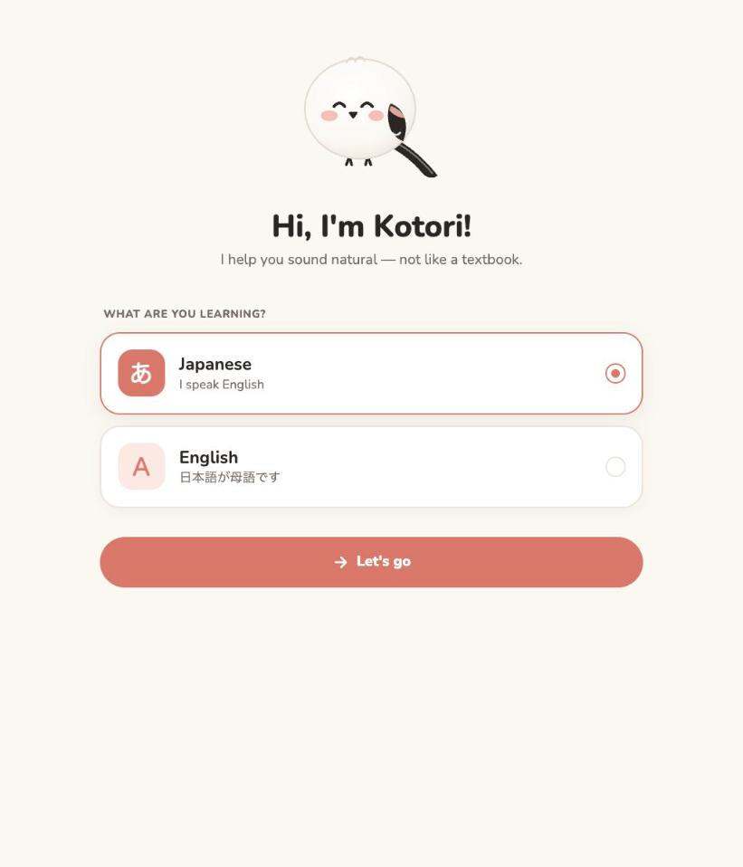
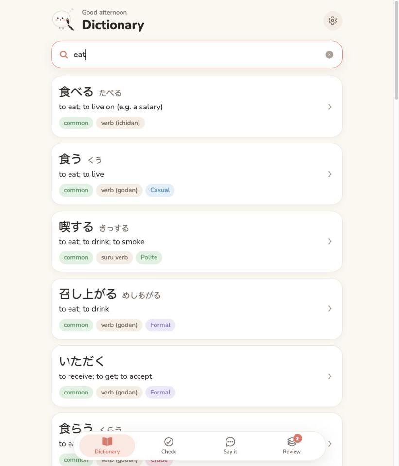
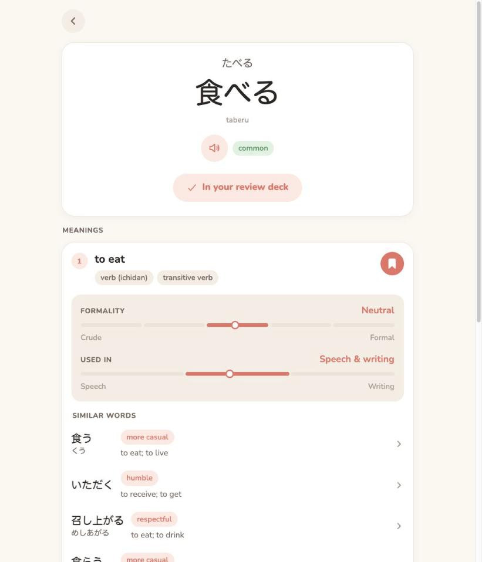
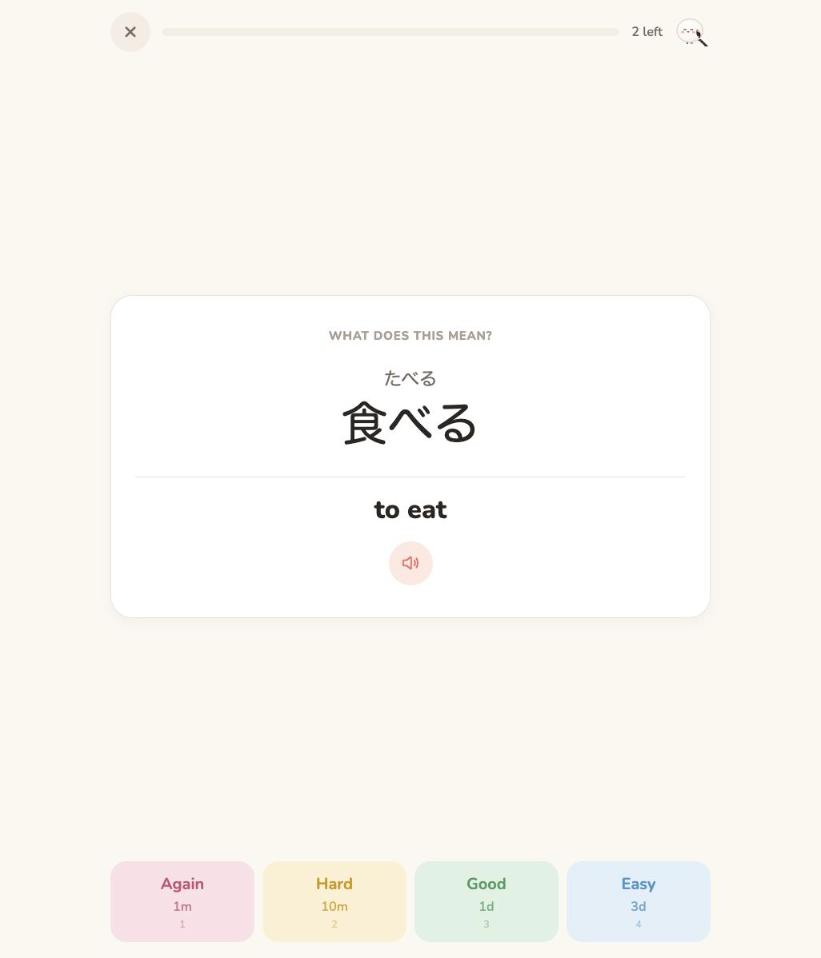

# Kotori ことり

Kotori helps intermediate and advanced learners **sound natural** — in Japanese if you speak English, in English if you speak Japanese. Its mascot is a shima enaga (シマエナガ), Hokkaido's snowball of a bird.

- **Dictionary** — for English speakers, all of [JMDict](https://www.edrdg.org/jmdict/j_jmdict.html) (≈219k Japanese words explained in English); for Japanese speakers, ≈65k English words explained in Japanese, built from Japanese Wiktionary, EJDict and JMDict read backwards. Both work the same way round: search in either language or in rōmaji, and conjugated forms work too (食べなかった finds 食べる, "ate" finds eat).
- **Nuance** — every sense gets judged for formality, speech vs. writing, keigo, speaker gender and age, how current it feels, connotation and learner pitfalls ("too casual for your boss"), plus similar words and how they differ. Judgments come from TypeSafe's **Jev**; JMDict's own usage tags override them where they exist.
- **Examples and pronunciation** — a separate worker writes natural example sentences per meaning with **Claude** (with furigana) and voices headwords and sentences with **ElevenLabs**.
- **Naturalness check** — write a sentence in the language you're learning; Kotori says how a native hears it, what to fix and how a native would say it.
- **How do I say…** — describe what you mean in your own language; get the ways natives actually say it, with literal glosses, register, key words and pitfalls.
- **Review** — save any word or phrase; cards are scheduled with Anki's SM-2 algorithm (learning steps, ease, lapses, fuzz, leeches).

The app runs on iOS, Android and the web from one Expo codebase, in English or Japanese depending on who's learning.

<p align="center">
  
  
  
  
</p>

## Monorepo

An [Nx](https://nx.dev) workspace using pnpm. Back end and data layer are TypeScript on [Effect 4](https://effect.website).

```
apps/
  api/        HTTP API (Effect HttpApi): dictionary, coach, study, audio
  worker/     CLI + job worker: seed JMDict, enrich with Jev / Claude / ElevenLabs
  app/        Expo (Router) app for iOS, Android and web
  local-auth/ Development stand-in for Neon's Managed Better Auth
packages/
  domain/     Schemas and the HttpApi contract shared by the API and the app (typed client)
  db/         Drizzle schema (the data model), generated migrations, repositories, full-text search
  jmdict/     Downloads and parses EDRDG's JMdict_e, imports it
  eiwa/       Builds the English dictionary for Japanese speakers (Wiktionary, EJDict, JMDict), imports it
  japanese/   Romaji ↔ kana, script detection, Yomichan-style deinflection
  nuance/     Jev questions, state building and interpretation for nuance + similar words
  ai/         Claude service, coach prompts, example-sentence writer
  tts/        ElevenLabs client, content-addressed audio store, monthly budget guard
  srs/        Anki's SM-2 scheduler (v3), pure and fully tested
tools/        Local setup script; renders the mascot into app icons
```

`nx graph` shows how they fit together.

## Getting started

You need **Node 24** (pinned in `.node-version`), **pnpm 12** (`corepack enable` installs the version pinned in `package.json`) and **Docker**, for Postgres.

**1. Install and build**

```sh
pnpm install
pnpm build    # compiles the API, the worker and their packages to dist/, and exports the web app
```

Development runs from source, so the build is only needed to check what production runs.

**2. Run the tests**

```sh
pnpm test
```

Tests need no database, server or API keys: repositories run on an in-process Postgres ([PGlite](https://pglite.dev)) and auth on an in-memory fake.

**3. Set up the database**

```sh
pnpm dev:setup
```

This creates `.env` from `.env.example`, starts Postgres 18 in Docker (`compose.yaml`), applies the schema (`pnpm kotori migrate`), downloads JMDict (~10 MB) and imports its ~219k entries (~30 s), downloads the English dictionary's sources (~65 MB) and imports its ~65k words (~20 s), and creates the development account `dev@kotori.test` (password `kotori-dev-account`), already confirmed, approved and learning Japanese. Each step skips what is already done, so it is safe to re-run. `pnpm seed` re-imports both dictionaries (`--dictionary jmdict` or `english` for one), updating entries in place so enrichment is kept; `docker compose down -v` deletes the database so you can start over.

If your local database predates the Postgres 18 and Drizzle schema change, `pnpm dev:setup` stops and asks you to run `docker compose down -v` once. The old database can't be upgraded in place, and setup never deletes it for you.

**4. Run the backend and the app**

```sh
pnpm dev       # auth server on :4001, API on :4000, enrichment worker
pnpm dev:app   # in a second terminal: press w for web, i for iOS, a for Android
```

In development the app signs in as the development account on launch. The app finds the API on the same host as the Expo dev server, so it works from a simulator or a phone on the same network; set `EXPO_PUBLIC_API_URL` to point it elsewhere. Interactive API docs are at <http://localhost:4000/docs> (OpenAPI at `/openapi.json`).

Dictionary search and review work without any API keys. The rest needs the keys below in `.env`.

### API keys

| Variable | Used for | Without it |
| --- | --- | --- |
| `ANTHROPIC_API_KEY` | Naturalness check, How do I say, example sentences | Coach features show "not set up"; no examples |
| `TYPESAFE_API_KEY` | Nuance and similar words (Jev) | Entries show meanings without nuance |
| `ELEVENLABS_API_KEY` | Pronunciation audio | No audio buttons |

The Anthropic SDK also picks up `ANTHROPIC_AUTH_TOKEN` or an `ant auth login` profile. Other settings (models, voices, paths, port, limits) are listed in `.env.example`.

## Enrichment

Looking at an entry in the app queues any missing enrichment at high priority; the worker (`pnpm dev` runs it) picks it up and the app updates itself when it's done. To backfill ahead of time, most frequent words first:

```sh
pnpm kotori enrich nuance --limit 2000      # Jev
pnpm kotori enrich examples --limit 500     # Claude
pnpm kotori enrich audio --limit 100        # ElevenLabs
pnpm kotori status                          # coverage and queue
```

Runs skip entries that are already done, so they can be repeated or interrupted safely.

**How nuance is judged.** Jev judges a whole entry in one request. Every question sees the word, its reading and the leading glosses of its senses, and carries in its own instructions the sense it's about: that sense's meaning, part of speech and JMDict's usage notes. Per sense it answers two scores (formality, speech ↔ writing), six choices (keigo type, gender, age group, currency, connotation, register shape) and two yes/no cautions. Similar-word candidates come from JMDict cross-references and words sharing an exact gloss; for each, Jev judges whether it's a near-synonym and how it differs (more casual, humble, broader…). Code combines the answers: JMDict tags such as `hon`, `col` or `male` win over Jev; "stiff between friends" is derived from the register judgments; low-confidence judgments are hidden; raw distributions are stored so labels can be re-derived without re-running inference (`kotori enrich nuance --reinterpret`). The model is pinned (`jev-1.14.0`) so stored confidences stay comparable, and `kotori eval nuance` measures the questions against a golden set of real JMDict entries.

**English words**, for Japanese speakers, are judged the same way, in one request per word: the same questions in English terms (no keigo), plus whose English it is (American or British), how offensive it is and whether it's textbook English that natives rarely say. The English dictionary's usage labels and regions decide where they speak, as JMDict's tags do. The word's katakana loan is judged once for the word: code finds the candidates (common katakana words in JMDict with the English word as a gloss, or as their `lsource`), Jev judges whether each is the word's loan and whether it means the same as the English word, has come to mean something different, or isn't from English at all, in a request of its own that leaves out the English word's Japanese senses. The app shows a warning when the loan is at least 0.7 likely to have drifted, and a "same meaning" chip when it is at least 0.7 likely to mean the same; Claude writes the warning's short explanation (スタイル isn't "style"). `kotori eval english` measures it on golden English words, some held out from tuning.

**Examples** use Claude structured outputs validated with Effect Schema. Furigana is written inline as `{漢字|かんじ}` and checked against the sentence before it's shown.

**Audio** is cached by content hash (voice, model, text), so each clip is generated once. `KOTORI_AUDIO_MONTHLY_CHARS` (default 50,000) caps spend. Learners hear the language they're learning: Japanese words and their example sentences are voiced in Japanese, headwords from their kana reading to avoid kanji misreadings, and English words and theirs in English. Re-running audio only voices what is missing, so existing clips keep their voices.

**The English dictionary** gives Japanese speakers what JMDict gives English speakers: English headwords with their pronunciation, inflections and senses written in Japanese, enriched with the same nuance, examples and audio. Each word comes from the first source that has it: [Japanese Wiktionary](https://ja.wiktionary.org) (≈32k words, with parts of speech, IPA, inflections and usage labels), then [EJDict-hand](https://github.com/kujirahand/EJDict) (≈26k more, mostly everyday words Wiktionary has no page for, such as "team" and "be"), then English words and phrases only JMDict has, read backwards from its glosses ("selfie" from 自撮り, "hang out" from 遊ぶ and たむろする) and kept only when attested as words people use. Pages that only name another word's inflection or spelling ("asked", "judgement") become forms of that word, and senses marked rare, dated or obsolete go last, as JMDict lists the commonest first. How common a word is comes from subtitle word counts ([FrequencyWords](https://github.com/hermitdave/FrequencyWords), OpenSubtitles 2018), counting its inflections; the 10,000 most used are marked common, as JMDict marks about a tenth of its words. A word only JMDict has counts as common only when a common Japanese word glosses it, since the subtitles may count a name spelled the same ("kim" for 韓国海苔). Wiktionary lists synonyms for a whole part of speech, so each is placed on the sense it shares a meaning with, or left out. Re-importing keeps each word's id, so enrichment and saved words survive.

Claude requests opt into server-side refusal fallbacks (`fallbacks: "default"`), so a safety-classifier decline is retried on Anthropic's recommended fallback model instead of failing.

## Accounts and sign-ups

Identity is handled by Neon's [Managed Better Auth](https://neon.com/docs/auth/overview), proxied by the API at `/api/auth/*`; users and sessions live in the `neon_auth` schema of the same Postgres. Learners sign up and sign in in the app with email and password, then confirm their email with a code. The app keeps Managed Auth's session (in the Keychain/Keystore on devices, as the browser's cookie on the web) and authenticates to the API with short-lived JWTs minted from it (`GET /api/auth/token`). Approval status and roles are Kotori's own, on the learner profile. Kotori is in private beta, so new accounts start **pending** and can only reach `/account` until approved:

```sh
pnpm kotori requests                  # sign-ups waiting for approval (--all includes archived)
pnpm kotori approve user@example.com  # unlocks the app and emails the learner
pnpm kotori archive user@example.com  # hides the request; nothing is sent
pnpm kotori users                     # every account
pnpm kotori admin admin@example.com     # admins skip approval (--remove to demote)
pnpm kotori revoke user@example.com    # signs them out of every device
```

For local work none of that is needed: `pnpm kotori dev-account` (run by `pnpm dev:setup`) creates an account already confirmed, approved and past the language picker, and in development the app signs in as it on launch. The command is idempotent, so run it again on a new database. Set `EXPO_PUBLIC_DEV_SIGN_IN=off` to use the real screens instead. Neither half reaches a release build, where `__DEV__` is false and the command refuses to run.

Locally, `apps/local-auth` stands in for Managed Auth: Better Auth set up the way Neon runs it (the `neon_auth` schema, Email OTP, EdDSA JWTs and their key set), so the API and the CLI run unchanged against `NEON_AUTH_BASE_URL=http://localhost:4001/neondb/auth`. Verification and password-reset codes are printed in its log. It refuses to run in production and isn't part of the deployed image. To work against a Neon branch instead, `neon checkout <branch>` writes the branch's `DATABASE_URL` and `NEON_AUTH_BASE_URL` into `.env.local`, which overrides `.env`; the local auth server then stays off.

Kotori sends its own email through [Resend](https://resend.com) when `RESEND_API_KEY` is set; otherwise messages are printed to the log, which is enough for local development. That covers the approval email and, once Managed Auth's webhook points at the API (`POST /webhooks/neon-auth`, signature-checked; see `docs/operations.md`), the verification and password-reset codes, all in the learner's language.

## Development

```sh
pnpm test        # every package's tests (Vitest + @effect/vitest), cached by Nx
pnpm typecheck   # TypeScript 7 (tsc --build) across the workspace
pnpm build       # emits dist/ for the API, the worker and the packages they use
pnpm lint        # Oxlint (.oxlintrc.json), including type-aware rules
pnpm format      # Oxfmt (.oxfmtrc.json); `pnpm format:check` in CI
pnpm sync        # Nx keeps tsconfig project references in step with package.json
pnpm assets      # re-render icons and splash from the mascot geometry
```

Packages are TypeScript project references. Each one has a `tsconfig.lib.json` (source, emitted to `dist/`) and a `tsconfig.spec.json` (tests, type-checked only); `nx sync` derives the `references` between them from `package.json` dependencies, so importing a package you have not declared fails the typecheck. Their `exports` maps point `@kotori/source` at `src/` and everything else at `dist/`: `tsc`, `tsx -C @kotori/source`, Vitest and Metro read source, while `node dist/main.js` in production reads the compiled output.

CI (`.github/workflows/ci.yml`) runs `nx sync:check`, format and lint checks, then `nx affected -t typecheck test build`; once the checks pass, a push to `main` runs `nx affected -t deploy`, which deploys the API and worker to Fly.io and the web app to Vercel, each only when the push changed it (see `docs/operations.md`; what is still to be done by hand is in `docs/deploy.md`). Dependency versions shared across packages live in the `catalog:` of `pnpm-workspace.yaml`. TypeScript 7 is installed as `@typescript/native` (the `tsc` you run) alongside TypeScript 6 as `typescript` (the compiler API that Nx and editors still need; `tsc6`). Oxlint's type-aware rules run on `oxlint-tsgolint`, which embeds its own TypeScript 7.

Tests cover the SM-2 scheduler against Anki's behaviour, deinflection, JMDict parsing, repositories on an in-process Postgres ([PGlite](https://pglite.dev), no server needed), the Jev and ElevenLabs pipelines with fakes, structured-output schemas, and the HTTP API end to end through Effect's in-memory `HttpApiTest` client.

## Data and credits

Dictionary data is [JMDict](https://www.edrdg.org/jmdict/j_jmdict.html) by the Electronic Dictionary Research and Development Group, used under [CC BY-SA 4.0](https://www.edrdg.org/edrdg/licence.html). English words come from [Japanese Wiktionary](https://ja.wiktionary.org) as extracted by [Wiktextract](https://github.com/tatuylonen/wiktextract) for [kaikki.org](https://kaikki.org/jawiktionary/) (CC BY-SA 4.0) and from [EJDict-hand](https://github.com/kujirahand/EJDict) (public domain, CC0); word frequencies from [FrequencyWords](https://github.com/hermitdave/FrequencyWords) (CC BY-SA 4.0). The app credits them in Settings. Downloads land in `data/` and are not committed; everything else lives in Postgres. The one exception is the golden set's fixture, `packages/nuance/golden/entries.json`: excerpts of all four, shared under CC BY-SA 4.0 rather than the repository's MIT licence, with the attributions and changes in [its notice](packages/nuance/golden/NOTICE.md).
