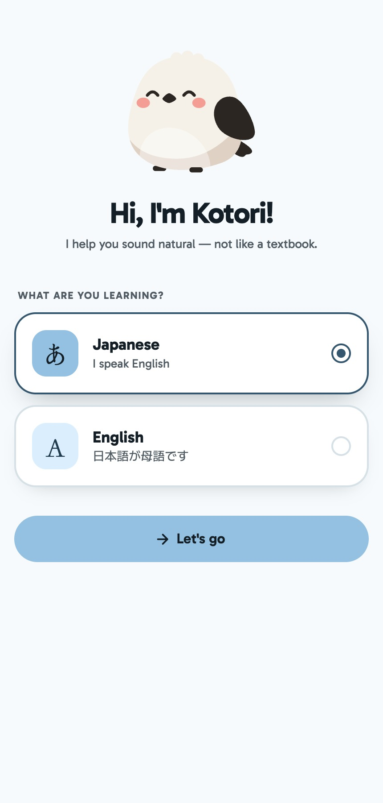
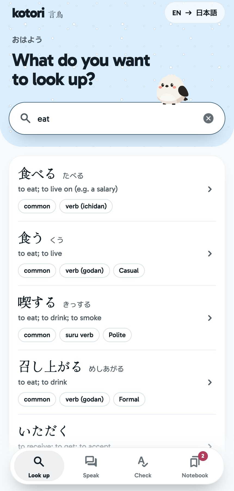
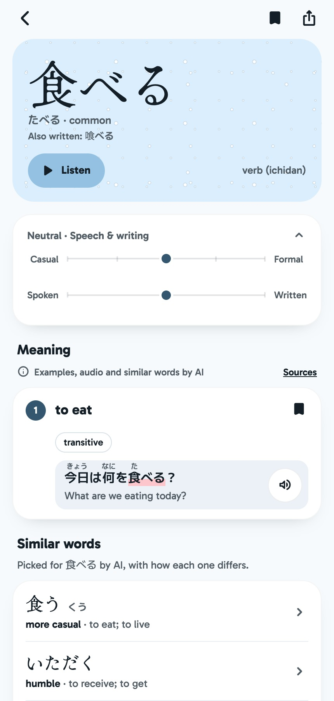
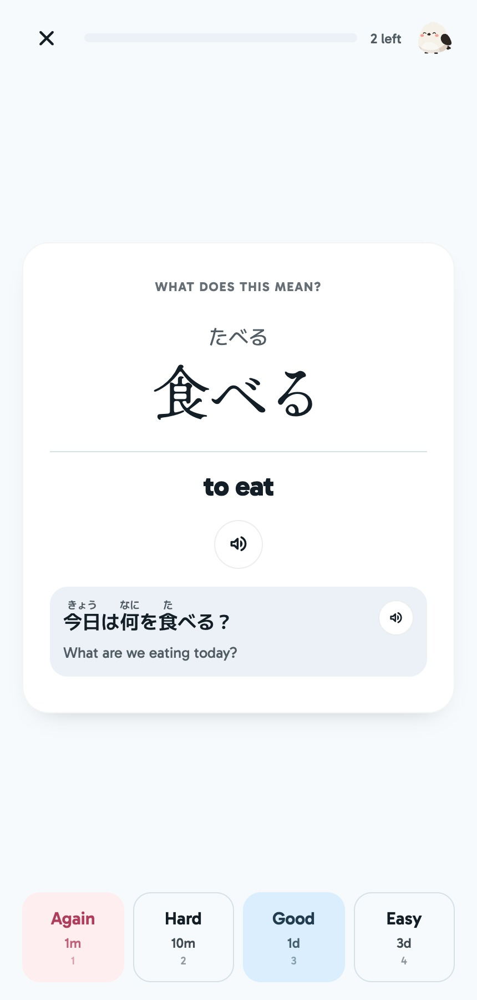

# Kotori ことり

Kotori helps intermediate and advanced language learners **sound natural** — in Japanese if you speak English, or in English if you speak Japanese. Its mascot is a shima enaga (シマエナガ), Hokkaido's tiny snowball of a bird.

The app runs on iOS, Android, and the web from a single Expo codebase, with the interface in English or Japanese depending on who is learning.

<p align="center">
  
  
  
  
</p>

## What's inside

- **Bilingual dictionary** — English speakers get all ~219k Japanese entries from [JMDict](https://www.edrdg.org/jmdict/j_jmdict.html); Japanese speakers get ~65k English entries explained in Japanese. Search in either language or in rōmaji, including conjugated forms (`食べなかった` finds `食べる`, `"ate"` finds `eat`).
- **Nuance and register** — Each meaning is rated for formality, spoken vs. written usage, keigo, speaker demographics, connotation, and common learner pitfalls (*"Can sound rude to your boss or customers"*, *"Not the katakana 「スタイル」"*), alongside similar words and how they differ.
- **Examples and audio** — Natural example sentences with furigana (written by **Claude**) and spoken audio for headwords and sentences (voiced by **ElevenLabs**).
- **Naturalness check** — Write a sentence in the language you're learning to see how it comes across to a native speaker, what to fix, and natural ways to phrase it.
- **How do I say…** — Describe what you want to say in your own language and get idiomatic ways natives actually say it, with tone, literal meaning, key vocabulary, and pitfalls to avoid.
- **Spaced repetition** — Save any word or phrase to your deck. Reviews are scheduled with Anki's SM-2 (v3) algorithm, including learning steps, ease, lapses, interval fuzz, and leech detection.

## Monorepo layout

Kotori is an [Nx](https://nx.dev) workspace managed with `pnpm`. The backend and data pipelines are written in TypeScript on [Effect](https://effect.website).

```text
apps/
  app/        Expo (Router) app for iOS, Android, and web
  backend/    HTTP API, enrichment worker and `kotori` CLI: one deployable, three entry points
packages/
  db/         The data model: Drizzle tables and the migrations generated from them
  contracts/  The HTTP contract (KotoriApi), its schemas derived from the tables
  ai/         Claude, Jev and ElevenLabs: coaching, examples, nuance, speech, golden evals
  language/   Japanese and English text: rōmaji ↔ kana, deinflection, furigana, glosses
  srs/        Pure, fully tested implementation of Anki's SM-2 scheduler
tools/
  local-auth/ Local development stand-in for Neon Managed Better Auth
  *.ts        Local setup script; mascot asset and animation renderers
```

Everything follows from the tables in `packages/db`: the backend's queries infer their rows from
them, `packages/contracts` derives the wire schemas from them, and the app is typed by the
contract. Change a column and typechecking fails wherever the change matters.
[`docs/monorepo-rearchitecture.md`](docs/monorepo-rearchitecture.md) explains the layout and the
boundaries `pnpm lint` enforces between projects.

Run `pnpm graph` (`nx graph`) to explore how the packages fit together.

## Getting started

You'll need **Node 24** (pinned in `.node-version`), **pnpm 12** (`corepack enable`), and **Docker** (for local Postgres).

### 1. Install dependencies

```sh
pnpm install
```

Development runs directly from TypeScript source. If you want to verify a production build (which compiles backend packages to `dist/` and exports the web app), run `pnpm build`.

### 2. Run the test suite

```sh
pnpm test
```

Tests run out of the box without Docker, a running server, or API keys — database tests use an in-process Postgres ([PGlite](https://pglite.dev)) and auth tests use an in-memory fake.

### 3. Set up the local database

```sh
pnpm dev:setup
```

This one-time script is safe to re-run (each step skips work that's already done):

1. Creates `.env` from `.env.example` if needed.
2. Starts Postgres 18 in Docker (`compose.yaml`) and runs migrations (`pnpm kotori migrate`).
3. Downloads and imports JMDict (~219k Japanese entries).
4. Downloads and builds the English dictionary (~65k English entries).
5. Creates a pre-approved development account (`dev@kotori.test` / `kotori-dev-account`).

To re-import dictionary data later without losing enrichment, run `pnpm seed` (or pass `--dictionary jmdict` / `--dictionary english`). To wipe the database and start fresh, run `docker compose down -v`.

### 4. Start the backend and app

```sh
pnpm dev       # starts local-auth (:4001), API (:4000), and the enrichment worker
pnpm dev:app   # in another terminal: press w for web, i for iOS, a for Android
```

In development, the app automatically signs in as `dev@kotori.test` on launch and connects to the API on the same host as the Expo dev server (override with `EXPO_PUBLIC_API_URL`). Interactive OpenAPI docs are available at <http://localhost:4000/docs>.

### API keys (optional for local dev)

Dictionary search and flashcard reviews work without any API keys. To enable coaching and enrichment, add keys to `.env`:

| Variable | Powers | Behavior without key |
| --- | --- | --- |
| `ANTHROPIC_API_KEY` | Naturalness check, *How do I say…*, example sentences | Coaching shows "not set up"; no new examples generated |
| `TYPESAFE_API_KEY` | Word nuance and similar-word judgments (Jev) | Entries show dictionary meanings without nuance scales |
| `ELEVENLABS_API_KEY` | Headword and example pronunciation audio | Audio buttons are hidden for unvoiced items |

The Anthropic client also accepts `ANTHROPIC_AUTH_TOKEN` or an `ant auth login` profile. See `.env.example` for model, voice, and rate-limit settings.

## Enrichment and dictionary data

When a learner opens an unenriched entry, the API queues high-priority jobs that the background worker (`pnpm dev`) picks up automatically. You can also backfill common words in batches:

```sh
pnpm kotori enrich nuance --limit 2000      # Jev register & similar words
pnpm kotori enrich examples --limit 500     # Claude example sentences
pnpm kotori enrich audio --limit 100        # ElevenLabs pronunciation clips
pnpm kotori status                          # check coverage and queue depth
```

All enrichment commands skip entries that are already complete, so they can be interrupted and re-run safely.

- **Nuance (Jev)** — TypeSafe's Jev (`jev-1.14.0`) evaluates an entry in a single pass, scoring formality and spoken vs. written register alongside keigo, speaker gender/age, currency, connotation, learner cautions, and candidate synonyms. Explicit dictionary usage tags (such as `hon`, `col`, or `male`) take precedence over model guesses, and low-confidence judgments are hidden. Raw probability distributions are stored in Postgres so display labels can be re-derived without re-running inference (`pnpm kotori enrich nuance --reinterpret`) and benchmarked against a golden set (`pnpm kotori eval nuance` and `pnpm kotori eval english`). See [`docs/nuance-rework.md`](docs/nuance-rework.md) and [`docs/nuance-on-english-entries.md`](docs/nuance-on-english-entries.md).
- **English dictionary & katakana loans** — For Japanese speakers learning English, the backend's dictionary import (`features/dictionary/import/eiwa`) assembles ~65k English headwords from [Japanese Wiktionary](https://ja.wiktionary.org), [EJDict-hand](https://github.com/kujirahand/EJDict), and attested English glosses in JMDict, ranked by [OpenSubtitles word frequency](https://github.com/hermitdave/FrequencyWords). In addition to register and US/UK variety, Jev checks whether an English word's katakana loanword has drifted in meaning — warning Japanese learners when a familiar katakana word like スタイル (*body figure*) doesn't match English *style*.
- **Examples (Claude)** — Generated via structured outputs validated with Effect Schema. Furigana is written inline as `{漢字|かんじ}` and verified against the Japanese text before saving.
- **Audio (ElevenLabs)** — Cached by content hash `(voice, model, text)` so each clip is synthesized once, guarded by a 30-day character budget (`KOTORI_AUDIO_MONTHLY_CHARS`, default `50000`). See [`docs/voice-casting.md`](docs/voice-casting.md).

## Accounts and authentication

Authentication uses Neon's [Managed Better Auth](https://neon.com/docs/auth/overview), proxied by the API at `/api/auth/*`. Kotori is currently in private beta: anyone can sign up and verify their email, but new accounts start in a **pending** state until approved via the CLI:

```sh
pnpm kotori requests                  # list sign-ups awaiting approval (--all includes archived)
pnpm kotori approve user@example.com  # approve account and send welcome email
pnpm kotori archive user@example.com  # hide request without emailing
pnpm kotori users                     # list all accounts
pnpm kotori admin admin@example.com   # grant admin role (--remove to demote)
pnpm kotori revoke user@example.com   # revoke sessions across all devices
```

### Local auth setup

For day-to-day development, `pnpm dev` runs `tools/local-auth` on port 4001 to emulate Neon Managed Auth locally, and the app signs in automatically as `dev@kotori.test`.

- To test the real sign-up, sign-in, and pending screens locally, set `EXPO_PUBLIC_DEV_SIGN_IN=off`. Verification and password-reset codes are printed to the console when `RESEND_API_KEY` is unset.
- To run against a live Neon branch instead of local Docker, run `neon checkout <branch>` (which writes `DATABASE_URL` and `NEON_AUTH_BASE_URL` to `.env.local`).

See [`docs/operations.md`](docs/operations.md) for production architecture and webhook details.

## Development commands

```sh
pnpm test          # run all unit and integration tests (Vitest + @effect/vitest)
pnpm typecheck     # typecheck the workspace with TypeScript 7 (tsc --build)
pnpm build         # compile backend packages to dist/ and export the web app
pnpm lint          # run Oxlint (including type-aware rules)
pnpm format        # format with Oxfmt (use `pnpm format:check` in CI)
pnpm sync          # sync tsconfig project references from package.json dependencies
pnpm assets        # re-render app icons and splash screen from the mascot geometry
pnpm motion        # preview a mascot animation clip, e.g. `pnpm motion celebrate`
```

CI (`.github/workflows/ci.yml`) checks project references, formatting, linting, types, tests, and builds on every push, then runs `nx affected -t deploy` on `main` to deploy the API/worker to Fly.io and the web app to Vercel. See [`docs/operations.md`](docs/operations.md) and [`docs/deploy.md`](docs/deploy.md).

## Data sources and credits

- **Japanese dictionary:** [JMDict](https://www.edrdg.org/jmdict/j_jmdict.html) by the Electronic Dictionary Research and Development Group ([CC BY-SA 4.0](https://www.edrdg.org/edrdg/licence.html)).
- **English dictionary:** [Japanese Wiktionary](https://ja.wiktionary.org) via [Wiktextract](https://github.com/tatuylonen/wiktextract) / [kaikki.org](https://kaikki.org/jawiktionary/) (CC BY-SA 4.0) and [EJDict-hand](https://github.com/kujirahand/EJDict) (CC0 public domain).
- **Word frequencies:** [FrequencyWords](https://github.com/hermitdave/FrequencyWords) from OpenSubtitles 2018 (CC BY-SA 4.0).
- **Evaluation fixture:** [`packages/ai/golden/entries.json`](packages/ai/golden/entries.json) contains excerpts from the sources above and is shared under CC BY-SA 4.0 (see [`packages/ai/golden/NOTICE.md`](packages/ai/golden/NOTICE.md)).
