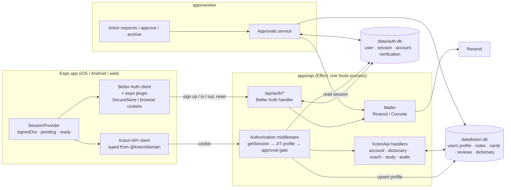
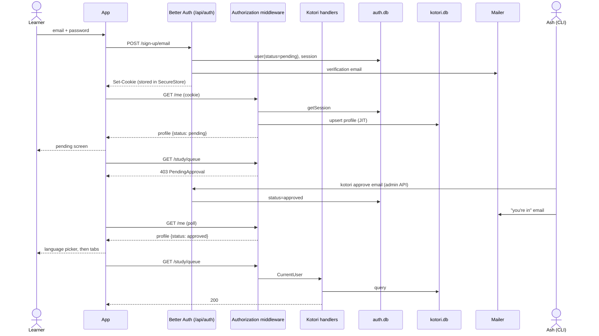

# Accounts and auth: scope and plan

Status: agreed, 2026-10-20. Milestone: private beta — open signup, admin approval.

## 1. Decision summary

- **Stack: Better Auth**, pinned to `~1.7.x`, self-hosted inside the existing API. MIT, Vercel-owned since July 2026; the library stays open source and host-agnostic. There is no hosted "Better Auth via Vercel" product — Vercel Connect is an OAuth gateway for third-party connectors, not managed auth — so we run the library and treat upkeep as dependency hygiene (§8).
- **Identity lives in its own database**, `data/auth.db`, owned and migrated by Better Auth. Kotori's `kotori.db` keeps the learner profile, study data, dictionary and enrichment. Rationale in §4.
- **v1 sign-in: email + password** with email verification and password reset. No login codes, no magic links.
- **v2 (fast-follow): Apple + Google** via the native ID-token flow. They ship as a pair: App Store guideline 4.8 means any social login on iOS requires an equivalent privacy-preserving option, in practice Sign in with Apple.
- **Access model: open signup, manual approval.** Anyone can create an account; it starts `pending`. Pending users can sign in but reach no feature endpoints — the app shows a "you're on the list" screen. Ash approves from a CLI surface; requests that won't be approved are archived, not banned.
- **The hand-rolled auth is removed**: anonymous device accounts, `kt_` token issuance, `token_hash` lookup, `Accounts.create/authenticate` and the onboarding "create account on first launch" flow. Better Auth owns identity and sessions; Kotori owns the learner profile and everything behind it.
- Deferred but cheap later, by design: 2FA, passkeys, magic links (Better Auth plugins).

## 2. Goals

1. Sign up and sign in with email + password on iOS, Android and web; same account and study data everywhere.
2. Pending accounts can authenticate but not use the app; Ash can list, approve and archive requests.
3. Sessions are revocable (per device, everywhere, admin) and survive daily use without re-login.
4. In-app account deletion (App Store 5.1.1(v); external TestFlight builds are reviewed).
5. Future phases — social, passkeys, 2FA, public launch — are configuration and UI, not re-architecture.

## 3. Product scope

### 3.1 Flows

**Sign up.** Welcome → "Create account": email, password, optional display name. Better Auth creates the user and sends a verification email. The app signs the user in immediately and lands on the **pending screen**: "Thanks for signing up — Kotori is in private beta, we'll email you when you're in." Verification status is shown there with a resend button.

**Approval.** `kotori requests` lists pending signups (email, name, signup date, verified?). `kotori approve <email>` sets the account to `approved` and sends a "you're in" email. `kotori archive <email>` hides the request from the default list; nothing is sent and the user's experience is unchanged. Archived requests can be approved later; `kotori requests --all` shows them. The pending screen polls `/me`, so approval takes effect without a reinstall.

**Sign in.** Email + password; pending and archived users land on the pending screen. "Forgot password" → reset email → reset form (a small web page served by the API in v1; native screens later).

**Onboarding.** The existing language picker becomes a first-use step after approval, shown while the profile has no native language.

**Settings → Account.** Email and verification status, change password, device list with per-session revoke, sign out everywhere, sign out, delete account (two-step confirm).

**Session expiry / revocation.** API returns 401 → app clears state → welcome screen. Same path as today.

### 3.2 Account status and the approval gate

- `status: "pending" | "approved" | "archived"` is an additional field on Better Auth's user (`input: false`, default `pending`). Admins are implicitly approved.
- Enforcement lives in **Kotori's `Authorization` middleware**, not in Better Auth: after resolving the session, anything other than `approved` yields a `PendingApproval` (403) error on every API group except `account`, so `/me` keeps working for the pending screen. The gate is stack-agnostic and tested end to end.
- `archived` behaves exactly like `pending` from the user's side. It is bookkeeping for Ash.
- Ban (admin plugin) is reserved for abuse; it is not part of the approval flow.

## 4. Data model

### 4.1 Two databases

| | `data/auth.db` (Better Auth) | `data/kotori.db` (Kotori) |
| --- | --- | --- |
| Tables | `user` (+ `status`, admin fields), `session`, `account`, `verification` | `users` (profile), `notes`, `cards`, `review_logs`, `coach_*`, dictionary, enrichment, `jobs` |
| Schema owner | Better Auth CLI (`auth migrate`, `auth check`) | Kotori's migrator (`packages/db/migrations.ts`) |
| Connection | Better Auth's own `node:sqlite` `DatabaseSync` | Effect `SqliteClient` |
| Tests | Better Auth on its own in-memory database | `DatabaseMemory` as today |

Why separate rather than one file: Better Auth's schema stays a black box we never hand-edit; library upgrades that touch schema are `auth migrate`, not edits to our migrations. The in-memory test harness stays simple — two `:memory:` connections to "the same file" are two different databases, and Effect's client does not expose its handle to share. Precious user data is also kept apart from hundreds of megabytes of rebuildable dictionary data and the worker's heavy enrichment writes. The cost is that there are no cross-database foreign keys: account deletion cascades at the app level through Better Auth's `user.delete.after` hook, which we want anyway, and the CLI joins pending users to profiles in two queries.

Considered and rejected: folding the profile into Better Auth's user via additional fields and dropping Kotori's `users` table. The profile is app domain with Effect schemas, repository tests and a PATCH endpoint; it stays in Kotori's database keyed by the auth user id.

### 4.2 Kotori migration `0004_profiles`

Pre-beta there are no real users, so this is a reshape, not a data migration:

- `users`: drop `token_hash`; `id` is now the Better Auth user id; `native_language` becomes nullable so the language picker can run after approval.
- Profile rows are created just-in-time by the Authorization middleware on first sight of an auth user (idempotent upsert), and deleted by the account-deletion hook along with study data.
- Study tables are unchanged.

## 5. Package structure

```
apps/
  api/
    src/
      auth.ts                      + Better Auth server config (plugins: admin, expo; email callbacks)
      http/
        Authorization.ts           ~ bearer-token lookup → getSession + JIT profile + approval gate
        auth.ts                    + mounts Better Auth's handler at /api/auth/*
        reset-password.ts          + minimal web form for password reset (v1)
        handlers.ts                ~ account group: /me + PATCH /me only
      services/
        Accounts.ts                ~ profile read/update only; create/authenticate removed
        Approvals.ts               + list / approve / archive (used by CLI; sends approval email)
      layers.ts                    ~ wires Auth, Mailer, Approvals
    test/api.test.ts               ~ auth setup via Better Auth sign-up; new gate/approval/deletion tests
  worker/
    src/cli/…                      + requests, approve, archive, users, admin, revoke commands
  app/
    src/
      auth/client.ts               + Better Auth client with the Expo plugin (SecureStore)
      api/client.ts                ~ forwards the auth cookie instead of a bearer token
      session/SessionProvider.tsx  ~ built on the auth client; adds "pending" status
      session/storage*.ts          − token storage no longer needed
    app/
      onboarding.tsx               ~ welcome: sign up / sign in; language picker moves post-approval
      sign-up.tsx, sign-in.tsx     +
      forgot-password.tsx          +
      pending.tsx                  +
      settings.tsx                 ~ Account section (email, password, devices, sign out, delete)
packages/
  domain/src/
    Account.ts                     ~ Profile gains email, emailVerified, status, role; Session/CreateAccountRequest removed
    Api.ts                         ~ Authorization security becomes cookie-based; POST /account removed; PendingApproval error
    Errors.ts                      ~ + PendingApproval (403)
  db/src/
    migrations.ts                  ~ + 0004_profiles
    UsersRepo.ts                   ~ byTokenHash removed; upsertProfile, delete added
  email/                           + Mailer service: Console (dev) and Resend layers; EN/JA templates
    src/Mailer.ts, Resend.ts, templates/
data/
  auth.db                          + (gitignored, created by `auth migrate`)
.env.example                       ~ BETTER_AUTH_SECRET, BETTER_AUTH_URL, RESEND_API_KEY, KOTORI_EMAIL_FROM,
                                     KOTORI_ADMIN_EMAILS, KOTORI_WEB_ORIGIN, KOTORI_AUTH_DB_PATH
```

`+` new, `~` changed, `−` removed.

## 6. System design

### 6.1 Components



Ownership rules the diagram encodes:

- Only Better Auth writes `auth.db`. Kotori reads sessions through Better Auth's server API and sets `status` through the same API from the CLI.
- Only Kotori writes `kotori.db`. The link between the two is the user id.
- The app has two clients but one session: the Better Auth client owns the cookie, the Kotori client forwards it.
- Email goes through one `Mailer` regardless of who triggers it (Better Auth callbacks or the approval CLI).

### 6.2 Data flow: sign-up, approval, use



Account deletion follows the reverse path: the app calls Better Auth's delete-user endpoint, Better Auth removes the identity and sessions from `auth.db`, and its `user.delete.after` hook deletes the profile and study rows from `kotori.db`.

## 7. Tests

- API end to end: sign-up → pending gate (403 on dictionary/study/coach, 200 on `/me`) → approve → full access; wrong password; verification and reset through a capturing fake Mailer; archive leaves the user's experience unchanged; session revocation; account deletion removes profile and study data; JIT profile creation is idempotent.
- Better Auth runs against an in-memory database in tests; Kotori keeps `DatabaseMemory`.
- CI runs `auth check` against the committed config so a library bump that changes schema fails before deploy.

## 8. Operating Better Auth

- Pin `~1.7.x`; Renovate or Dependabot for patch PRs; the e2e suite plus `auth check` run on every bump, so a bad release fails CI, not production.
- Watch the GitHub security advisories feed. Exposure is narrow: core email/password, sessions, admin and expo plugins. Most 2026 advisories were in SSO, SCIM and OAuth-provider plugins we don't install; the critical ones required the magic-link plugin, which we don't use.
- Re-evaluate only if Vercel's ownership visibly starves non-Vercel paths. A hosted offering, if one appears, would run this same library and schema; adopting it later is configuration, not a rewrite.

## 9. Build order

1. **Foundation**: dependency, server config, `auth.db` created by `auth migrate`, handler mounted, health reports the `email` feature.
2. **Middleware and domain**: Authorization via `getSession`, JIT profile, `PendingApproval` gate, domain schema changes, removal of the hand-rolled paths, API test setup rewritten.
3. **Email and approval**: `packages/email`, verification and reset wiring, admin plugin, Approvals service, CLI commands, approval email, gate and flow tests.
4. **App**: Expo client plugin, cookie-forwarding API client, SessionProvider rebuild, sign-up / sign-in / forgot / pending screens, Settings account section, strings, CORS with credentials for the web origin.
5. **Pre-invite checklist**: API behind HTTPS with `BETTER_AUTH_URL` set, Resend sending subdomain with SPF, DKIM and DMARC `p=none`, test emails to Gmail, Outlook and iCloud, `KOTORI_ADMIN_EMAILS` set, TestFlight build includes account deletion.

## 10. v2 parking lot

- Apple + Google ID-token sign-in, shipped together (guideline 4.8).
- Passkeys and 2FA via plugins.
- Native password-reset screens replacing the web form.
- Admin web surface replacing the CLI if request volume warrants.
- Postgres and database-backed rate limiting when the API outgrows one process.
