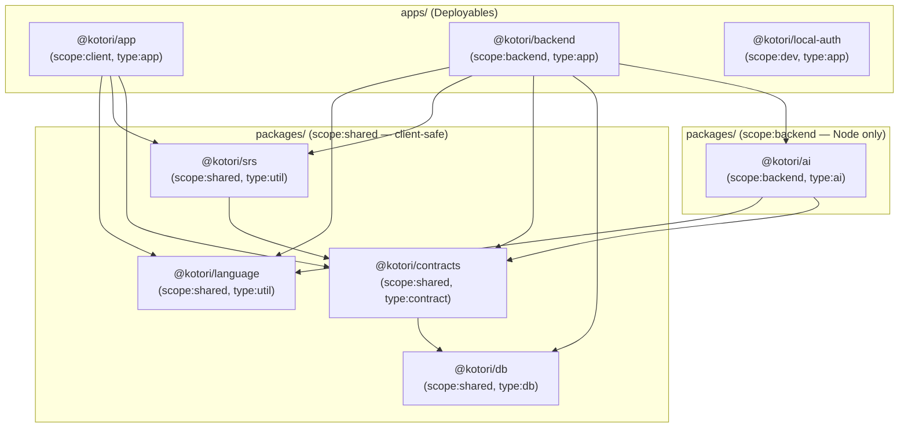

# Monorepo rearchitecture

> Implemented 2026-11-02. This replaces the plan of the same date: the plan is kept where it was
> followed, and [What changed from the plan](#what-changed-from-the-plan) records where the
> implementation departed from it and why.

## Goal

One definition of the data model, propagating automatically to every consumer, with no
hand-maintained shadow copies anywhere. Along the way, the workspace went from
**15 projects (4 apps, 11 packages) to 8 projects (3 apps, 5 packages)**.

### The chain of truth

Everything below follows from one rule: **a Drizzle table file is the single source of
truth for its data, and every downstream type is derived or inferred from it — never
restated.**

```
packages/db/src/notes.ts                 ← the only place a shape is declared, ids branded
  │ $inferSelect, query-result inference
  ▼
apps/backend/src/features/*/queries.ts   ← Drizzle queries beside their feature, results inferred
  │ createSelectSchema(notes)
  ▼
packages/contracts/src/*.ts              ← wire schemas derived; published fields picked explicitly
  │ KotoriApi
  ▼
apps/app/src/api/client.ts               ← HttpApiClient.ForApi<typeof KotoriApi>
  ▼
apps/app components                      ← fully typed; no locally declared response shapes
```

Change a column and `pnpm nx run-many -t typecheck` fails at the backend query, at the
contract, and at every app component that used the field; the contract's OpenAPI snapshot
test fails too, so the wire change is a reviewed diff. The loop holds across migrations
because `drizzle-kit generate` reads the same table files that produce the types.

### Why each project exists

- **DB (`@kotori/db`)** is *only* the tables and their migrations: one file per table, each owning its columns, the enums only it uses, its JSONB value schemas and its id brand. No connection code, no relations, no queries, so the client can import it.
- **Contracts (`@kotori/contracts`)** is the HTTP boundary: request and response schemas derived from the tables via `drizzle-orm/effect-schema`, the `KotoriApi` declaration, public errors, and `EntryRecord`, the dictionary entry as the importers, the backend and the AI all handle it.
- **Language (`@kotori/language`)** provides pure Japanese and English morphology, script, furigana and gloss helpers.
- **SRS (`@kotori/srs`)** provides pure spaced-repetition scheduling and interval preview formatting.
- **AI (`@kotori/ai`)** provides stateless, database-free model capabilities, provider adapters, and offline golden-set evaluation.
- **Backend (`@kotori/backend`)** owns all database access, coordinates behaviour across feature folders, and runs the HTTP server, background worker and CLI from separate entry points.

Single responsibility means one reason to change, not one file or package per function.
Package count is not the success criterion; locality of changes and clear dependency
direction are.

### Two decisions worth recording

**Contracts derives from tables at runtime, and Drizzle ships in the client bundle.**
`createSelectSchema(users)` needs the table object at runtime, so `@kotori/contracts`
imports `@kotori/db` as a value and `drizzle-orm/pg-core` reaches the Expo bundle. This was
chosen over codegen or a type-only projection because it is the only option where drift is
impossible *by construction* rather than caught by a check, and it needs no tooling. Measured
after the change, drizzle-orm is about 280 KB of the 4.4 MB minified web bundle (6%), rather
than the 30–40 KB gzipped the plan estimated: Metro does not tree-shake, so importing
`drizzle-orm` and `drizzle-orm/pg-core` brings their whole module graphs, query builders
included. If the cost ever matters, codegen (below) is the way out.

**Contracts stays a separate package, not a folder in `apps/backend`.** It has two
consumers across a deployment boundary: the app calls `KotoriApi`, the backend implements
it. Folding it into `apps/backend` would make `apps/app` depend on `apps/backend` (so Nx
`affected` redeploys the app on every backend change), would expose `pg`,
`@effect/platform-node` and the AI SDKs to Metro's resolver through the backend's
`package.json`, and would make the boundary unenforceable.

## Layout

```text
apps/
  app/                          Expo application (iOS, Android, Web)
  backend/                      @kotori/backend
    src/
      entrypoints/
        http.ts                 HTTP process (Fly "api" process group)
        worker.ts               Enrichment worker (Fly "worker" process group)
        cli.ts                  kotori: migrate, seed, enrich, eval, golden, status, accounts
      http/                     Routes, the Authorization middleware, CORS, webhooks, /audio
      cli/                      One module per command
      worker/                   The polling loop and JobRunner
      db/                       Database, Migrate, neonAuth, relations, scopedToUser
      features/
        accounts/               Profiles, approvals, Managed Auth webhooks + queries.ts
        audio/                  AudioStore (clip bytes), Speech (clip cache, budget) + queries.ts
        coaching/               Learner requests, answer cache, usage limits + queries.ts
        dictionary/             Search, entry assembly, word lookup + queries.ts
          import/               JMDict and the English dictionary (Wiktionary, EJDict, frequency)
        enrichment/             Enrichers, NuanceEnricher, AudioEnricher + queries.ts, jobs.ts
        study/                  Notes, review queue, answering, statistics + queries.ts
      integrations/
        auth/                   Managed Better Auth: JWT verification, JWKS, webhook signatures
        email/                  Resend, console and memory mail transports, templates
      runtime/                  HttpLayers, WorkerLayers, CliLayers, Paths
      testing/                  DatabaseMemory: PGlite, migrated as production is
    test/                       Per feature, with shared fixtures
  local-auth/                   Development-only Better Auth stand-in
packages/
  ai/
    golden/                     Offline golden fixture (`kotori golden` rebuilds it), NOTICE.md
    src/
      providers/                Claude, Jev, ElevenLabs
      coaching/                 Coach, Jev's formality reading, prompts
      examples/                 ExampleWriter, LoanWriter, prompts
      nuance/                   NuanceJudge; questions, requests, state, interpretation
      speech/                   Pronouncer (casting, synthesis), casting rules, voices
      eval/                     Golden set definitions and reversed-choice evaluation
  contracts/
    src/                        Account, Api, Coach, Dictionary, Errors, Language, Nuance, Records, Study
    test/openapi.json           The published OpenAPI document, snapshot-tested
  db/
    drizzle.config.ts
    migrations/                 SQL migrations and their snapshots
    src/                        One file per table, columns.ts, index.ts (every table, for drizzle-kit)
  language/                     japanese/ (script, deinflect, furigana), english/ (inflect, gloss)
  srs/                          SM-2 v3 scheduler and interval formatting
```

`apps/backend` replaced `apps/api` and `apps/worker`. Its entry points still run
independently, each with its own layer graph: HTTP builds only what the API serves; the
worker builds the enrichers and providers, not auth or mail; and each CLI command builds
only what it uses, so `kotori migrate` (Fly's `release_command`) needs nothing but
`DATABASE_URL`.

### Old-to-new mapping

| Before | After |
| --- | --- |
| `apps/api` + `apps/worker` | `apps/backend` |
| `packages/auth` | `integrations/auth` (`Auth`, `WebhookSignature`) and `features/accounts` (`Approvals`, the Managed Auth webhooks) |
| `packages/email` | `integrations/email` |
| `packages/jmdict` + `packages/eiwa` | `features/dictionary/import/{jmdict,eiwa}`; English `uninflect` to `@kotori/language` |
| `tools/golden-fixture.mts` | `kotori golden` (`pnpm golden`) |
| `packages/ai` + `packages/nuance` + `packages/tts` | `packages/ai`, minus what touches the database: `NuanceEnricher`, `AudioStore`, the clip cache and entry voicing moved to the backend |
| `packages/domain` | `packages/contracts`, deriving from the tables |
| `packages/japanese` | `packages/language` |
| `db/src/{rows,records}.ts` | Deleted. `EntryRecord` is derived in contracts; `matchSenses` went to the dictionary import; the gloss normalizers to `@kotori/language` |
| `db/src/{Database,Migrate,neonAuth}.ts`, `schema/relations.ts` | `apps/backend/src/db/` |
| `db/src/Paths.ts` | `apps/backend/src/runtime/` |
| `db/src/testing.ts` | `apps/backend/src/testing/DatabaseMemory.ts` |
| `db/src/*Repo.ts` (6 files) | `apps/backend/src/features/*/queries.ts` |

## Ownership and dependency graph



These are import dependencies, not network services. `ai` is an in-process package.

- `@kotori/db` depends only on `drizzle-orm` and `effect`.
- `@kotori/contracts` imports `@kotori/db`. It derives and composes; it declares no row shapes of its own.
- `@kotori/ai` consumes `@kotori/contracts` and `@kotori/language`; it never imports `@kotori/db`.
- `@kotori/backend` is the only project that opens a database connection.

## The schema package (`@kotori/db`)

One file per table, [as Drizzle recommends](https://orm.drizzle.team/docs/sql-schema-declaration).
Each file is self-contained — the table, the enums only it uses, the Effect schemas for its
JSONB columns, and its id brand — so "what shape is a note?" has exactly one answer:

```ts
// packages/db/src/notes.ts (abridged)
export const NoteContent = Schema.Union([WordNote, PhraseNote])
export type NoteContent = typeof NoteContent.Type

export const NoteId = Schema.String.pipe(Schema.brand("NoteId"))
export type NoteId = typeof NoteId.Type

export const notes = table("notes", {
  id: uuid().primaryKey().defaultRandom().$type<NoteId>(),
  userId: uuid().$type<UserId>().notNull().references(() => users.id, { onDelete: "cascade" }),
  content: jsonb().$type<NoteContent>().notNull(),
  …
})
```

`$type<…>()` changes no DDL; it brands what queries infer, so an `EntryId` can't be passed
where a `NoteId` or a sense index belongs, in the backend or in the app. Enums used by
several tables (`language`, `card_queue`, `formality`), their `Language` and `Formality`
schemas, and the column helpers live in `columns.ts`; `index.ts` lists every table.

### Feature queries

The six repositories are gone. Their SQL lives beside the feature that uses it, as plain
functions taking the database handle, so a query's result type comes straight from the
table. Three guardrails replace what the repositories bought:

- **Tenancy.** A learner's queries take a `Learner` from `scopedToUser(db, userId)` and filter by its user id: `learner.owns(table, …)` in the SQL builder, `where: { userId: learner.userId }` in the two relational reads of notes with their cards. Whose data a query reads is in its signature, and writes that name a row check it is the learner's (answering another learner's card writes nothing). Tests pin that one learner can't read, answer or delete another's data.
- **Feature encapsulation.** Each feature's `index.ts` lists what other features and the entry points may call; nothing outside a feature imports its `queries.ts`. This is a review convention: features are folders in one project, so no lint rule can see them.
- **Transactions.** Multi-table writes run in one transaction at the query: a note with its card, an answer with its review log, an account's profile with its Managed Auth identity, and coach usage, where the learner's row is locked so concurrent requests can't both take the last slot. Each has a rollback test.

Unexpected SQL and connection failures are Effect defects (`Effect.orDie`) inside query
functions; the typed error channel is for recoverable domain errors.

## The HTTP boundary (`@kotori/contracts`)

```ts
import { accountStatus, UserId, users } from "@kotori/db"
import { createSelectSchema, createUpdateSchema } from "drizzle-orm/effect-schema"

export const AccountStatus = createSelectSchema(accountStatus)
const User = createSelectSchema(users, { id: UserId })

export const Profile = Schema.Struct({
  ...Struct.pick(User.fields, ["id", "status", "role", "nativeLanguage", …, "createdAt"]),
  email: Schema.String,
  emailVerified: Schema.Boolean,
  onboarded: Schema.Boolean
})

const UserUpdate = createUpdateSchema(users, {
  dailyNewLimit: (limit) => limit.check(Schema.isBetween({ minimum: 0, maximum: 9999 })),
  …
})
export const UpdateProfileRequest = Schema.Struct(Struct.pick(UserUpdate.fields, [/* explicit */]))
```

**Fields are always picked explicitly.** Derivation gives the correct *type* for free; it
must never give *exposure* for free. Adding `enrichments.answers`, `jobs.error` or a new
`users` column publishes nothing until someone picks it.

Every enum is derived from its `pgEnum`. Row-backed fields are picked from their table:
profile and update fields from `users`; card and note fields from `cards` and `notes`;
entry, form, example, similar-word and sense-note fields from the dictionary tables; and
`EntryRecord` with its parts from `entries`, `forms`, `senses` and `glosses`. Computed or
assembled shapes stay explicit: stats, queue counts, the entry view's tags, cross-references
and audio URLs, and the coaching requests and results.

Derivation turns `timestamptz` columns into `Schema.Date`, so timestamps travel as ISO
strings and decode to `Date` in the app. `forms.text` is a custom bytewise-collated column,
which derives as unknown, so it is overridden with `Schema.String` where it is picked.

## AI package (`@kotori/ai`)

Capabilities: `Coach`, `ExampleWriter`, `LoanWriter`, `NuanceJudge`, `Pronouncer`, with
`Claude`, `Jev` and `ElevenLabs` as the provider seams tests fake.

- **AI owns** prompts, structured-output validation, model configuration, provider retries, provider errors, the nuance questions and their interpretation, voice casting (`speech/casting.ts`, Jev breaking ties), synthesis, and golden-set evaluation.
- **Backend features own** gathering from Postgres (an entry, its candidates, its loan candidates), missing-data checks (`awaitsWarning`, `nuanceOutdated` are pure and live in ai, the backend calls them), the clip cache and monthly budget (`Speech`), quota enforcement, persistence, and job scheduling.
- `NuanceJudge.judge` takes an entry, its tags, its similar-word candidates and its loan candidates as values, and returns the interpretation with the raw answers to keep. `NuanceEnricher` in `features/enrichment` gathers and saves.
- `Pronouncer.cast` picks the reader of an example; `Speech.speak` makes or reuses the clip; `AudioEnricher` voices an entry's headword and examples.

## Nx and tech-stack configuration

### Tags and module boundaries

Boundaries are enforced by [`@nx/oxlint/boundaries-plugin`](https://nx.dev/docs/technologies/oxlint/introduction),
`@nx/enforce-module-boundaries` as an Oxlint JavaScript plugin, pinned to `24.0.0` in the
catalog to match `nx`. The plugin rides Oxlint's JS plugin API, which Oxlint's semver
policy excludes, so `oxlint` stays pinned and any bump is a change to check against it.

| Project | `nx.tags` |
| --- | --- |
| `@kotori/app` | `["scope:client", "type:app"]` |
| `@kotori/backend` | `["scope:backend", "type:app"]` |
| `@kotori/local-auth` | `["scope:dev", "type:app"]` |
| `@kotori/ai` | `["scope:backend", "type:ai"]` |
| `@kotori/db` | `["scope:shared", "type:db"]` |
| `@kotori/contracts` | `["scope:shared", "type:contract"]` |
| `@kotori/language` | `["scope:shared", "type:util"]` |
| `@kotori/srs` | `["scope:shared", "type:util"]` |

`scope` carries the platform meaning: `scope:shared` is client-safe by definition,
`scope:backend` is Node only. The constraints live in `.oxlintrc.json`:

- `scope:shared` and `scope:client` can't import the database drivers the backend actually uses (`drizzle-orm/effect-postgres`, `effect-pglite`, `pg-core/effect`, `drizzle-orm/migrator`), nor `drizzle-orm/node-postgres`, `drizzle-kit`, `pg`, `@effect/sql-*`, `@electric-sql/*` or `@effect/platform-node`. This is what keeps `@kotori/db` driver-free, which everything above rests on.
- `type:db` depends on no workspace library and only on `drizzle-orm`, `drizzle-orm/pg-core` and `effect`.
- `type:contract` depends only on `type:db` and `type:util`; `type:util` only on `type:contract` and `type:util`; `type:ai` only on `type:contract` and `type:util`, so the AI can't reach the database.
- Shared packages may import `vitest` and `@effect/vitest` (their tests do). `drizzle.config.ts` and the `vitest.config.ts` files are exempt: the first is the schema package's one touchpoint with its toolchain, the others import the workspace's shared config.
- `import/no-nodejs-modules` applies to the shared packages' sources and to the app, because the Nx rule only checks npm packages, not Node builtins.
- An untagged project can depend on nothing, so a new package that forgets its tags fails loudly.

Checked when they were added: a `drizzle-orm/node-postgres`, `drizzle-orm/effect-postgres`
or `drizzle-kit` import in `packages/db`, `node:fs` in `packages/srs`, `@kotori/db` in
`packages/ai`, `@kotori/ai` or `@effect/sql-pg` in the app, and `@kotori/ai` in
`packages/contracts` all fail `pnpm lint`.

### `nx.json` inputs and deployment

`sharedGlobals` holds `tsconfig.base.json`, `pnpm-lock.yaml` and `pnpm-workspace.yaml`.
`production` leaves out tests, test configs and `golden/`, so a fixture change doesn't
redeploy. `@kotori/backend:deploy` (`flyctl deploy --remote-only`) depends on its build and
reads the outputs of everything it depends on, the migrations, `Dockerfile`,
`.dockerignore` and `fly.toml`. `^deploy` is deliberately absent: nothing the backend
depends on deploys, and including it risks picking up the app's Vercel deploy.

### Exports, Metro and Docker

- Every internal library exports `"@kotori/source"` → `./src/...` alongside `"types"` and `"default"` → `./dist/...`. Metro, Vitest and `tsx -C @kotori/source` read source; production runs compiled JavaScript.
- `@kotori/db` also exports its `package.json`, which the migrator resolves to find `migrations/` wherever the package is installed.
- The image is built and installed for `@kotori/backend...` only (`nodeLinker: hoisted` stays for Expo; the image installs isolated). `fly.toml` runs `apps/backend/dist/entrypoints/{http,worker}.js`, and `cli.js migrate` as the release command.

## What changed from the plan

- **Order.** Steps 6 and 7 (absorbing `auth`, `email`, the importers, `nuance` and `tts`) ran before step 3 (slimming `@kotori/db`): those packages imported the database layer, and a package can't import an app.
- **Step 8 was dropped.** `outdatedNuanceEntryIds` and `loanCandidates` already filtered in SQL, and the third scan it named did not exist.
- **The wire format changed** where derivation said it should: timestamps as ISO dates, `role` as its enum, int32 bounds on integer columns, and `AddNoteRequest.templates` (sent by no client) removed. There are no active users to keep compatible, and the OpenAPI snapshot now makes every such change visible.
- **`Pronouncer` and `NuanceEnricher` were split** rather than moved, because both read and wrote Postgres; see the AI section.
- **`EntryRecord` lives in contracts**, derived from the dictionary tables: the AI needs it and can't import `@kotori/db`.
- **Voices stay in `@kotori/ai`** rather than contracts: the app doesn't use them.
- **`relations.ts` stayed one file, in the backend.** `defineRelations` takes the whole schema, so per-table relations would import each other in a cycle; and relations serve the relational queries, so they live with the queries rather than in the package the client imports.
- **Ids are branded on the columns**, not just on the wire, so the brands flow through every inferred query result.
- **`checkNestedExternalImports` is off.** `@kotori/db` uses `drizzle-kit` in its config, which the nested check reports against every importer of `@kotori/db`. Every shared package carries the driver bans directly, so the transitive guarantee holds without it.
- **The plan's ban list named the wrong drivers.** The backend connects through Drizzle's Effect drivers, not `node-postgres`, so those are banned too.

## Validation

- Pure algorithms (`@kotori/language`, `@kotori/srs`) are tested directly.
- `@kotori/ai` capabilities are tested through their interfaces with fake providers, including the golden set's order-bias checks.
- Backend features run against PGlite with fake AI and mail layers, with tenancy and rollback tests on multi-table writes, and HTTP integration tests for authorization, responses and errors.
- The OpenAPI snapshot (`packages/contracts/test/openapi.json`) pins the wire.

## Appendix

### Rejected alternatives

| Option | Why not |
| --- | --- |
| **Codegen** — a generator emits plain Effect schemas into `contracts`, checked in, with `git diff --exit-code` in CI | Keeps Drizzle out of the client bundle, but costs a ~200-line generator to own and puts generated files in every review diff. Only worth it if the bundle cost proves unacceptable. |
| **Type-only projection** — `import type` from `db`, with a `ProjectionOf<Row>` conditional type making drift a typecheck error | Zero bundle cost and no build step, but you still hand-write each field schema. |
| **Parity test** — contracts declares schemas independently; a backend test asserts they match the tables | A workaround rather than a design: drift is caught by a test someone can skip, not by construction. |
| **Inverted arrow** — contracts owns the vocabulary, tables import it | Keeps the bundle clean but splits the data model across two packages, which is the smell this refactor removed. |
| **No contracts package; client queries via Drizzle** | The app reaches the backend over HTTP. Giving it a database connection means shipping Postgres credentials in an app bundle and replacing Better Auth JWT middleware with row-level security. |

### Expand/contract discipline

Types propagate at *build* time, which is what you want — a mismatch should stop the build,
not surface at deploy. The type system cannot, however, catch the deploy-ordering hazard:
Fly's `release_command` applies migrations before new machines roll, so for a window the old
code runs against the new schema. Destructive changes therefore need two deploys — expand
(add the column, backfill, write both), then contract (stop writing the old, drop it) — in a
later release. `docs/operations.md` says the same where deploys are described.
