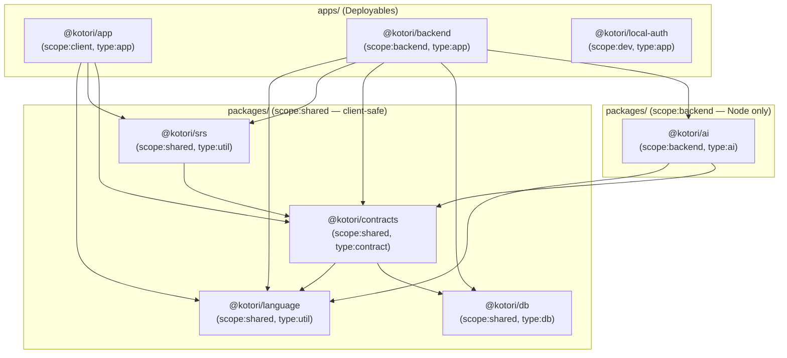

# Monorepo rearchitecture

> Agreed direction, updated 2026-11-02 (supersedes the 2026-10-28 and earlier 2026-11-02 drafts).
> Incorporates the English dictionary (`@kotori/eiwa`), bilingual nuance & katakana
> loanword warnings (`LoanWriter`), voice casting, golden-set evaluation, and Nx / Effect 4 /
> Drizzle 1.0 / Expo 57 architectural standards. Implement the migration in the order below.

## Goal

One definition of the data model, propagating automatically to every consumer, with no
hand-maintained shadow copies anywhere. Along the way, reduce the workspace from
**15 projects (4 apps, 11 packages) to 8 projects (3 apps, 5 packages)**.

### The chain of truth

Everything below follows from one rule: **a Drizzle table file is the single source of
truth for its data, and every downstream type is derived or inferred from it — never
restated.**

```
packages/db/src/schema/users.ts          ← the only place a shape is declared
  │ $inferSelect, query-result inference
  ▼
apps/backend/src/features/*/queries.ts   ← inline Drizzle queries, result types inferred
  │ createSelectSchema(users)
  ▼
packages/contracts/src/http/*.ts         ← response schemas derived; fields picked explicitly
  │ KotoriApi
  ▼
apps/app/src/api/client.ts               ← HttpApiClient.ForApi<typeof KotoriApi>
  ▼
apps/app components                      ← fully typed; zero locally declared interfaces
```

Change a column and `pnpm nx run-many -t typecheck` fails at the backend query, at the
contract, and at every app component that used the field. The loop holds across migrations
because `drizzle-kit generate` reads the same table files that produce the types — the SQL
and the types cannot disagree.

### Why each project exists

- **DB (`@kotori/db`)** is *only* the schema and its migrations: one file per table, each owning its columns, enums, JSONB value schemas, and relations. No connection code, no repositories.
- **Contracts (`@kotori/contracts`)** is the HTTP boundary: response/request schemas derived from the tables via `drizzle-orm/effect-schema`, the `KotoriApi` declaration, public errors, and voice metadata. It is the transport encoding of the model, not a second model.
- **Language (`@kotori/language`)** provides pure, zero-I/O Japanese and English morphology, script, furigana, and gloss normalization helpers.
- **SRS (`@kotori/srs`)** provides pure spaced-repetition scheduling and interval preview formatting.
- **AI (`@kotori/ai`)** provides stateless, database-free model capabilities, provider adapters, and offline golden-set evaluation.
- **Backend (`@kotori/backend`)** owns all database access, coordinates application behavior across vertical feature slices, and runs the HTTP server, background worker, and CLI from independent entry points.

Single responsibility means one reason to change, not one file or package per function.
Package count is not the success criterion; locality of changes and clear dependency
direction are.

### Two decisions worth recording

**Contracts derives from tables at runtime, and Drizzle ships in the client bundle.**
`createSelectSchema(users)` needs the table object at runtime, so `@kotori/contracts`
imports `@kotori/db/schema` as a value and `drizzle-orm/pg-core` reaches the Expo bundle
(~30–40KB gzipped, pure JS, React Native safe). This was chosen deliberately over
codegen or a type-only projection: it is the only option where drift is impossible *by
construction* rather than caught by a check, and it requires no tooling to build or
maintain. The alternatives are recorded in [Rejected alternatives](#rejected-alternatives).

**Contracts stays a separate package, not a folder in `apps/backend`.** It has two
consumers across a deployment boundary: the app calls `KotoriApi`, the backend implements
it. Folding it into `apps/backend` would make `apps/app` depend on `apps/backend` (so Nx
`affected` redeploys the app on every backend change), would expose `pg`,
`@effect/platform-node`, and the AI SDKs to Metro's resolver through the backend's
`package.json`, and would make the boundary unenforceable — Nx resolves a subpath import
to its owning project, so no tag rule could stop the app reaching into backend features.

## Target layout

```text
apps/
  app/                          Expo application (iOS, Android, Web)
  backend/                      Consolidated backend application (@kotori/backend)
    src/
      entrypoints/
        http.ts                 HTTP process (Fly "api" process group)
        worker.ts               Background worker process (Fly "worker" process group)
        cli.ts                  Administrative, seed, eval, and migration commands
      http/                     Routes, auth middleware, codecs, webhooks, CORS
      cli/                      Argument parsing and subcommand wiring
      worker/                   Job polling loop, concurrency, and process lifecycle
      db/                       Connection pool, migrator, neon_auth helpers, scopedToUser
      features/
        accounts/               Profiles, approvals, account lifecycle + its queries
        dictionary/             Search, entry assembly, vocabulary lookup + its queries
          import/               JMDict XML & Eiwa (Wiktionary/EJDict/frequency) ingestion
        coaching/               Learner requests, caching, usage limits + its queries
        study/                  Notes, review queue, answering, statistics + its queries
        enrichment/             NuanceEnricher, Enrichers, job and enrichment queries
        audio/                  AudioStore clip cache, spending policy, storage, retrieval
      integrations/
        auth/                   Managed Better Auth JWT verification, JWKS, webhook signatures
        email/                  Resend, console, and memory mail transports
      runtime/                  HttpLayers, WorkerLayers, environment and path resolution
      testing/                  PGlite in-memory database with template snapshot caching
  local-auth/                   Development-only Better Auth stand-in (@kotori/local-auth)
packages/
  ai/                           Stateless model capabilities, provider adapters, golden evals
    golden/
      entries.json              Offline golden evaluation fixture
    src/
      coaching/                 Coach conversation and tool loop
      examples/                 ExampleWriter, sense matching, LoanWriter
      nuance/                   NuanceJudge, Japanese & English question builders, state
      speech/                   Pronouncer synthesis and voice casting
      providers/                Claude, Jev, ElevenLabs adapters
      eval/                     Golden set definitions and reversed-choice bias evaluation
  contracts/                    Derived HTTP wire contract
    src/
      http/                     Requests, responses, KotoriApi, public Errors
      Voices.ts                 Voice, Cast, CASTS metadata
  db/                           Schema and migrations only
    drizzle.config.ts
    migrations/                 SQL migrations and meta journal
    src/
      columns.ts                Shared column helpers and pgEnums
      users.ts                  users table + its enums, JSONB schemas, relations
      entries.ts                entries table + ...
      senses.ts
      notes.ts
      cards.ts
      enrichments.ts
      jobs.ts
      index.ts                  Barrel re-export
  language/                     Pure Japanese & English morphology, script, furigana, gloss helpers
  srs/                          Pure SM-2 v3 scheduler and shared review interval formatting
```

`apps/backend` replaces both `apps/api` and `apps/worker` as source projects. Its entry
points still run independently, with separate runtime layers and process configuration.
The HTTP process initializes only the dependencies it needs; worker and CLI composition
remain separate. HTTP continues as Fly's `api` process group, enrichment as `worker`,
and migration remains a release command rather than application startup work.

`packages/services` is untracked stale build artifacts — delete it locally. It is absent
from fresh clones and CI, so it is a cleanup note rather than a migration step.
See [Nx's folder-structure guidance](https://nx.dev/docs/kb/folder-structure).

### Old-to-new mapping

| Current | Target | Rationale |
| --- | --- | --- |
| `apps/api` + `apps/worker` | `apps/backend` | Built into the same Docker image and deployed together on Fly.io; shares vertical feature slices while keeping 3 separate process entry points. |
| `packages/auth` + `packages/email` | `apps/backend/src/integrations/` | Thin wrappers (~270 LOC combined) around `jose`, Better Auth webhooks, and Resend used exclusively by the backend. |
| `packages/jmdict` + `packages/eiwa` | `apps/backend/src/features/dictionary/import/` | Dictionary seeders/parsers used only by `kotori seed` and `kotori golden`. Pure English `uninflect` moves to `@kotori/language`. |
| `packages/ai` + `packages/nuance` + `packages/tts` | `packages/ai` | Consolidates all external AI/ML providers (Claude, Jev, ElevenLabs) into one stateless, DB-free package. DB-coupled `NuanceEnricher` and filesystem-coupled `AudioStore` move to `apps/backend`. |
| `packages/domain` | `packages/contracts` | Narrowed to the derived HTTP boundary. Loses every re-declared row shape. |
| `packages/japanese` | `packages/language` | Expanded to house pure, zero-I/O linguistic utilities for both languages. |
| `db/src/{rows,records}.ts` | *(Delete — 205 LOC)* | The hand-maintained shadow model that caused drift. `createSelectSchema` replaces `rows.ts`; `records.ts` splits between `@kotori/language` (gloss normalizers) and the table files (JSONB schemas). |
| `db/src/{Database,Migrate,neonAuth,Paths}.ts` | `apps/backend/src/db/` | ~170 LOC of connection and migration plumbing used only by the backend. Removing it is what lets `@kotori/db` be client-safe. |
| `db/src/testing.ts` | `apps/backend/src/testing/` | PGlite harness used only by backend tests. |
| `db/src/*Repo.ts` (6 files, 1,979 LOC) | `apps/backend/src/features/*/queries.ts` | Dissolved — see [Dissolving the repositories](#dissolving-the-repositories). |
| `packages/srs` | `packages/srs` | Unchanged except that `Rating`/`CardQueue` now come from `@kotori/contracts`. |

## Ownership and dependency graph



These are import dependencies, not network services. `ai` remains an in-process package.

- `@kotori/db` owns persistence. One file per table, each declaring its columns, the `pgEnum`s it uses, its JSONB value schemas, and its relations. Its only dependency is `drizzle-orm`. Because the connection code now lives in the backend, the whole project is client-safe and needs no subpath boundary.
- `@kotori/contracts` imports `@kotori/db` and `@kotori/language`. It derives and composes; it declares no row shapes of its own.
- `@kotori/language` owns pure, synchronous linguistic utilities:
  - `japanese/script.ts` (romaji/kana conversion, script inspection)
  - `japanese/deinflect.ts` (Yomichan verb/adjective deinflection)
  - `japanese/furigana.ts` (inline `kanji[reading]` parser and stripper, from `domain`)
  - `english/inflect.ts` (regular English `uninflect` and `Inflection` tags, from `eiwa`)
  - `english/gloss.ts` (`normalizeGloss`, `normalizeJapaneseGloss`, `loanCandidatesIn`, from `db/src/records.ts`)
- `@kotori/ai` consumes `@kotori/contracts` and `@kotori/language`; it never imports `@kotori/db`.
- `@kotori/backend` is the only project that opens a database connection.

## The schema package (`@kotori/db`)

One file per table, [as Drizzle recommends](https://orm.drizzle.team/docs/sql-schema-declaration).
Each file is self-contained — the table, the enums it uses, the Effect schemas for its JSONB
columns, and its relations all live together, so "what shape is a note?" has exactly one answer:

```ts
// packages/db/src/notes.ts
import { jsonb, pgTable, timestamp, uuid } from "drizzle-orm/pg-core"
import * as Schema from "effect/Schema"
import { users } from "./users.ts"

export const NoteContent = Schema.Struct({
  text: Schema.String,
  furigana: Schema.optional(Schema.String),
})
export type NoteContent = typeof NoteContent.Type

export const notes = pgTable("notes", {
  id: uuid().primaryKey().defaultRandom(),
  userId: uuid().notNull().references(() => users.id, { onDelete: "cascade" }),
  content: jsonb().$type<NoteContent>().notNull(),
  createdAt: timestamp({ withTimezone: true }).notNull().defaultNow(),
})
```

`$type<NoteContent>()` gives compile-time typing only; it does not generate the nested
runtime validator. Contracts supplies that by passing the same `NoteContent` schema as an
override to `createSelectSchema`, so the validator and the column type come from one
declaration. See [Drizzle's JSON typing documentation](https://orm.drizzle.team/docs/column-types#jsonb).

Shared pgEnums and reusable column helpers stay in `columns.ts`; `index.ts` is a barrel.
`relations.ts` is dissolved into the table files.

### Dissolving the repositories

The six `*Repo` modules (1,979 LOC — `DictionaryRepo` 717, `EnrichmentRepo` 550,
`StudyRepo` 340, `JobsRepo` 191, `UsersRepo` 112, `CoachRepo` 69) are deleted as Effect
services. Their SQL moves into `queries.ts` beside the feature that uses it, as plain
functions taking the `db` handle. The point is inference: a query written at its call site
yields a result type straight from the table, so nothing restates the row shape.

Two guardrails survive the dissolution:

- **Tenancy.** Every learner-scoped query goes through a shared `scopedToUser(db, userId)` helper in `apps/backend/src/db/`. Scattering raw Drizzle across call sites in a multi-tenant app is how tenancy bugs happen, and this is the one thing the repositories were genuinely buying.
- **Feature encapsulation.** A feature calls another feature's exported interface, never its `queries.ts` directly. This is a review convention, not a lint rule — backend features are folders in one project, not separate projects.

Multi-table mutations (answering a review card in `study`, reserving quota and recording a
turn in `coaching`, deleting an account across `public.users` and `neon_auth.user` in
`accounts`) wrap their work in `db.transaction(...)` at the feature boundary.

Unexpected SQL and connection failures stay Effect defects (`Effect.orDie`) inside query
functions; the typed error channel `E` is reserved for recoverable domain errors declared
in `@kotori/contracts`.

## The HTTP boundary (`@kotori/contracts`)

Rename `packages/domain` and narrow it to the wire. It holds request and response schemas,
`KotoriApi`, public errors, and `Voices.ts`. It maintains no second set of row definitions.

```ts
import { accountStatusEnum, users } from "@kotori/db"
import { createSelectSchema, createUpdateSchema } from "drizzle-orm/effect-schema"
import * as Schema from "effect/Schema"

export const AccountStatus = createSelectSchema(accountStatusEnum)

const UserUpdate = createUpdateSchema(users, {
  dailyNewLimit: (schema) =>
    schema.check(Schema.isBetween({ minimum: 0, maximum: 9999 }))
})

export const UpdateProfileRequest = Schema.Struct({
  displayName: UserUpdate.fields.displayName,
  dailyNewLimit: UserUpdate.fields.dailyNewLimit
})
```

See [Drizzle's Effect schema integration](https://orm.drizzle.team/docs/effect-schema).

**Fields are always picked explicitly.** Derivation gives you the correct *type* for free;
it must never give you *exposure* for free. Adding `enrichments.answers`,
`enrichments.nuanceVersion`, `jobs.lastError`, or `users.approvalToken` must not publish the
column in a response or let a client update it. Explicit picks are what make the generated
field schemas safe to use.

Some contracts have no table to derive from, and stay explicit:

- `Profile` (`Me`) combines identity-provider details with learner fields and derives `onboarded` from `onboardedAt`.
- `EntryDetail` assembles four dictionary tables, resolves tags, and adds romaji, audio URLs, similar words, katakana loan warnings, and enrichment status.
- `ReviewQueue` and `StudyStats` describe computed results.
- Coaching contracts describe structured AI requests and results, not table rows.
- `Voices.ts` holds pure voice metadata (`Voice`, `Cast`, `CASTS`) shared by backend and client without pulling in ElevenLabs or filesystem code.

### Resolving the existing cycle

Today the tables import types from `domain`, while `ExampleWriter` in `ai` imports gloss
normalizers from `db`. The target direction is `contracts → db`, so both edges must go:

1. Move the gloss normalizers into `@kotori/language`, so `ai` no longer imports `db`.
2. Move the JSONB value schemas out of `domain` into their table files, so `db` no longer imports `domain`.
3. Delete `rows.ts` and `records.ts`.

## AI package (`@kotori/ai`)

```text
packages/ai/
  golden/entries.json    Offline golden fixture built by `kotori golden`
  src/
    coaching/            Coach conversation, tool loop, formality judgment
    examples/            ExampleWriter, sense matching (matchSenses), LoanWriter
    nuance/              NuanceJudge, Japanese (request.ts) & English (english.ts) questions, state.ts
    speech/              Pronouncer synthesis and deterministic voice casting
    providers/           Claude, Jev, ElevenLabs adapters
    eval/                Golden set definitions (golden.ts) and bias evaluation (evaluation.ts)
```

Expose focused capability interfaces: `Coach`, `ExampleWriter`, `LoanWriter`, `NuanceJudge`,
`Pronouncer`. Provider adapters stay internal seams, with fake adapters for tests.

- **AI owns** prompts, structured-output validation, model configuration, provider retries, rate-limit concurrency, provider errors, deterministic voice casting (`casting.ts`), interpretation of provider answers, and golden-set evaluation logic.
- **Backend features own** candidate selection from Postgres, missing-data checks (`awaitsWarning`, `nuanceOutdated`), audio file caching (`AudioStore`), learner quota enforcement, persistence, and background job scheduling.
- `NuanceJudge` receives pure values — entry records, tag labels, similar-word candidates, loan candidates — and returns the computed `Nuance` plus raw answers. `apps/backend/src/features/enrichment/NuanceEnricher.ts` coordinates loading and persisting.

## Backend features and integrations

| Owner | Code that moves here |
| --- | --- |
| `features/accounts` | API `Accounts`, auth `Approvals`, account webhook policy, CLI account workflows, `UsersRepo` SQL |
| `features/dictionary` | API `Dictionary` search, entry assembly, word lookup, `DictionaryRepo` SQL |
| `features/dictionary/import` | `packages/jmdict` and `packages/eiwa` |
| `features/coaching` | API `Coaching` workflows, quota reservation, `CoachRepo` SQL |
| `features/study` | API `Study`, notes, queue, answering, statistics, `StudyRepo` SQL |
| `features/enrichment` | Worker `Enrichers`, `NuanceEnricher`, `JobRunner` policies, `JobsRepo` + `EnrichmentRepo` SQL |
| `features/audio` | `AudioStore` filesystem clip cache, SHA-256 content addressing, `/audio/:key` streaming |
| `integrations/auth` | Better Auth JWKS verification (`Auth.ts`), webhook signatures (`Webhooks.ts`) |
| `integrations/email` | Resend, console, and memory mail transports |
| `db/` | `Database.ts`, `Migrate.ts`, `neonAuth.ts`, `scopedToUser` |
| `runtime/` | `HttpLayers.ts`, `WorkerLayers.ts`, `Paths.ts` |

**Entrypoint-specific Layer graphs:**

- `HttpLayers.ts` wires only what the HTTP server needs (`DatabaseLive`, `AuthLive`, `EmailLive`, `CoachLive`, `AudioStoreLive`, HTTP feature services). It never instantiates JMDict/Eiwa parsers, `ExampleWriter`, `NuanceJudge`, or `JobRunner`.
- `WorkerLayers.ts` wires `DatabaseLive`, `ExampleWriterLive`, `LoanWriterLive`, `NuanceJudgeLive`, `PronouncerLive`, `AudioStoreLive`, `EnrichersLive`, `JobRunnerLive`.
- `entrypoints/cli.ts` provides layers lazily per subcommand, so `cli.js migrate` (the Fly `release_command`) constructs only `MigrateLive` and exits. `tools/golden-fixture.mts` becomes a `kotori golden` subcommand rather than a workspace-root tool reaching into app internals.

## Nx and tech-stack configuration

### 1. Two-dimensional tags and module boundaries

Boundaries are enforced by [`@nx/oxlint/boundaries-plugin`](https://nx.dev/docs/technologies/oxlint/introduction),
which ships `@nx/enforce-module-boundaries` as an Oxlint JavaScript plugin. Install with
`nx add @nx/oxlint` and pin `@nx/oxlint` to `24.0.0` in the `pnpm-workspace.yaml` catalog to
match the `nx` entry (`catalogMode: strict` requires it).

> **Caveat:** the Oxlint build of this rule is experimental — it rides Oxlint's JavaScript
> plugin API, explicitly excluded from Oxlint's semver policy. `oxlint` is already pinned
> exactly (`1.89.0`); keep it pinned and treat any Oxlint bump as a change to verify
> against this rule.

Two dimensions suffice. **`scope` carries the platform meaning** — `scope:shared` is
client-safe by definition, `scope:backend` is Node-only — so no `platform` tag is needed.

| Project | `nx.tags` |
| --- | --- |
| `@kotori/app` | `["scope:client", "type:app"]` |
| `@kotori/backend` | `["scope:backend", "type:app"]` |
| `@kotori/local-auth` | `["scope:dev", "type:app"]` |
| `@kotori/ai` | `["scope:backend", "type:ai"]` |
| `@kotori/db` | `["scope:shared", "type:db"]` |
| `@kotori/contracts` | `["scope:shared", "type:contract"]` |
| `@kotori/language` | `["scope:shared", "type:util"]` |
| `@kotori/srs` | `["scope:shared", "type:util"]` |

Beyond the tags already agreed, one addition: **`type:ai`** for `@kotori/ai`, which is
neither a `type:util` (it performs provider I/O) nor a `type:db`. `scope:dev` replaces a
one-off `scope:dev-auth` so the constraint list stays closed. No `type:feature` tag —
backend features are folders in one project.

```json
{
  "jsPlugins": ["@nx/oxlint/boundaries-plugin"],
  "rules": {
    "@nx/enforce-module-boundaries": [
      "error",
      {
        "allow": [],
        "checkNestedExternalImports": true,
        "depConstraints": [
          {
            "sourceTag": "scope:shared",
            "onlyDependOnLibsWithTags": ["scope:shared"],
            "bannedExternalImports": ["pg", "@effect/sql-*", "@effect/platform-node", "drizzle-orm/node-postgres", "drizzle-kit"]
          },
          {
            "sourceTag": "scope:client",
            "onlyDependOnLibsWithTags": ["scope:shared", "scope:client"],
            "notDependOnLibsWithTags": ["scope:backend", "scope:dev"],
            "bannedExternalImports": ["pg", "@effect/sql-*", "@effect/platform-node", "drizzle-orm/node-postgres", "drizzle-kit"]
          },
          {
            "sourceTag": "scope:backend",
            "onlyDependOnLibsWithTags": ["scope:shared", "scope:backend"],
            "notDependOnLibsWithTags": ["scope:client", "scope:dev"]
          },
          {
            "sourceTag": "scope:dev",
            "onlyDependOnLibsWithTags": ["scope:shared", "scope:dev"]
          },

          {
            "sourceTag": "type:db",
            "onlyDependOnLibsWithTags": [],
            "allowedExternalImports": ["drizzle-orm", "drizzle-orm/pg-core", "effect", "effect/*"]
          },
          {
            "sourceTag": "type:contract",
            "onlyDependOnLibsWithTags": ["type:db", "type:util"],
            "allowedExternalImports": ["drizzle-orm", "drizzle-orm/*", "effect", "effect/*"]
          },
          {
            "sourceTag": "type:util",
            "onlyDependOnLibsWithTags": ["type:contract", "type:util"],
            "allowedExternalImports": ["effect", "effect/*", "wanakana"]
          },
          {
            "sourceTag": "type:ai",
            "onlyDependOnLibsWithTags": ["type:contract", "type:util"]
          },
          {
            "sourceTag": "type:app",
            "onlyDependOnLibsWithTags": ["type:contract", "type:util", "type:db", "type:ai"]
          }
        ]
      }
    ]
  }
}
```

Every matching constraint applies cumulatively
([tag in multiple dimensions](https://nx.dev/docs/guides/enforce-module-boundaries/tag-multiple-dimensions)).
What the non-obvious lines buy:

- `type:db` with `onlyDependOnLibsWithTags: []` and a two-package allowlist keeps the schema a leaf. The ban on `drizzle-orm/node-postgres` and `drizzle-kit` is what stops connection code creeping back in and un-sharing the package — the single most important rule here, since the whole simplification rests on `@kotori/db` staying driver-free ([ban external imports](https://nx.dev/docs/guides/enforce-module-boundaries/ban-external-imports)).
- `type:ai` excludes `type:db`, replacing the prose rule "`ai` must not touch the database" with one the linter checks.
- `checkNestedExternalImports: true` extends the `scope:client` bans transitively, so a driver smuggled in through a shared package is still caught.
- Nx treats an **untagged project as unable to depend on anything**, so a new package that forgets its tags fails loudly rather than silently escaping the graph.

Note `drizzle-orm` itself is *not* banned for `scope:client` — that is the accepted
consequence of runtime derivation. Only the driver-bound entry points are.

### 2. `nx.json` inputs and deployment caching

Carry forward the deploy inputs that exist today in `apps/api/package.json`
(`Dockerfile`, `.dockerignore`, `fly.toml`, dependent build outputs); losing them means a
`fly.toml` edit no longer triggers a deploy. Keep `pnpm-lock.yaml` in `sharedGlobals` — it
is the file that changes on a dependency bump — and add `pnpm-workspace.yaml` alongside it
rather than in its place. The migrations directory is `packages/db/migrations/`; a glob
that matches nothing fails open and silently.

```json
{
  "namedInputs": {
    "default": ["{projectRoot}/**/*", "sharedGlobals"],
    "sharedGlobals": [
      "{workspaceRoot}/tsconfig.base.json",
      "{workspaceRoot}/pnpm-lock.yaml",
      "{workspaceRoot}/pnpm-workspace.yaml"
    ],
    "production": [
      "default",
      "!{projectRoot}/**/*.test.ts",
      "!{projectRoot}/**/*.test.tsx",
      "!{projectRoot}/test/**/*",
      "!{projectRoot}/tsconfig.spec.json",
      "!{projectRoot}/vitest.config.ts",
      "!{projectRoot}/golden/**/*"
    ]
  }
}
```

The `deploy` target stays declared on `@kotori/backend` rather than in `targetDefaults`,
since it is the only deployable of its kind:

```json
{
  "nx": {
    "targets": {
      "deploy": {
        "dependsOn": ["build"],
        "inputs": [
          "production",
          { "dependentTasksOutputFiles": "**/*", "transitive": true },
          "{workspaceRoot}/packages/db/migrations/**/*",
          "{workspaceRoot}/Dockerfile",
          "{workspaceRoot}/.dockerignore",
          "{workspaceRoot}/fly.toml"
        ],
        "command": "flyctl deploy --remote-only"
      }
    }
  }
}
```

`^deploy` is deliberately absent: nothing `@kotori/backend` depends on has a `deploy`
target, and including it risks picking up the Expo app's Vercel deploy if the graph shifts.
Excluding `golden/**` from `production` keeps the offline evaluation fixture from
invalidating production deploys; the explicit migrations glob ensures schema changes do.

### 3. Exports, Metro, and Docker

- **Dual export conditions (`@kotori/source`)**: every internal library exposes `"@kotori/source"` → `./src/...` alongside `"types"` and `"default"` → `./dist/...`. Metro, Vitest, and `tsx --conditions @kotori/source` resolve TypeScript source during development; production runs compiled JavaScript.
- **`@kotori/db` needs no subpath exports.** Removing the connection code is what made the subpath split unnecessary — a single root export is both simpler and safer, because subpaths were never enforceable as boundaries anyway.
- **pnpm & Docker**: retain `nodeLinker: hoisted` and `catalogMode: strict` for React Native / Expo autolinking, and filter the production image to `@kotori/backend...`. Keep the existing store cache mount and the `$p/migrations` copy loop (the migrations directory name is unchanged):
  ```dockerfile
  RUN --mount=type=cache,id=pnpm-store,target=/pnpm/store \
      pnpm install --prod --frozen-lockfile --store-dir /pnpm/store \
        --config.node-linker=isolated \
        --filter "@kotori/backend..."
  ```
- **`fly.toml`**:
  ```toml
  [deploy]
    release_command = "node apps/backend/dist/entrypoints/cli.js migrate"

  [processes]
    api = "node apps/backend/dist/entrypoints/http.js"
    worker = "node apps/backend/dist/entrypoints/worker.js"
  ```

## Migration sequence

Each step leaves `pnpm nx sync:check` and `pnpm nx run-many -t typecheck test lint` green.
Boundary enforcement lands last because the intermediate states legitimately violate it.

1. **Create `@kotori/language`.** Rename/expand `packages/japanese`, adding `japanese/furigana.ts` (from `domain`), `english/inflect.ts` (`uninflect` from `eiwa`), `english/gloss.ts` (`normalizeGloss`, `normalizeJapaneseGloss`, `loanCandidatesIn` from `db/src/records.ts`).
   **Done when:** `@kotori/ai` imports text helpers from `@kotori/language` and no longer depends on `@kotori/db`.

2. **Create `apps/backend`.** Merge `apps/api` and `apps/worker` as-is behind `entrypoints/{http,worker,cli}.ts` and `runtime/{HttpLayers,WorkerLayers}.ts`, without restructuring their internals. Delete both old apps.
   **Done when:** all three entry points run and the existing suites pass unchanged from `@kotori/backend`.

3. **Slim `@kotori/db` to schema and migrations.** Move `Database.ts`, `Migrate.ts`, `neonAuth.ts` into `apps/backend/src/db/`, `Paths.ts` into `apps/backend/src/runtime/`, and `testing.ts` into `apps/backend/src/testing/`. Split the schema one file per table, folding `relations.ts` and the JSONB value schemas into the table files. Delete `rows.ts` and `records.ts`.
   **Done when:** `@kotori/db`'s only dependency is `drizzle-orm`, it no longer depends on `@kotori/domain`, the import graph is acyclic, and `drizzle-kit generate` produces no schema diff.

4. **Replace `@kotori/domain` with `@kotori/contracts`.** Rename, derive entity and enum schemas from `@kotori/db` via `drizzle-orm/effect-schema`, keep explicit field picks, move `Voices.ts` in, and delete every re-declared row shape.
   **Done when:** no duplicate model declarations remain, HTTP contract tests pass, and Metro plus `expo export --platform web` resolve the new imports cleanly.

5. **Dissolve the repositories into feature slices.** Create `features/{accounts,dictionary,coaching,study,enrichment,audio}`, moving each `*Repo`'s SQL into a `queries.ts` beside its consumer, `NuanceEnricher` into `features/enrichment/`, `AudioStore` into `features/audio/`. Add `scopedToUser` and route every learner-scoped query through it. Wrap multi-write operations in `db.transaction(...)`.
   **Done when:** the 6 `*Repo` modules are deleted, every PGlite feature test passes, rollback coverage exists on each multi-table write, and no query function re-declares a row type.

6. **Absorb the backend-only packages.** Move `packages/auth` and `packages/email` into `integrations/`, `packages/jmdict` and `packages/eiwa` into `features/dictionary/import/`. Convert `tools/golden-fixture.mts` into a `kotori golden` subcommand.
   **Done when:** `packages/{auth,email,jmdict,eiwa}` are deleted and no workspace-root tool imports app internals.

7. **Consolidate `@kotori/ai`.** Move `NuanceJudge`, `request.ts`, `english.ts`, `questions.ts`, `state.ts`, `golden.ts`, `evaluation.ts`, `golden/entries.json`, `Pronouncer`, and `casting.ts` into `packages/ai`.
   **Done when:** `packages/{nuance,tts}` are deleted and all provider and golden evaluation tests pass.

8. **Push predicates to SQL.** Replace the full-table in-memory scans in the former `EnrichmentRepo.outdatedNuanceIds`, `EnrichmentRepo.missingLoanWarningWords`, and `DictionaryRepo.loanCandidates` with targeted `WHERE` clauses, adding supporting indexes in a new migration.
   **Done when:** the migration applies cleanly and each rewritten query returns results identical to the scan it replaces.

9. **Cut over tooling and boundaries.** Add `@nx/oxlint` (catalog-pinned `24.0.0`), register the plugin and `depConstraints` in `.oxlintrc.json`, add `nx.tags` to all 8 `package.json` files, and update `nx.json`, `Dockerfile`, `fly.toml`, `knip.json`, root `package.json` scripts (`dev`, `seed`, `kotori`, `golden` all still reference `@kotori/worker`), and docs (`README.md`, `docs/operations.md`, `docs/accounts-and-auth.md`).
   **Done when:** `sync:check`, `typecheck`, `test`, `lint`, `build`, Metro bundling, and the Docker build all succeed with zero references to retired packages, and a deliberately added `drizzle-orm/node-postgres` import in `packages/db` fails `pnpm lint`.

## Validation and completion

- Test pure algorithms (`@kotori/language`, `@kotori/srs`) directly.
- Test `@kotori/ai` capabilities through their interfaces with fake provider adapters, covering independent availability, structured-output handling, and golden-set order-bias checks.
- Test `@kotori/backend` features against the PGlite harness with fake AI and email layers, including transaction rollback coverage on multi-table writes.
- Retain HTTP integration checks for authorization, responses, error codes, and explicit field selection.
- Verify the drift loop actually bites: change a column type in `packages/db` and confirm `pnpm nx run-many -t typecheck` fails in `apps/backend`, `packages/contracts`, *and* `apps/app`.
- Verify the boundary rules bite: a temporary `drizzle-orm/node-postgres` import in `packages/db` and a temporary `node:fs` import in `packages/srs` must both fail `pnpm lint`.
- Confirm the shipped web bundle contains no `pg`, `@effect/platform-node`, or `node:*` polyfill from a workspace package.
- Run `pnpm nx sync:check` and `pnpm nx run-many -t typecheck test lint build` at cutover, and verify the Docker image builds and runs `http.js`, `worker.js`, and `cli.js migrate` without source files.

## Appendix

### Rejected alternatives

| Option | Why not |
| --- | --- |
| **Codegen** — a generator emits plain Effect schemas into `contracts`, checked in, with `git diff --exit-code` in CI | Keeps Drizzle out of the client bundle, but costs a ~200-line generator to own and puts generated files in every review diff. Only worth it if the bundle cost had proved unacceptable. |
| **Type-only projection** — `import type` from `db`, with a `ProjectionOf<Row>` conditional type making drift a typecheck error | Zero bundle cost and no build step, but you still hand-write each field schema, and it needs verification that `@nx/enforce-module-boundaries` can ignore type-only edges (Nx counts them as dependencies by default). |
| **Parity test** — contracts declares schemas independently; a backend test asserts they match the tables | Rejected as a workaround rather than a design: drift is caught by a test someone can skip, not by construction. |
| **Inverted arrow** — contracts owns the vocabulary, tables import it | Keeps the bundle clean but splits the data model across two packages, which is the smell this refactor exists to remove. |
| **No contracts package; client queries via Drizzle** | The Expo app reaches the backend over HTTP (`apps/app/src/api/client.ts` uses `HttpApiClient.make(KotoriApi)`). It has no database connection, and giving it one means shipping Postgres credentials in an app bundle and replacing Better Auth JWT middleware with row-level security. |

### Expand/contract discipline

Types propagate at *build* time, which is what you want — a mismatch should stop the build,
not surface at deploy. The type system cannot, however, catch the deploy-ordering hazard:
Fly's `release_command` applies migrations before new machines roll, so for a window the old
code runs against the new schema. Destructive changes therefore need two deploys — expand
(add the column, backfill, write both), then contract (stop writing the old, drop it) — in a
later release. This belongs in `docs/operations.md`; it is not solvable in the schema.
