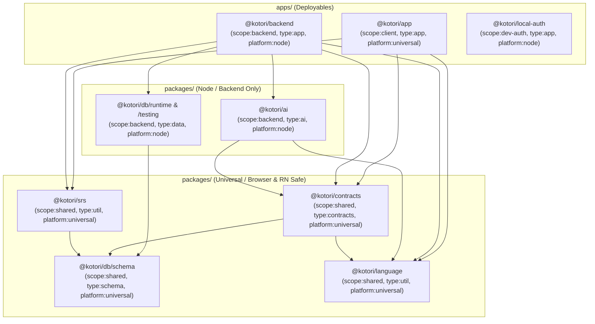

# Monorepo rearchitecture

> Agreed direction, updated 2026-11-02 (supersedes the 2026-10-28 draft).
> Incorporates the English dictionary (`@kotori/eiwa`), bilingual nuance & katakana
> loanword warnings (`LoanWriter`), voice casting, golden-set evaluation, and Nx / Effect 4 /
> Drizzle 1.0 / Expo 57 architectural standards. Implement the migration in the order below.

## Goal

Give each part of Kotori one clear owner while reducing the workspace from **15 projects
(4 apps, 11 packages) to 8 projects (3 apps, 5 packages)**:

- **Drizzle (`@kotori/db`)** defines stored data, enums, JSONB value schemas, and database connections.
- **Contracts (`@kotori/contracts`)** derives base schemas from `@kotori/db/schema` and composes the values exchanged over HTTP.
- **Language (`@kotori/language`)** provides pure, zero-I/O Japanese and English morphology, script, furigana, and gloss normalization helpers.
- **SRS (`@kotori/srs`)** provides pure spaced-repetition scheduling and interval preview formatting.
- **AI (`@kotori/ai`)** provides stateless, database-free model capabilities, provider adapters, and offline golden-set evaluation.
- **Backend (`@kotori/backend`)** coordinates application behavior across vertical feature slices and runs the HTTP server, background worker, and CLI from independent entry points.

Single responsibility means one reason to change, not one file or package per function.
A package can contain several focused modules behind a small interface. Package count is
not the success criterion; locality of changes and clear dependency direction are.

## Target layout

```text
apps/
  app/                          Expo application (iOS, Android, Web)
  backend/                      Consolidated backend application (@kotori/backend)
    src/
      entrypoints/
        http.ts                 HTTP process (Fly "api" process group)
        worker.ts               Background worker process (Fly "worker" process group)
        cli.ts                  Administrative, seed, eval, and migration commands
      http/                     Routes, auth middleware, codecs, webhooks, CORS
      cli/                      Argument parsing and subcommand wiring
      worker/                   Job polling loop, concurrency, and process lifecycle
      features/
        accounts/               Profiles, approvals, account lifecycle, UsersRepo queries
        dictionary/             Search, entry assembly, vocabulary lookup, DictionaryRepo queries
          import/               JMDict XML & Eiwa (Wiktionary/EJDict/frequency) ingestion
        coaching/               Learner requests, caching, usage limits, CoachRepo queries
        study/                  Notes, review queue, answering, statistics, StudyRepo queries
        enrichment/             NuanceEnricher, Enrichers, JobsRepo, EnrichmentRepo queries
        audio/                  AudioStore clip cache, spending policy, storage, retrieval
      integrations/
        auth/                   Managed Better Auth JWT verification, JWKS, webhook signatures
        email/                  Resend, console, and memory mail transports
      runtime/                  HttpLayers, WorkerLayers, environment and path resolution
  local-auth/                   Development-only Better Auth stand-in (@kotori/local-auth)
packages/
  ai/                           Stateless model capabilities, provider adapters, golden evals
    golden/
      entries.json              Offline golden evaluation fixture
    src/
      coaching/                 Coach conversation and tool loop
      examples/                 ExampleWriter, sense matching, LoanWriter
      nuance/                   NuanceJudge, Japanese & English question builders, state
      speech/                   Pronouncer synthesis and voice casting
      providers/                Claude, Jev, ElevenLabs adapters
      eval/                     Golden set definitions and reversed-choice bias evaluation
  db/
    drizzle/                    SQL migrations and meta journal
    src/
      schema/                   Browser-safe tables, pgEnums, relations, JSONB schemas, records
      runtime/                  Node Postgres connection pool, migrator, neon_auth helpers
      testing/                  PGlite in-memory database with template snapshot caching
  contracts/                    Composed Effect schemas, voice metadata, and HttpApi contract
  language/                     Pure Japanese & English morphology, script, furigana, gloss helpers
  srs/                          Pure SM-2 v3 scheduler and shared review interval formatting
```

`apps/backend` replaces both `apps/api` and `apps/worker` as source projects. Its entry
points still run independently, with separate runtime layers and process configuration.
The HTTP process initializes only the dependencies it needs; worker and CLI composition
remain separate. HTTP continues as Fly's `api` process group, enrichment as `worker`,
and migration remains a release command rather than application startup work.

There is no `packages/services` (delete the leftover stale directory). The application-specific
workflows belong to the backend application. See [Nx's folder-structure guidance](https://nx.dev/docs/kb/folder-structure).

### Old-to-new package mapping

| Current Project | Target Location | Rationale |
| --- | --- | --- |
| `apps/api` + `apps/worker` | `apps/backend` (`@kotori/backend`) | Built into the same Docker image and deployed together on Fly.io; shares vertical feature slices while keeping 3 separate process entry points. |
| `packages/auth` + `packages/email` | `apps/backend/src/integrations/` | Thin wrappers (~270 LOC combined) around `jose`, Better Auth webhooks, and Resend used exclusively by the backend. |
| `packages/jmdict` + `packages/eiwa` | `apps/backend/src/features/dictionary/import/` | Dictionary seeders/parsers used only by `kotori seed` and `tools/golden-fixture.mts`. Pure English `uninflect` moves to `@kotori/language` so HTTP search never pulls in dictionary importers. |
| `packages/ai` + `packages/nuance` + `packages/tts` | `packages/ai` (`@kotori/ai`) | Consolidates all external AI/ML providers (Anthropic Claude, TypeSafe AI `jev-1.13`, ElevenLabs TTS) into one stateless, DB-free package. DB-coupled `NuanceEnricher` and filesystem-coupled `AudioStore` move to `apps/backend`. |
| `packages/domain` | `packages/contracts` (`@kotori/contracts`) | Clarifies its role as the shared HTTP wire contract and public schema layer derived from `@kotori/db/schema`. |
| `packages/japanese` | `packages/language` (`@kotori/language`) | Expanded to house pure, zero-I/O linguistic utilities for both Japanese and English. |
| `packages/db` | `packages/db` (`@kotori/db`) | Split into strict subpath exports (`/schema`, `/runtime`, `/testing`), migrating the 6 `*Repo` services into `apps/backend` vertical slices. |
| `packages/srs` | `packages/srs` (`@kotori/srs`) | Kept as a standalone pure scheduling package, sharing `Rating` and `CardQueue` from `@kotori/db/schema`. |
| `packages/services` | *(Delete)* | Leftover stale build artifacts not registered in `pnpm-workspace.yaml`. |

## Ownership and dependency graph



These are import dependencies, not network services. `ai` remains an in-process package.

- `@kotori/db/schema` owns the persistent model, enums, pure ingestion record shapes (`EntryRecord`, `LoanCandidate`), and stored JSONB value schemas (`Nuance`, `EnglishSenseNuance`, `LoanVerdict`, `NoteContent`). It has no dependency on contracts, backend features, database drivers, or environment configuration.
- `@kotori/language` owns pure, synchronous linguistic utilities for both languages:
  - `japanese/script.ts` (romaji/kana conversion, script inspection)
  - `japanese/deinflect.ts` (Yomichan verb/adjective deinflection)
  - `japanese/furigana.ts` (inline `kanji[reading]` parser and stripper moved from `domain`)
  - `english/inflect.ts` (regular English `uninflect` and `Inflection` tags moved from `eiwa`)
  - `english/gloss.ts` (`normalizeGloss`, `normalizeJapaneseGloss`, and `loanCandidatesIn` moved from `db/src/records.ts`)
- `@kotori/contracts` imports `@kotori/db/schema` and `@kotori/language`, never `@kotori/db/runtime`.
- `@kotori/ai` consumes `@kotori/contracts`, `@kotori/db/schema`, and `@kotori/language`; it does not query or write database tables or manage local audio files.
- `@kotori/backend` features own production application queries and transactions. A feature calls another feature's interface rather than reaching into its private query helpers.

## One source of truth for data and contracts

Rename `packages/domain` to `packages/contracts` and narrow its responsibility. It holds
request and response schemas, the HTTP contract (`KotoriApi`), public errors, shared voice
metadata (`Voices.ts`), and composition of model schemas. It does not maintain a second set
of database row definitions.

The installed Drizzle version includes `drizzle-orm/effect-schema`. Use its
`createSelectSchema`, `createInsertSchema`, and `createUpdateSchema` functions to derive
Effect schemas from tables, views, and enums, then compose the public contracts.
See [Drizzle's Effect schema integration](https://orm.drizzle.team/docs/effect-schema).

| Information | Owner and derivation |
| --- | --- |
| Columns, nullability, defaults, relations, constraints, indexes | Drizzle tables in `@kotori/db/schema` |
| Selected and inserted row types | `$inferSelect`, `$inferInsert`, or inferred query results |
| Persisted enum values | Drizzle `pgEnum`s in `@kotori/db/schema/columns.ts`; derive Effect schemas from them |
| Structured JSONB (`NoteContent`, `Nuance`, `LoanVerdict`) | Explicit Effect schemas under `@kotori/db/schema`; infer their TypeScript types |
| Unchanged public fields | Reuse generated field schemas |
| Public requests | Select permitted fields explicitly and add request-specific validation |
| Assembled responses | Compose model fields with explicit joined and computed values |
| Algorithm state | Define the algorithm's actual input; reuse model vocabulary where meanings match |

### Resolve the existing dependency cycle first

Today, Drizzle tables import types from `domain`, while `ExampleWriter` in `ai` imports
gloss normalizers from `db`. Before contracts import the tables:

1. Move pure gloss normalizers (`normalizeGloss`, `normalizeJapaneseGloss`, `loanCandidatesIn`) into `@kotori/language`.
2. Move stored JSONB value schemas (`Nuance`, `EnglishSenseNuance`, `LoanVerdict`, `NoteContent`) and their required vocabulary (register values, frequencies, branded IDs) into `@kotori/db/schema`.
3. Keep enum declarations, JSONB value schemas, and table declarations in separate modules under `packages/db/src/schema/` so their internal imports remain acyclic.
4. Re-export or compose those definitions in `@kotori/contracts` rather than maintaining copies.

For JSONB columns, `$type<NoteContent>()` supplies compile-time typing; it does not
generate the nested runtime validator. Use the same explicit `NoteContent` schema as an
override when generating a table schema. Apply the same rule to `Nuance` and other
structured values. See [Drizzle's JSON typing documentation](https://orm.drizzle.team/docs/column-types#jsonb).

### Compose explicit public interfaces

```ts
import { accountStatusEnum, users } from "@kotori/db/schema"
import { createSelectSchema, createUpdateSchema } from "drizzle-orm/effect-schema"
import * as Schema from "effect/Schema"

export const AccountStatus = createSelectSchema(accountStatusEnum)

const UserUpdate = createUpdateSchema(users, {
  dailyNewLimit: (schema) =>
    schema.check(Schema.isBetween({ minimum: 0, maximum: 9999 }))
})

export const UpdateProfileRequest = Schema.Struct({
  displayName: UserUpdate.fields.displayName,
  dailyNewLimit: UserUpdate.fields.dailyNewLimit
})
```

Select fields explicitly so adding a database column (such as `enrichments.answers`,
`enrichments.nuanceVersion`, `jobs.lastError`, or `users.approvalToken`) never automatically
exposes it in a response or allows a client to update it.

Retain explicit definitions for differences that carry meaning:

- `Profile` (`Me`) combines identity-provider details with learner fields and derives `onboarded` from `onboardedAt`.
- `EntryDetail` assembles dictionary tables, resolves tags, and adds romaji, audio URLs, similar words, katakana loan warnings, and enrichment status.
- `ReviewQueue` and `StudyStats` describe computed results.
- Coaching contracts describe structured AI requests and results, not table rows.
- `Voices.ts` holds pure voice metadata (`Voice`, `Cast`, `CASTS`) shared by the backend and client without pulling in ElevenLabs or filesystem code.

## AI package (`@kotori/ai`)

Consolidate the stateless model capabilities from `ai`, `nuance`, and `tts` into `packages/ai`:

```text
packages/ai/
  golden/
    entries.json    Offline golden fixture built by tools/golden-fixture.mts
  src/
    coaching/       Coach conversation, tool loop, formality judgment
    examples/       ExampleWriter, sense matching (matchSenses), LoanWriter
    nuance/         NuanceJudge, Japanese (request.ts) & English (english.ts) questions, state.ts
    speech/         Pronouncer synthesis and deterministic voice casting
    providers/      Claude, Jev, ElevenLabs adapters
    eval/           Golden set definitions (golden.ts) and bias evaluation (evaluation.ts)
```

Expose focused capability interfaces: `Coach`, `ExampleWriter`, `LoanWriter`, `NuanceJudge`,
and `Pronouncer`. Provider adapters remain internal implementation seams where practical,
with fake adapters for tests.

- **AI owns** prompts, structured-output validation, model configuration, provider retries, rate-limit concurrency, provider errors, deterministic voice casting (`casting.ts`), interpretation of provider answers, and golden-set evaluation logic.
- **Backend features own** candidate selection from Postgres, missing-data checks (`awaitsWarning`, `nuanceOutdated`), audio file caching (`AudioStore`), learner quota enforcement, persistence, and background job scheduling.
- `NuanceJudge` receives pure `EntryRecord`, tag labels, similar-word candidates, and `LoanCandidate` values and returns the computed `Nuance` plus raw answers; `apps/backend/src/features/enrichment/NuanceEnricher.ts` coordinates loading from `dictionary` and persisting to `enrichment`.

## Backend features and integrations (`@kotori/backend`)

| Owner | Current code that moves here |
| --- | --- |
| `features/accounts` | API `Accounts`, auth `Approvals`, account webhook policy, CLI account workflows, `UsersRepo` queries |
| `features/dictionary` | API `Dictionary` search, entry assembly, word lookup, `DictionaryRepo` queries |
| `features/dictionary/import` | `packages/jmdict` (XML download & parser) and `packages/eiwa` (Wiktionary, EJDict, frequency list builder & ingestion) |
| `features/coaching` | API `Coaching` naturalness and how-to-say workflows, quota reservation, `CoachRepo` queries |
| `features/study` | API `Study`, `StudyRepo` queries, notes, queue, answering, statistics |
| `features/enrichment` | Worker `Enrichers`, `NuanceEnricher`, `JobRunner` policies, `JobsRepo` and `EnrichmentRepo` queries |
| `features/audio` | `AudioStore` filesystem clip cache, SHA-256 content addressing, `/audio/:key` HTTP streaming |
| `integrations/auth` | Managed Better Auth JWKS verification (`Auth.ts`) and webhook signature verification (`Webhooks.ts`) |
| `integrations/email` | Resend, console, and memory mail transports (`packages/email`) |
| `runtime` | `HttpLayers.ts`, `WorkerLayers.ts`, environment and path loading (`Paths.ts`) |

Within features:

- **Entrypoint-specific Effect `Layer` graphs**:
  - `HttpLayers.ts` wires only what the HTTP server requires (`DatabaseLive`, `AuthLive`, `EmailLive`, `CoachLive`, `AudioStoreLive`, and HTTP feature services). It never instantiates JMDict/Eiwa parsers, `ExampleWriter`, `NuanceJudge`, or `JobRunner`.
  - `WorkerLayers.ts` wires `DatabaseLive`, `ExampleWriterLive`, `LoanWriterLive`, `NuanceJudgeLive`, `PronouncerLive`, `AudioStoreLive`, `EnrichersLive`, and `JobRunnerLive`.
  - `entrypoints/cli.ts` lazily provides layers per subcommand so `node apps/backend/dist/entrypoints/cli.js migrate` (the Fly `release_command`) constructs only `MigrateLive` and exits immediately.
- **Transactional unit-of-work at the feature boundary**:
  - Multi-table mutations (such as answering a review card in `study`, reserving quota and recording a turn in `coaching`, or deleting an account across `public.users` and `neon_auth.user` in `accounts`) wrap their work in `db.transaction(...)`.
- **Typed domain errors vs. defects**:
  - Keep unexpected SQL/connection failures as Effect defects (`Effect.orDie`) inside query helpers, and reserve the typed error channel `E` for recoverable domain errors in `@kotori/contracts/Errors`.
- **Push predicates to SQL**:
  - Replace full-table in-memory scans in `EnrichmentRepo.outdatedNuanceIds`, `EnrichmentRepo.missingLoanWarningWords`, and `DictionaryRepo.loanCandidates` with targeted SQL `WHERE` clauses and indexes.

## Nx and tech-stack configuration

### 1. Three-dimensional project tags and module boundaries

Declare `nx.tags` in each project's `package.json`:

| Project | `nx.tags` |
| --- | --- |
| `@kotori/app` | `["scope:client", "type:app", "platform:universal"]` |
| `@kotori/backend` | `["scope:backend", "type:app", "platform:node"]` |
| `@kotori/local-auth` | `["scope:dev-auth", "type:app", "platform:node"]` |
| `@kotori/ai` | `["scope:backend", "type:ai", "platform:node"]` |
| `@kotori/db` | `["scope:shared", "type:data", "platform:mixed"]` |
| `@kotori/contracts` | `["scope:shared", "type:contracts", "platform:universal"]` |
| `@kotori/language` | `["scope:shared", "type:util", "platform:universal"]` |
| `@kotori/srs` | `["scope:shared", "type:util", "platform:universal"]` |

Enforce import rules in `.oxlintrc.json`:
- Projects tagged `platform:universal` (`@kotori/app`, `@kotori/contracts`, `@kotori/language`, `@kotori/srs`) must never import `platform:node` packages (`@kotori/ai`, `@kotori/backend`), `@kotori/db/runtime`, `@kotori/db/testing`, or `node:*` built-ins.
- `@kotori/ai` may import `@kotori/db/schema`, `@kotori/contracts`, and `@kotori/language`, but never `@kotori/db/runtime`.

### 2. `nx.json` inputs and deployment caching

Ensure SQL migrations in `packages/db/drizzle/` invalidate the `deploy` target for `@kotori/backend`, while offline evaluation fixtures in `packages/ai/golden/` do not trigger production deploys:

```json
{
  "namedInputs": {
    "default": ["{projectRoot}/**/*", "sharedGlobals"],
    "sharedGlobals": [
      "{workspaceRoot}/tsconfig.base.json",
      "{workspaceRoot}/pnpm-workspace.yaml"
    ],
    "production": [
      "default",
      "!{projectRoot}/**/*.test.ts",
      "!{projectRoot}/**/*.test.tsx",
      "!{projectRoot}/tsconfig.spec.json",
      "!{projectRoot}/vitest.config.ts",
      "!{projectRoot}/golden/**/*"
    ],
    "migrations": ["{workspaceRoot}/packages/db/drizzle/**/*"]
  },
  "targetDefaults": {
    "deploy": {
      "dependsOn": ["build", "^build", "^deploy"],
      "inputs": ["production", "^production", "migrations"]
    }
  }
}
```

### 3. Subpath exports, Metro, and Docker isolation

- **Dual export conditions (`@kotori/source`)**: Every internal library exposes `"@kotori/source"` pointing to `./src/...` alongside `"types"` and `"default"` pointing to `./dist/...`. Metro, Vitest, and `tsx --conditions @kotori/source` resolve TypeScript source directly during development, while production runs compiled JavaScript from `dist/`.
- **`@kotori/db` subpath exports**:
  - `@kotori/db/schema` $\rightarrow$ `./src/schema/index.ts` (universal, browser-safe)
  - `@kotori/db/runtime` $\rightarrow$ `./src/runtime/index.ts` (Node-only)
  - `@kotori/db/testing` $\rightarrow$ `./src/testing/index.ts` (Vitest/PGlite-only)
- **pnpm & Docker**: Retain `nodeLinker: hoisted` and `catalogMode: strict` in `pnpm-workspace.yaml` for React Native / Expo autolinking, and filter the production image in `Dockerfile` to `@kotori/backend...`:
  ```dockerfile
  RUN pnpm install --frozen-lockfile --prod --ignore-scripts \
    --config.node-linker=isolated \
    --filter @kotori/backend...
  ```
- **`fly.toml` entry points**:
  ```toml
  [deploy]
    release_command = "node apps/backend/dist/entrypoints/cli.js migrate"

  [processes]
    api = "node apps/backend/dist/entrypoints/http.js"
    worker = "node apps/backend/dist/entrypoints/worker.js"
  ```

## Migration sequence

Each step leaves `pnpm nx sync:check` and `pnpm nx run-many -t typecheck test lint` green.

1. **Create `@kotori/language` and clean up stale artifacts.** Rename/expand `packages/japanese` to `packages/language`, adding `furigana.ts` (from `domain`), `english/inflect.ts` (`uninflect` from `eiwa`), and `english/gloss.ts` (`normalizeGloss`, `normalizeJapaneseGloss`, `loanCandidatesIn` from `db/src/records.ts`). Delete the untracked `packages/services` build artifacts.
   **Done when:** `@kotori/ai` and `apps/api` import text/inflection helpers from `@kotori/language` instead of `@kotori/db` or `@kotori/eiwa`.

2. **Establish `@kotori/db` subpath exports (`/schema`, `/runtime`, `/testing`).** Move stored JSONB value schemas (`Nuance`, `EnglishSenseNuance`, `LoanVerdict`, `NoteContent`) and enum vocabularies into `packages/db/src/schema/`. Separate runtime connection/migration code into `src/runtime/` and PGlite `DatabaseMemory` into `src/testing/`.
   **Done when:** the model import graph is acyclic, `@kotori/db` does not depend on `@kotori/domain`, and `@kotori/db/schema` initializes with zero Node or Postgres driver imports.

3. **Replace `@kotori/domain` with `@kotori/contracts`.** Rename the package, derive base entity and enum schemas from `@kotori/db/schema` via `drizzle-orm/effect-schema`, retain explicit public field sets, and move pure voice metadata (`Voices.ts`) into `@kotori/contracts`.
   **Done when:** duplicate model declarations are removed, HTTP contract tests pass, and Expo/Metro plus `expo export --platform web` resolve the new imports cleanly.

4. **Consolidate `@kotori/ai`.** Move pure nuance judgment/request builders (`NuanceJudge`, `request.ts`, `english.ts`, `questions.ts`, `state.ts`), golden evaluation (`golden.ts`, `evaluation.ts`, `golden/entries.json`), and speech synthesis/casting (`Pronouncer`, `casting.ts`) into `packages/ai`. Update `tools/golden-fixture.mts` paths.
   **Done when:** `@kotori/ai` has no dependency on `@kotori/db/runtime`, and all provider and golden evaluation tests pass.

5. **Create `apps/backend` and migrate vertical features.** Introduce `apps/backend` with `entrypoints/{http,worker,cli}.ts`, `runtime/{HttpLayers,WorkerLayers}.ts`, `integrations/{auth,email}`, and `features/{accounts,dictionary,coaching,study,enrichment,audio}`. Move `packages/jmdict` and `packages/eiwa` into `features/dictionary/import/`, `NuanceEnricher` into `features/enrichment/`, `AudioStore` into `features/audio/`, and the 6 `*Repo` modules into their owning features. Wrap multi-write feature operations in `db.transaction(...)`.
   **Done when:** all three entry points and all PGlite feature tests execute through `@kotori/backend`, and `packages/{auth,email,jmdict,eiwa,nuance,tts}` are deleted.

6. **Cut over deployment and tooling.** Remove `apps/api` and `apps/worker`. Update `Dockerfile`, `fly.toml`, `nx.json`, `knip.json`, `.oxlintrc.json`, root `package.json` scripts, and operational documentation (`README.md`, `docs/operations.md`, `docs/accounts-and-auth.md`).
   **Done when:** `pnpm nx sync:check`, `typecheck`, `test`, `lint`, `build`, Metro bundling, and Docker image build all succeed with zero references to retired packages.

## Validation and completion

- Test pure algorithms (`@kotori/language`, `@kotori/srs`) directly.
- Test `@kotori/ai` capabilities through their interfaces with fake provider adapters, including independent availability, structured-output handling, and golden-set order-bias checks.
- Test `@kotori/backend` features against `@kotori/db/testing` (PGlite) with fake AI and email layers, including transaction rollback coverage on multi-table writes.
- Retain HTTP integration checks for authorization, responses, error codes, and explicit field selection.
- Run `pnpm nx sync:check` and `pnpm nx run-many -t typecheck test lint build` at cutover, and verify `Dockerfile` builds and runs `http.js`, `worker.js`, and `cli.js migrate` without source files.
