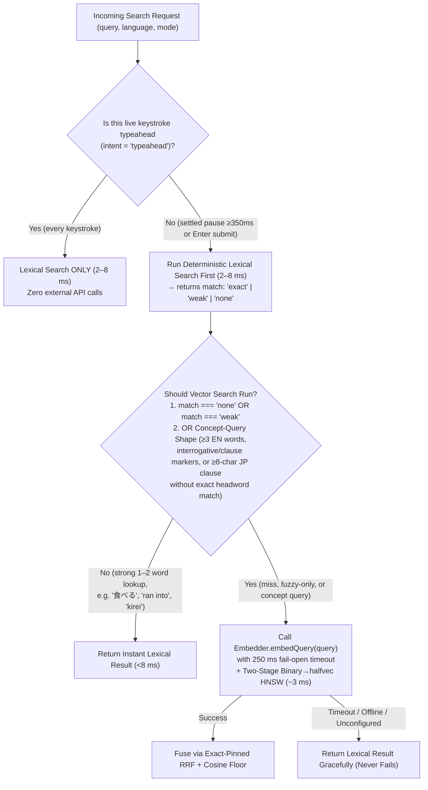

# Vector ("Semantic/Vibe") Search & `Ask Kotori` Grounding Architecture

> **Scope**: Primary-source investigation and concrete architectural design for Phase 2 of Kotori's dictionary search (cross-lingual EN↔JP semantic/"vibe" search in PostgreSQL + `pgvector`) and dictionary-grounded Retrieval-Augmented Generation (RAG) for `Ask Kotori` (`Asks`, `Coaching`, and multi-turn `Conversation`s). Built on Phase 1's settled single-Postgres architecture (`entries` JSONB + derived search projections, ~350,000 monolingual `Entry` documents, containerless `@electric-sql/pglite` tests, and 512 MB–1 GB early-beta hosting constraints).

---

## 0. Plain-English Conceptual Overview (No Jargon Required)

### Why Phase 1 Search Alone Cannot Answer "Vibe" Lookups

Phase 1 of Kotori's dictionary search is **deterministic lexical search**: it matches the letters, kana, rōmaji, grammatical inflections (`食べちゃった` → `食べる`, `"ran into"` → `"run into"`), substrings, and typos a learner types against the words (`Form`s) and short translations (`Gloss`es) stored in the dictionary. Lexical search is instantaneous (~2–8 ms in PostgreSQL) and exact—when a learner searches `食べる` or `"skate on thin ice"`, they get the exact `Entry` first every time.

However, intermediate and advanced learners constantly run into **reverse-dictionary ("tip-of-the-tongue" or "vibe") moments**, where they know the *situation, feeling, or social nuance* they want to express, not the words inside its dictionary definition:

- *"that awkward feeling when someone reads your message and doesn't reply"* → **`既読スルー`** (whose JMDict gloss is simply *"ignoring a message after reading it"*—zero overlap with *"awkward"*, *"feeling"*, or *"doesn't reply"*).
- *"politely turning down an invitation without saying no"* → **`ちょっと…`** / **`また今度`** / **`行けたら行く`**.
- *"saying yes in a way that actually means no thank you"* → **`結構です`** (Sense 2, carrying Kotori's `set_phrase` `Caution`).

At the same time, **`Ask Kotori`** (`Asks` and `Coaching`) currently calls Claude either with **lexical-only lookalikes** (`Asks.ts` / `judge.ts`) or **no dictionary context at all** (`Coaching.ts` `howToSay` and `naturalness`). Without semantic retrieval into Kotori's 350,000-entry dictionary:
1. A learner asking about a colloquial paraphrase can cause Claude to **draft a duplicate `Drafted entry`** when the real `Entry` already exists under a different wording.
2. `Coaching` answers rely purely on Claude's parametric memory instead of surfacing Kotori's verified **`Entry` IDs, `Labels`, `Usage` patterns, `Frequency` chips, and `Caution`s** (such as warning that `了解` is rude upward or contrasting `お疲れ様` vs. `ご苦労様`).

### Plain-English Glossary of Core Concepts Used in This Report

Before diving into primary-source benchmarks and byte-level math, here are the seven building blocks in plain English:

1. **Embeddings (Semantic Vectors)**:
   An AI model reads a piece of text (either a dictionary `Sense` or a learner's search query) and converts its *meaning* into a list of numbers—for example, 1,024 numbers like `[0.04, -0.11, 0.29, ...]`. Think of this list as **GPS coordinates on a map of meaning**. Cross-lingual embedding models place an English description (*"leaving someone on read"*) and its Japanese counterpart (`既読スルー`) right next to each other on that map, even though they share zero characters or words.
2. **Matryoshka Representation Learning (MRL / Dimension Reduction)**:
   Named after Russian nesting dolls, Matryoshka training teaches an embedding model to pack the most important semantic information into the *earliest* numbers of the list ([Kusupati et al., NeurIPS 2022][mrl-paper]). That lets you slice a 2,048- or 3,072-number vector down to its first **512 or 1,024 numbers**, cutting database storage by 50%–83% while keeping ~97%–99% of search accuracy.
3. **Quantization (`float32` → `halfvec` `float16` → Binary `bit`)**:
   Shrinking how many bits each coordinate number takes to store:
   - **`float32` (`vector`)**: Standard 32-bit decimal (4 bytes per number). Overkill for search similarity.
   - **`float16` (`halfvec`)**: Half-precision 16-bit decimal (2 bytes per number). Cuts RAM and disk in **half** with virtually **zero** loss in search accuracy ([`pgvector` 0.7+][pgvector-gh]).
   - **Binary Quantization (`bit`)**: Replaces each number with a single `0` or `1` bit (`1` if positive, `0` if negative — 8 numbers per byte!). Cuts vector size by **32×** compared to `float32` (and **16×** vs. `halfvec`), shrinking a 500,000-vector index down to ~200 MB of RAM.
4. **Two-Stage Binary Rescoring (Coarse-to-Fine Search)**:
   Alone, squashing numbers to single `0`/`1` bits loses ~3%–8% of search precision. Two-stage rescoring gets **both** tiny RAM and full accuracy:
   - **Stage 1 (In RAM)**: Quickly scan the tiny 1-bit index in RAM using bit-flip counting (*Hamming distance*) to grab the rough **top 80 candidates**.
   - **Stage 2 (From SSD)**: Read the 16-bit `halfvec` coordinates off SSD disk for *only those 80 rows* (<1 MB of disk reads, ~1–2 ms) and re-sort them accurately ([`pgvector` Binary Quantization][pgvector-gh]; [Voyage Binary Rescoring][voyage-35-blog]).
5. **HNSW (Hierarchical Navigable Small World) & Iterative Scans**:
   Checking a query against all 500,000 dictionary vectors one by one takes tens of milliseconds of CPU. **HNSW** is a multi-layer "expressway + local streets" graph index ([Malkov & Yashunin, TPAMI 2020][hnsw-paper]) that jumps across big semantic neighborhoods on top layers before zooming into nearby words on the bottom layer in ~1–3 ms. Because HNSW works best when its graph fits in RAM, shrinking the indexed vectors via quantization is what keeps Postgres hosting cheap. **Iterative scans** (added in [`pgvector` 0.8.0][pgvector-080]) tell Postgres to keep walking the graph if `WHERE` filters (such as `language = 'ja'` and `review_state != 'discarded'`) filter out early hits.
6. **PostgreSQL TOAST (*The Oversized-Attribute Storage Technique*)**:
   Postgres stores rows in 8 KB pages. When a row exceeds ~2 KB, Postgres automatically moves wide columns out of the main table into side storage chunks on disk called **TOAST**, reading them *only* when a query explicitly asks for that column ([PostgreSQL TOAST Docs][pg-toast]). Using this deliberately keeps large `halfvec` arrays off hot table pages until Stage-2 rescoring needs them.
7. **Reciprocal Rank Fusion (RRF) & Grounded Tool-Use ("Agentic") RAG**:
   - **RRF** is a simple, calibration-free formula (`1 / (60 + rank)`) for merging two ranked lists—such as lexical keyword rank #1, #2, #3 and semantic vector rank #1, #2, #3—without needing their raw scores to use the same scale ([Cormack et al., SIGIR 2009][rrf-paper]).
   - **Grounded RAG (Retrieval-Augmented Generation)**: Instead of letting an LLM answer from memory (and risk inventing readings or missing Kotori's `Caution`s), the backend retrieves real Kotori `Entry` records first ("pre-retrieval workflow") and gives Claude a bounded `search_dictionary` tool ("tool-use / agentic escape hatch") when a follow-up `Turn` explores new expressions—verifying every cited `EntryId` against Postgres before returning the response.

### Summary of Recommended Architectural Decisions

| Design Question | Recommended Choice | Why It Fits Kotori |
| :--- | :--- | :--- |
| **1. Embedding Model** | **Voyage `voyage-3.5` (`1024d`)** behind an `@kotori/ai` `Embedder` service *(fallback: OpenAI `text-embedding-3-large` at `1024d`)* | Purpose-built asymmetric query/document retrieval (`input_type`), quantization-aware training for binary rescoring, strong EN↔JP precision, **$0.06/1M** ($0.04/1M Batch; first 200M standard tokens free → **~$0–$1.80** to embed the entire dictionary). |
| **2. `pgvector` Storage & Index** | **Dedicated `entry_sense_vectors` table**: **Binary HNSW (`bit(1024)` `bit_hamming_ops`)** in RAM + **`halfvec(1024)` (`STORAGE EXTERNAL`)** on disk for top-80 rescore | Keeps the **entire 550k-vector HNSW index at ~260 MB** (vs. ~1.55 GB for `halfvec(1024)` HNSW or ~4.5 GB for `vector(1536)`), running comfortably on a **512 MB–1 GB Postgres instance** while recovering ~98–99% of full-precision recall. |
| **3. Embedding Granularity & Template** | **1 vector per distinct `Sense` (or merged near-identical sense cluster, ~500k–580k vectors)**; lexical `entry_search` stays **1 row per `Entry`** | Solves the polysemy trap (`かける`, `run`, `結構`) without bloating lexical search; embeds deterministic `entries.base` (`Form`s + POS + `Labels` + `Gloss`es + `Usage` notes) + approved `Caution`s, **excluding** volatile on-view example sentences/audio, keyed by `sha256(template)`. |
| **4. Hybrid Search Routing & Fusion** | **0 embedding calls on keystroke typeahead or strong short lexical matches**; trigger vector search only on `weak`/`none` lexical match or 3+ word / clause queries; merge via **Exact-Match-Pinned RRF (`k = 60`) + cosine ceiling** | Preserves **2–8 ms** deterministic dictionary lookups for 85%+ of queries, insulates search from external API outages (`250 ms` fail-open timeout), and guarantees semantic neighbors (`飲む`) never outrank exact matches (`食べる`). |
| **5. `Ask Kotori` Grounding Architecture** | **Hybrid Pre-Retrieval Workflow + Bounded Dictionary Tools (`maxSteps = 2`) + Deterministic Post-Verification** | Prevents duplicate `Drafted entry` creation via pre-Claude hybrid retrieval + post-draft vector/form check; grounds `how-to-say`, `naturalness`, and multi-turn `Conversation` `Turn`s in real Kotori `Entry` dossiers (`EntryId`, `Labels`, `Usage`, `Caution`s, `Frequency`) with zero hallucinated links. |

---

## 1. Multilingual EN↔JP Embeddings & `pgvector` Quantization (Keeping RAM Tiny)

### 1.1 Cross-Lingual EN↔JP Embedding Model Comparison

Kotori's semantic search is inherently **asymmetric and cross-lingual**:
- A **Japanese learner** types a multi-word English concept description (*"awkward silence after someone reads your message"*) to retrieve a Japanese `Entry` (`既読スルー`).
- An **English learner** types a Japanese situational description (*"会議を別の日に変えたいとき自然に言う表現"*) to retrieve an English phrasal verb (`push back`, `rain check`, `reschedule`).
- Or a learner searches **monolingually** by paraphrase (*"既読無視"* → `既読スルー`).

We evaluated the five leading commercial cross-lingual embedding families against primary provider documentation and retrieval benchmarks (**MIRACL** — Zhang et al., TACL 2023 human-annotated retrieval across 18 languages including Japanese ([MIRACL Paper][miracl-paper]); and **MMTEB** — Enevoldsen et al., 2025 Massive Multilingual Text Embedding Benchmark ([MMTEB Paper][mmteb-paper])):

| Model | Dimensions & Matryoshka (MRL) | Asymmetric Prefix / `input_type` | Native Quantization Awareness | Price per 1M Tokens (Standard / Batch) | Full Corpus Cost (~40M tokens / 550k senses) | Cross-Lingual EN↔JP Quality & Operational Notes |
| :--- | :--- | :--- | :--- | :--- | :--- | :--- |
| **Voyage `voyage-3.5`** *(Recommended)* | `1024` default; MRL **`2048, 1024, 512, 256`** ([Voyage Docs][voyage-emb]) | **Yes**: `input_type: "query"` vs `"document"` ([Voyage Docs][voyage-emb]) | **Yes** (QAT trained for `float`, `int8`, `binary` + rescoring) ([Voyage 3.5 Blog][voyage-35-blog]) | **$0.06** / **$0.04** Batch (33% off; **first 200M standard tokens free**) ([Voyage Pricing][voyage-pricing]; [Voyage Batch][voyage-batch]) | **$0.00** (free tier) or **$1.60** (Batch) | Outperforms `text-embedding-3-large` by **+8.26%** avg across 100 datasets including 62 multilingual retrieval sets across 26 languages ([Voyage 3.5 Blog][voyage-35-blog]). Explicit binary-rescoring training recovers +6.38% over raw 1-bit search. |
| **Voyage `voyage-3.5-lite`** | `1024` default; MRL **`2048, 1024, 512, 256`** ([Voyage Docs][voyage-emb]) | **Yes**: `input_type: "query"` vs `"document"` | **Yes** (`float`, `int8`, `binary`) | **$0.02** / **~$0.013** Batch (**first 200M tokens free**) ([Voyage Pricing][voyage-pricing]) | **$0.00** (free tier) or **$0.54** (Batch) | Lowest-latency (~30–60 ms), ultra-cheap option that still beats `text-embedding-3-large` on average multilingual retrieval in Voyage's eval suite ([Voyage 3.5 Blog][voyage-35-blog]), though ~2–3 pts behind full `voyage-3.5` on subtle idioms. |
| **Voyage `voyage-multilingual-2`** | Fixed `1024` (no MRL truncation) ([Voyage Docs][voyage-emb]) | **Yes**: `input_type: "query"` vs `"document"` | `float` only | **$0.12** / **$0.08** Batch ([Voyage Pricing][voyage-pricing]) | **~$3.20** (Batch) | Previous-gen multilingual specialist; superseded on cost ($0.06 vs $0.12), MRL flexibility, and binary quantization accuracy by **`voyage-3.5`** ([Voyage 3.5 Blog][voyage-35-blog]). |
| **OpenAI `text-embedding-3-large`** *(Strong Runner-Up)* | `3072` default; MRL **`256–3072`** via `dimensions` (L2-normalized by API) ([OpenAI Docs][openai-emb]) | **No** (symmetric input; optional manual text prefix) | Post-hoc only (not QAT trained for 1-bit) | **$0.13** / **$0.065** Batch (50% off) ([OpenAI Pricing][openai-pricing]) | **$2.60** (Batch) | **54.9% MIRACL** multilingual score (up from 31.4% `ada-002` and **44.0%** `3-small`) ([OpenAI Emb Announcement][openai-miracl]). Rock-solid uptime and Batch API, but weaker than `voyage-3.5` / `gemini-embedding-001` on non-English tasks and loses more recall under 1-bit quantization without QAT. |
| **Google `gemini-embedding-001`** | `3072` default; MRL **`128–3072`** (`768`, `1536` recommended) ([Gemini Emb Docs][gemini-emb]) | **Yes**: `taskType: "RETRIEVAL_QUERY"` vs `"RETRIEVAL_DOCUMENT"` + `title` field ([Gemini Emb Docs][gemini-emb]) | Post-hoc (`halfvec` / `bit` in DB) | **$0.15** / **$0.075** Batch (50% off) ([Gemini Pricing][gemini-pricing]) | **$3.00** (Batch) | Top-tier **68.4 MMTEB** Multilingual mean score across 100+ languages ([Google Blog][gemini-blog]). **Gotcha**: max **2,048 input tokens**, and truncated dimensions (`< 3072`, e.g. `768` or `1024`) are **not** returned unit-normalized—caller **must L2-renormalize** in TypeScript before storing ([Gemini Emb Docs][gemini-emb]). |
| **Cohere `embed-v4.0`** *(and `embed-multilingual-v3.0`)* | `1536` default (`v4`); MRL **`256, 512, 1024, 1536`** (`v3`: fixed `1024`) ([Cohere Docs][cohere-emb]) | **Yes**: `input_type: "search_query"` vs `"search_document"` ([Cohere Docs][cohere-emb]) | **Yes**: native `float`, `int8`, `binary`, `ubinary` `embedding_types` ([Cohere Docs][cohere-emb]) | **$0.12** text ([Cohere Pricing][cohere-pricing]) | **~$4.80** | Strong enterprise multilingual + multimodal (128k context) with native binary quantization training, though multimodal image weights add overhead Kotori doesn't need and standard text cost is 2× `voyage-3.5`. |

#### Three Primary-Source Nuances That Matter in Implementation

1. **Why asymmetric `input_type` matters for dictionary search**:
   In dictionary concept search, the query (`"polite way to decline an invitation"`) is an informal learner question, while the indexed document (`"ちょっと (adv, exp) [col]: (used to trail off and decline politely) a bit; rather..."`) is a structured lexicographic entry. Symmetric embeddings encourage lexical/structural similarity (matching questions to questions), whereas asymmetric models (`voyage-3.5` `input_type: "query" | "document"`, `gemini-embedding-001` `RETRIEVAL_QUERY | RETRIEVAL_DOCUMENT`, `cohere` `search_query | search_document`) prepend distinct learned task projections at encode time so short situational queries project onto dense definitions ([Voyage Docs][voyage-emb]; [Gemini Emb Docs][gemini-emb]).
2. **Why Quantization-Aware Training (QAT) matters if using Binary HNSW**:
   Standard post-hoc sign binarization ($\text{bit}_i = \mathbb{1}[x_i > 0]$) on models not trained for binary space (`text-embedding-3-large` truncated to `512d`) suffers noticeable anisotropy/recall drop unless oversampled heavily ($4\times\text{–}8\times$). Models trained explicitly with quantization-aware Matryoshka objectives (`voyage-3.5` and `cohere embed-v4.0`) preserve angular geometry across signs at `1024d` and `512d`, recovering **~98%–99%+** of `float32` NDCG@10 when Stage-1 binary candidates (`top 80–100`) are rescored with `halfvec` ([Voyage 3.5 Blog][voyage-35-blog]; [Cohere Quantization Docs][cohere-emb]).
3. **Interactive Query Latency**:
   Single short-string query embedding (`10–40` tokens) over keep-alive HTTPS (`HTTP/2`) typically completes in **~35–75 ms p50** (`~90–160 ms p95`) for `voyage-3.5-lite` / `voyage-3.5` / `text-embedding-3-large` from US-Central (`ord`, Kotori's Fly.io region in `fly.toml`). Because 40–150 ms is invisible on an intentional `Enter` submit or `Ask Kotori` turn—but painfully noticeable on every keystroke—§3 gates query-time embedding strictly away from keystroke typeahead.

> **Model Verdict**: Wrap embedding generation behind a tiny `@kotori/ai` `Embedder` Effect service (`embedQuery(text)` / `embedDocuments(texts)`), defaulting to **`voyage-3.5` at `output_dimension: 1024`** (storing the model + dimension string on the vector metadata or config so re-indexing is explicit). Keep **`text-embedding-3-large` (`dimensions: 1024`)** or **`gemini-embedding-001` (`outputDimensionality: 768` or `1024` + L2 normalize)** as a one-file adapter swap.

---

### 1.2 `pgvector` (`0.7` / `0.8`) Storage, Quantization & Exact RAM Math

Let's verify exact byte layouts directly from [`pgvector` source & docs (`0.7.0` / `0.8.0`)][pgvector-gh] and [PostgreSQL 17/18 Page & TOAST Internals][pg-toast] to guarantee semantic search will not blow up a **512 MB–1 GB** PostgreSQL instance.

#### Byte-Level Vector Payload Sizes (Dimension $d$)

In `pgvector`:
- **`vector(d)` (`float32`)**: $4d + 8\text{ bytes}$ (`4 B` Postgres `varlena` header + `2 B` `dim` + `2 B` `unused`).
  - At $d = 1024$: **$4,104\text{ bytes}$**; at $d = 1536$: **$6,152\text{ bytes}$**.
- **`halfvec(d)` (`float16`, added in `pgvector 0.7.0`)**: $2d + 8\text{ bytes}$, supporting HNSW up to $4,000$ dimensions (`halfvec_cosine_ops`) ([`pgvector` 0.7.0][pgvector-070]).
  - At $d = 512$: **$1,032\text{ bytes}$**; at $d = 1024$: **$2,056\text{ bytes}$**.
- **`bit(d)` (`PostgreSQL varbit/bit`, indexed via `bit_hamming_ops` in `pgvector 0.7.0+`)**: $\lceil d / 8 \rceil + 8\text{ bytes}$ (`4 B` `varlena` header + `4 B` bit length), supporting HNSW up to $64,000$ bits via Hamming distance `<~>` ([`pgvector` Binary Quantization][pgvector-gh]).
  - At $d = 512$: **$72\text{ bytes}$**; at $d = 1024$: **$136\text{ bytes}$** (**15.1× smaller** than `halfvec(1024)`, **30.2× smaller** than `vector(1024)`!).

#### Exact On-Disk / Buffer-Cache HNSW Index Size Formula (`m = 16`)

In `pgvector`'s HNSW implementation (`src/hnsw.h`), every indexed row writes two index tuples into 8,192-byte Postgres pages:
1. **`HnswElementTupleData`**: The vector payload itself + `heaptids[10]` (`10 × 6 B = 60 B` heap TIDs for HOT-update resilience) + level/deleted metadata + Postgres `IndexTupleData` & line-pointer overhead ($\approx \text{vector\_bytes} + 84\text{ B}$).
2. **`HnswNeighborTupleData`**: Layer-0 neighbor list ($2M = 32$ `ItemPointerData` links $\times 6\text{ B} = 192\text{ B}$) + geometric upper-layer links ($\frac{M}{M-1}$ decay adds ~2 links avg) + tuple/line-pointer header ($\approx 230\text{ B}$ total at default `m = 16`).
3. **8 KB Page Packing & Alignment Slack**: Each 8,192-byte page carries `24 B` page header + `16 B` `HnswPageOpaqueData` = `8,152 B` usable. Large element tuples suffer quantization slack when packing into `8,152 B` (e.g., `2,140 B` element tuples fit only 3 per page $\implies 21\%$ slack; `220 B` `bit(1024)` element tuples fit 37 per page $\implies <2\%$ slack, plus ~10% HNSW page split/free-space slack).

Applying this exact page-packing math across **350k** (1 per `Entry`), **500k** (sense-clustered), and **600k** (1 per `Sense`) rows at `m = 16`:

| Storage & Index Strategy | Bytes / Row in HNSW Index | **HNSW Index Size (`350k` / `500k` / `600k` rows)** | **Table + TOAST Vector Disk (`350k` / `500k` / `600k`)** | Min Safe Postgres Instance RAM | Recall vs. `float32` |
| :--- | :--- | :--- | :--- | :--- | :--- |
| **`vector(1536)` (`float32`) HNSW** *(Anti-pattern)* | ~8,192 B *(1 elem/page!)* | **2.87 GB / 4.10 GB / 4.92 GB** | 2.15 GB / 3.08 GB / 3.69 GB | **8 GB+ RAM** | 100% (baseline) |
| **`halfvec(1024)` (`float16`) HNSW** | ~2,960 B | **1.04 GB / 1.48 GB / 1.78 GB** | 0.72 GB / 1.03 GB / 1.23 GB | **2–4 GB RAM** | ~99.8% |
| **`halfvec(512)` (`float16`) HNSW** | ~1,400 B | **490 MB / 700 MB / 840 MB** | 0.36 GB / 0.52 GB / 0.62 GB | **1–2 GB RAM** *(tight on 512 MB)* | ~98.5% |
| **Two-Stage: `bit(1024)` Hamming HNSW + `halfvec(1024)` Disk Rescore** *(Recommended)* | **~495 B** *(HNSW holds `bit(1024)` only!)* | **173 MB / 248 MB / 297 MB** | **0.77 GB / 1.10 GB / 1.32 GB** *(cold on SSD; <640 KB read/query!)* | **512 MB – 1 GB RAM** | **~98.5%–99.2%** *(at top-80 rescore)* |
| **Ultra-Tiny Two-Stage: `bit(512)` Hamming HNSW + `halfvec(512)` Disk Rescore** | **~420 B** | **147 MB / 210 MB / 252 MB** | **0.39 GB / 0.55 GB / 0.66 GB** *(cold on SSD)* | **512 MB RAM** | ~97.5%–98.5% |

#### Why Two-Stage Binary HNSW + `halfvec` Disk Rescoring Wins for Kotori

Look at the memory physics on a **512 MB or 1 GB** PostgreSQL instance (where `shared_buffers` is typically `128 MB–256 MB` and the Linux page cache holds another `200 MB–500 MB`, shared with `entries`, `entry_search` GIN indexes, users, and `Notebook` SRS tables):

1. **HNSW is random-access; Stage-2 rescoring is bounded point-lookup**:
   During an HNSW graph walk (`ef_search = 64` or `100`), Postgres jumps across ~800–1,500 graph nodes per query. If the HNSW index exceeds available RAM (`1.48 GB` for `halfvec(1024)` on a 1 GB host), every query thrashes random disk pages and latency spikes from `2 ms` to `80–300 ms`.
   With **`bit(1024)` `bit_hamming_ops`**, the **entire 500,000-sense HNSW graph is 248 MB** (173 MB at 350k)—fitting right inside OS page cache / `shared_buffers` even on a small 1 GB instance (and `bit(512)` at 147–210 MB fits even on 512 MB!). CPU distance computation uses hardware `POPCNT` instructions over two `uint64`s (16× faster than SIMD float16 dot products).
2. **Stage-2 `halfvec` rescoring never needs its column cached in RAM**:
   Once the in-memory `bit(1024)` HNSW scan returns the top $K_{\text{coarse}} = 80$ candidate IDs, Postgres fetches `halfvec(1024)` for **only 80 rows**:
   $$80 \text{ rows} \times 8\text{ KB page} = \mathbf{640\text{ KB max random SSD read}} \quad (\approx \mathbf{0.8\text{–}2.5\text{ ms}}\text{ on cloud NVMe}).$$
   The 1.1 GB of `halfvec(1024)` vectors sits peacefully on cheap SSD storage ($0.10–$0.15/GB-month ≈ **$0.15/mo**!) without pressuring RAM.

#### Crucial PostgreSQL TOAST & Table-Isolation Trap (and How to Avoid It)

A subtle PostgreSQL storage rule trips up many `pgvector` deployments ([PostgreSQL TOAST Internals][pg-toast]):
- PostgreSQL's `TOAST_TUPLE_THRESHOLD` is **~2,000 bytes** (`MaxHeapTupleSize / 4`).
- If you add `embedding halfvec(512)` (`1,032 B`) directly onto `entry_search`, **1,032 bytes is below the 2 KB TOAST threshold**—so Postgres stores the vector **inline on the main `entry_search` heap pages**! Even `halfvec(1024)` (`2,056 B`) defaults to `STORAGE EXTENDED`, where Postgres first burns CPU trying `pglz`/`lz4` compression on incompressible floating-point mantissas before TOASTing.
- Storing vectors inline on `entry_search` makes every lexical search row 3–4× wider, evicting hot lexical heap pages from `shared_buffers` with cold vector bytes.

**The Clean Fix (Zero Heap Pollution + Zero Wasted TOAST Reads)**:
1. **Keep `entry_search` (lexical) 100% vector-free** and put vectors in a separate derived table **`entry_sense_vectors`**.
2. Set **`ALTER TABLE entry_sense_vectors ALTER COLUMN embedding SET STORAGE EXTERNAL;`** ([PostgreSQL `ALTER TABLE SET STORAGE`][pg-toast]):
   - `EXTERNAL` disables futile CPU compression on float16 bytes and allows out-of-line TOAST storage whenever row width crosses `TOAST_TUPLE_TARGET` (~2 KB)—which `halfvec(1024)` (`2,056 B`) + `bit(1024)` (`136 B`) + `entry_id` + tuple header (`~2,240 B`) crosses automatically!
   - Consequently, the main heap of `entry_sense_vectors` holds only scalar filter columns (`id`, `entry_id`, `sense_index`, `language`, `review_state`, `embedding_bit` `136 B`, and an `18 B` TOAST pointer ≈ **200 bytes/row**, ~100 MB total!).
3. **Two-step self-join so filtered HNSW scans never touch TOAST for rejected rows**:
   In PostgreSQL, an out-of-line TOAST pointer is **never dereferenced unless that column is projected**. By selecting only `id` inside the inner HNSW `LIMIT 80` CTE and joining back on `id` in the outer query to compute `embedding <=> $qvec`, any rows inspected and discarded by `WHERE language = $1 AND review_state != 'discarded'` during HNSW's iterative scan read only the compact 200-byte main heap tuple—zero TOAST I/O until the final 80 winners!
4. **Enable `pgvector 0.8.0` Iterative Index Scans**:
   Because `entry_sense_vectors` holds both Japanese (~65%) and English (~35%) vectors plus occasional `discarded` `Drafted entry` rows, a single HNSW index across the table filters out ~35%–65% of visited graph nodes on every query. Setting **`SET LOCAL hnsw.iterative_scan = relaxed_order;`** inside the search transaction ([`pgvector` 0.8.0 Release Notes][pgvector-080]) ensures HNSW never returns fewer than 80 candidates when searching the smaller English partition, without needing separate partial HNSW indexes per language (though partial HNSW indexes `WHERE language = 'ja' AND review_state != 'discarded'` and `WHERE language = 'en' AND review_state != 'discarded'` are also tiny—~160 MB + ~85 MB—and eliminate filter overhead altogether!).
   > **Bonus Optimization — Partial HNSW Indexes by Language**: Creating **two partial HNSW indexes** (`WHERE language = 'ja' AND review_state != 'discarded'` and `WHERE language = 'en' AND review_state != 'discarded'`) takes the **exact same total RAM** ($160\text{ MB} + 88\text{ MB} = 248\text{ MB}$) because the row sets are disjoint, while making every query within `ja` or `en` **100% pre-filtered inside the HNSW graph** with zero wasted node visits! Keep `hnsw.iterative_scan = relaxed_order` enabled anyway for future filters.

#### Local Test Note for `@electric-sql/pglite` in Kotori

We inspected Kotori's installed `@electric-sql/pglite@0.5.11` (`node_modules/@electric-sql/pglite/package.json` via `@effect/sql-pglite@4.0.3`):
- `pg_trgm` and `fuzzystrmatch` ship directly inside `@electric-sql/pglite/contrib/*`.
- `pgvector` (`vector` extension, supporting `halfvec` and `bit_hamming_ops`) is distributed in the companion WASM package **`@electric-sql/pglite-pgvector`** (matched to the `@electric-sql/pglite` version) and passed via `new PGlite({ extensions: { vector } })` ([PGlite Extensions Docs][pglite-ext]). Adding `@electric-sql/pglite-pgvector` to `devDependencies` preserves 100% zero-Docker, in-process SQL parity in `pnpm test`!

---

## 2. Dictionary Embedding Recipe (Entry-Level vs. Sense-Level & Text Formatting)

### 2.1 The Polysemy Trap: 1 Vector per `Entry` vs. 1 Vector per `Sense`

#### Why Single-Vector Entry Averaging Fails on Core Vocabulary

High-frequency verbs, adjectives, and conversational expressions—the very words intermediate learners struggle to use idiomatically—are heavily **polysemous** (one `Entry` carries many unrelated `Sense`s):
- Japanese **`かける`** (`掛ける` / `架ける` / `懸ける`) has **25+ senses** in JMDict: *to hang on a wall*, *to put on glasses*, *to make a phone call*, *to pour/sprinkle (soy sauce)*, *to spend (time/money)*, *to cause trouble (`迷惑をかける`)*, *to play music*, *to multiply*, *to pun (`言葉遊び`)*.
- Japanese **`結構`** has *splendid/fine*, *no thank you (polite refusal)*, and *fairly/quite*.
- Japanese **`抱く`** has *to hug/embrace*, *to harbor (a feeling/doubt)*, and *to sleep with someone* (Kotori's canonical sense-scoped `Caution` in `dictionary-enrichment-model.md`).
- English **`run`**, **`take`**, **`set`**, **`get`**, and **`break`** each span **20–45 senses**.

Both theoretical retrieval analysis ([Luan et al., TACL 2021 — *Sparse, Dense, and Attentional Representations for Text Retrieval*][luan-tacl]) and Word Sense Disambiguation literature ([Blevins & Zettlemoyer, ACL 2020 — *Gloss-Informed Bi-Encoders*][blevins-acl]) demonstrate that **a single fixed-dimension bi-encoder vector acts as a weighted centroid of the concepts in its input text**, biased heavily toward the first/longest span:
- When 25 senses of `かける` are concatenated into one `Entry` document, the resulting embedding sits in an averaged "general action verb" region of vector space—far away from *"sprinkle sauce over rice"* or *"apologize for causing someone inconvenience"*.
- Worse, rare idiomatic tail senses (often senses #5–#15) suffer catastrophic recall loss compared to single-sense entries.

#### Sizing Reality Check: Sense-Level Is Only ~1.55× Larger Than Entry-Level!

In lexicographic corpora (JMDict ~210k entries + English Wiktionary/curated ~100k–140k entries), sense counts follow a steep Zipfian distribution:
- **~74%–78% of `Entry` records have only 1 `Sense`** (~265k entries → 265k vectors).
- **~14%–16% have 2 `Sense`s** (~52k entries → 104k vectors).
- **~8% have 3+ `Sense`s** (~33k entries × ~4.8 avg senses → ~158k vectors).
- **Total across ~350,000 `Entry` rows**: **~525,000–580,000 `Sense` rows** (or **~460,000–500,000** if adjacent senses with >80% token overlap or identical POS+domain are clustered).

Let's compare the three granularity options directly:

| Criterion | Option A: **1 Vector per `Entry`** (~350k rows) | Option B: **Sense-Clustered** (~470k rows) | Option C: **1 Vector per `Sense`** (~550k rows) *(Recommended)* |
| :--- | :--- | :--- | :--- |
| **Binary HNSW RAM (`bit(1024)`)** | ~173 MB | ~233 MB | **~272 MB** (`bit(512)`: **~231 MB**) |
| **One-Time Batch Embed Cost (`voyage-3.5`)** | ~$1.20 ($0 free tier) | ~$1.50 ($0 free tier) | **~$1.75** ($0 free tier) |
| **Polysemous Recall (`かける`, `結構`, `抱く`, `run`)** | **Poor** on senses #3+ (centroid dilution) | **High** (requires heuristic clustering logic to maintain) | **Best-in-class** (every distinct `Sense` occupies its own sharp point in vector space) |
| **UI & `Ask Kotori` Precision** | Returns `EntryId` only; UI shows first 3 glosses even if Sense #7 matched! | Returns cluster ID; needs mapping back to senses | **Returns `(entry_id, sense_index)`**! Search cards & `Ask Kotori` can preview the **exact matching `Sense`** (and its sense-scoped `Caution`!) |
| **Content-Hash Incremental Updates** | Any edit to 1 sense re-embeds the whole `Entry` | Cluster logic must re-run on edits | **Simple 1:1 `(entry_id, sense_index)` deterministic mapping** |

> **Granularity Verdict**: Keep lexical `entry_search` **1 row per `Entry`** (so fast deterministic word/inflection queries never pay multi-row `GROUP BY` deduplication overhead), and make `entry_sense_vectors` **1 row per `Sense` `(entry_id, sense_index)`** (~550k rows, ~272 MB Binary HNSW RAM). When a learner searches *"politely saying no thank you"* and matches `結構` **Sense 2**, Kotori knows `sense_index = 1` matched—allowing the search summary card and `Ask Kotori` to highlight Sense 2's gloss (*"no thank you; quite enough"*) instead of confusing the learner with Sense 1 (*"splendid; nice"*).

---

### 2.2 Deterministic Embedding Text Template (`entries.base` + Approved Nuance vs. Volatile `enrichment`)

#### What to Include vs. Exclude (Avoiding Re-Embedding Churn)

Per Phase 1's architecture and [`dictionary-enrichment-model.md`](../specs/dictionary-enrichment-model.md), Kotori separates dictionary data into two lifecycles:
1. **Deterministic & Curated Facts** (`entries.base` + committed `data/*.jsonl` passes + admin-approved `Drafted entry` / `Caution` / `Usage` edits):
   - `Form`s (kanji headword, common alternative spellings, kana reading — omit search-only misspellings tagged `sK`/`sk`).
   - Part-of-speech names (`exp`, `v1`, `n`, expanded to human words like `"expression"`, `"verb"`—embeddings understand `"expression, casual slang"` far better than raw JMDict codes `"exp, col, net-sl"`!).
   - Sense `Labels` expanded to natural English/Japanese descriptors (e.g., `hon` → `"respectful keigo"`, `hum` → `"humble keigo"`, `col` → `"casual conversational"`, `wasei` → `"wasei-eigo (Japanese-coined English)"`, `rude_upward` / `derog` / `sl` / `net-sl`).
   - Sense `Gloss`es + JMDict `s_inf` / Wiktionary `info` usage notes (`"usu. to one's subordinate"`, `"used to decline politely"`).
   - **Approved `Usage` patterns & `Caution`s** (both word-level `sense IS NULL` and sense-scoped `sense = sense_index`): **Include these!** Consider why: JMDict's bare gloss for `了解` is `"comprehension; consent; roger"`. Without Kotori's `rude_upward` `Caution` (*"Avoid saying 了解です to superiors or clients; use 承知しました or かしこまりました"*), a learner searching *"saying understood to your boss"* or *"casual roger/got it in messages"* misses the crucial pragmatic link. Because offline `data/cautions/*.jsonl` and `data/labels/*.jsonl` passes only change on deliberate CLI commits (not on learner page views!), including them causes **zero runtime churn**.
2. **Volatile On-View Worker `enrichment`** (learner-triggered Claude example sentences & ElevenLabs audio clips):
   - **Exclude completely from embeddings.** Example sentences are generated lazily when learners view entries (`requestEnrichment` in `Dictionary.ts`). Including them would create inconsistent vector geometry between viewed and unviewed entries and trigger paid embedding API calls inside the background worker.

#### Contextual Bilingual Sense Template (Inspired by Anthropic Contextual Retrieval)

Following [Anthropic's Contextual Retrieval][anthropic-contextual] finding that prepending concise document-level identity + disambiguating context to each chunk cuts retrieval failure rates by **35%–49%**, every `Sense` template anchors the sense with its parent `Entry`'s written forms, language, register labels, glosses, and usage/cautions in clean natural prose (human-readable labels rather than opaque tag codes):

**For a Japanese `Entry` (`language = 'ja'`, Sense $i$)**:
```text
Japanese expression: 既読スルー (きどくスルー) | Also written: 既読無視
Part of speech: noun, suru verb, expression | Register & usage tags: internet slang, colloquial
Meaning (Sense 1): ignoring a message after reading it; leaving someone on read (in messaging apps)
Usage & nuance: Used when a recipient opens a chat message (showing a "Read" / 既読 receipt) and does not reply.
```

**For a Polysemous Sense with a Sense-Scoped `Caution` (`結構`, Sense 2)**:
```text
Japanese expression: 結構 (けっこう)
Part of speech: na-adjective, adverb, expression | Register & usage tags: polite conversational set phrase
Meaning (Sense 2): no thank you; I've had enough; not necessary; fine without it
Usage & nuance: Often as 結構です to decline an offer politely. Caution (set phrase): Depending on context, 結構です can mean either "Yes, that's fine" or "No, thank you"—listen to intonation and whether something is being offered.
```

**For an English `Entry` (`language = 'en'`, Sense $i$ — Bilingual JP+EN Template)**:
```text
English expression: rain check | Part of speech: noun, idiom | Register & usage tags: casual conversational
Meaning (Sense 1 — 日本語の意味): また今度にする約束、延期、都合が悪くなったときの丁寧な断り文句
Usage & nuance: Used as "take a rain check" to politely decline an invitation while showing you want to do it another time.
```

> **Why include English headwords + Japanese `Gloss`es + short English `Usage` on `en` entries?** Because `en` entries are searched by **English learners** (native Japanese speakers who may describe a concept in Japanese *or* type partial English words), while `Ask Kotori` may also cross-link counterparts. Using ~45–90 tokens per sense means **550,000 senses = ~36M tokens total** (**$0.00** on Voyage's 200M free tier, or **$1.44** via Voyage Batch API!).
>
> **Content-Hash Idempotency**: Store `content_hash text NOT NULL` (`sha256(model_id + "\0" + template)` truncated to 16 bytes / 32 hex chars) on `entry_sense_vectors`. On `kotori dictionary import` or `kotori vectors sync`, SQL diffs `content_hash` and sends **only new or changed senses** to the Batch/Realtime API—making 99.9% of re-imports free and instantaneous.

---

## 3. Smart Hybrid Query Routing & Score Fusion (Zero Latency Penalty on Normal Lookups)

### 3.1 Gating the Embedding API: When to Embed vs. When to Skip Completely

A round-trip to an external embedding API (`voyage-3.5` / `text-embedding-3-large`) takes **~40–150 ms**, costs money/rate-limit quota per call, and introduces an external network dependency. Meanwhile, Kotori's deterministic Postgres lexical search completes in **~2–8 ms** with zero external dependencies.

Calling an embedding API on every search request would make normal dictionary lookups **10×–30× slower** for zero benefit when someone types `食べる`, `taberu`, `食べちゃった`, or `run into`. Instead, Kotori should route dictionary queries through a **3-tier deterministic gate**:



#### Exact Deterministic Gate Rules (`shouldRunSemanticSearch`)

After `normalizeAsk` / NFKC trimming and running Phase 1 lexical search (~3 ms):
1. **Never embed** if:
   - `intent === "typeahead"` (keystroke-by-keystroke input before debounce/submit), OR
   - `turnAway(query, language) !== null` (keyboard mash `asdkjhqwe`, pure numbers `12345`, emoji-only, single ASCII letter — reusing Kotori's existing `garbage.ts`!), OR
   - `query.length < 2` (for CJK) or `< 3` (for ASCII).
2. **Skip embedding (return lexical immediately in <8 ms)** when:
   - Lexical `match === "exact"` **AND** the query looks like a lexical lookup rather than a prose description:
     - **ASCII / English**: $\le 2$ words (or an exact multi-word `Form` / idiom match like `"skate on thin ice"`, `"it is what it is"`) and does not start with question/concept prefixes (`"how to"`, `"what do you call"`, `"way to"`, `"feeling when"`, `"word for"`).
     - **Japanese**: Exact or deinflected `Form` match (`食べる`, `食べさせられた`, `既読スルー`) or $\le 6$ characters with strong `Gloss` match.
3. **Run semantic embedding (`Embedder.embedQuery`, bounded by `Effect.timeoutOption("250 millis")`)** when:
   - Lexical `match === "none"` or `match === "weak"` (only relaxed word-dropped hits or fuzzy trigram guesses survived), **OR**
   - Query has **Concept-Query Shape**: $\ge 3$ English words without an exact multi-word `Form` hit (e.g., *"politely decline an invitation"*, *"read message without replying"*), or a Japanese descriptive clause ($\ge 8$ chars containing particles like `とき` / `こと` / `気持ち` / `言い方` / `表現` without an exact `Form` match).

#### Progressive UX Option (Zero Perceived Latency Even When Embedding Runs)

Because deterministic lexical search finishes in ~5 ms while `embedQuery` + HNSW takes ~50–120 ms:
- On settled/submitted queries where lexical `match === "none"`, waiting ~60–110 ms to return semantic hits directly in `Dictionary.search` feels completely instantaneous to a human (<150 ms perceptual threshold) and requires **zero HTTP contract churn**.
- On queries that have `exact` 1–2 word hits *plus* potential conceptual siblings (or if a learner clicks *"Search by meaning"*), the UI can render lexical hits immediately and fetch/display a labeled **`意味が近い表現` / `"Related by meaning"`** section underneath so learners always know *why* a conceptual result (`既読スルー`) matched a phrase that doesn't literally contain their words.
- **LRU Query Embedding Cache**: Cache normalized `(language, query) → halfvec(1024)` in an in-memory 5,000-entry LRU (~10 MB RAM in the Node `api` process) or Postgres table. Repeated searches cost **0 ms and $0**.

---

### 3.2 Combining Lexical Scores with Vector Similarity in PostgreSQL

How should PostgreSQL combine Phase 1's deterministic lexical scores (`formScore`, `glossScore`, `ts_rank_cd`) with `pgvector` cosine distance (`embedding <=> $qvec`)?

#### Comparing the Three Fusion Strategies

| Strategy | Formula / Mechanism | Failure Mode on Dictionary Lookups | Verdict |
| :--- | :--- | :--- | :--- |
| **1. Raw Weighted Linear Score Fusion** | $\alpha \cdot \text{norm}(\text{lex\_score}) + (1 - \alpha) \cdot (1 - \text{cosine\_dist})$ | **Fragile & model-dependent**: Kotori's lexical scores in `search.ts` span `20` to `1,000+` across discrete tiers, whereas cosine similarity (`1 - dist`) clusters tightly in `[0.42, 0.72]` for `voyage-3.5` and `[0.30, 0.65]` for `text-embedding-3-large`. Tuning $\alpha$ breaks whenever the embedding model changes, and high cosine scores (`0.70`) on an antonym (`飲む` / `食べる`, which share context!) can leapfrog exact lexical senses. | **Avoid** |
| **2. Pure Thresholded Fallback** | Use vector search *only* when lexical returns `0` rows | **Misses multi-word concept queries with weak lexical noise**: Searching *"polite way to say no"* matches lexical glosses containing `"polite"` (`丁寧`) and `"no"` (`いいえ`), returning mediocre literal words while blocking `結構です` and `ちょっと…` completely! | **Too narrow** |
| **3. Exact-Tier-Pinned Reciprocal Rank Fusion (RRF, $k=60$) + Cosine Distance Ceiling** *(Recommended)* | Pin Tier-1 exact/inflected `Form` & exact whole-`Gloss` matches (`strong = true`) on top; fuse remaining lexical candidates ($r_{\text{lex}}$) and Stage-2 rescored vector candidates ($r_{\text{vec}}$) via $\frac{w_{\text{lex}}}{60 + r_{\text{lex}}} + \frac{w_{\text{vec}}}{60 + r_{\text{vec}}}$, subject to $\text{cosine\_dist} \le \tau_{\max}$ | **None**: Scale-free across embedding models ([Cormack et al., SIGIR 2009][rrf-paper]); rewards entries that match *both* weak keywords and semantic vibe; never lets vector neighbors dethrone an exact dictionary headword; rejects noise on nonsense queries via $\tau_{\max}$. | **Recommended** |

#### Concrete Two-Stage Binary→`halfvec` Rescore + Pinned RRF SQL Blueprint

```sql
-- Inside transaction when semantic search is triggered:
SET LOCAL hnsw.ef_search = 80;
SET LOCAL hnsw.iterative_scan = relaxed_order;

WITH
-- Stage 1: Ultra-fast in-RAM Hamming HNSW scan over 136-byte bit(1024) vectors.
-- Selecting ONLY `id` avoids touching out-of-line halfvec TOAST pages for filtered-out rows!
coarse_sense_ids AS MATERIALIZED (
  SELECT v.id
  FROM entry_sense_vectors v
  WHERE v.language = $1                        -- Partial HNSW index per language makes this 0-overhead
    AND v.review_state != 'discarded'
  ORDER BY v.embedding_bit <~> binary_quantize($2::halfvec(1024))::bit(1024)
  LIMIT 80
),
-- Stage 2: Exact float16 cosine rescore on ONLY the 80 surviving rows (<640 KB SSD read),
-- keeping the best-matching sense per Entry AND recording which sense_index matched!
semantic_entries AS (
  SELECT DISTINCT ON (v.entry_id)
    v.entry_id,
    v.sense_index AS matched_sense_index,
    (v.embedding <=> $2::halfvec(1024)) AS cosine_distance
  FROM coarse_sense_ids c
  JOIN entry_sense_vectors v ON v.id = c.id
  WHERE (v.embedding <=> $2::halfvec(1024)) <= $3   -- Distance ceiling (e.g. 0.52 for voyage-3.5; calibrated on golden eval)
  ORDER BY v.entry_id, (v.embedding <=> $2::halfvec(1024)) ASC
),
semantic_ranked AS (
  SELECT
    entry_id,
    matched_sense_index,
    cosine_distance,
    ROW_NUMBER() OVER (ORDER BY cosine_distance ASC) AS vec_rank
  FROM semantic_entries
  ORDER BY cosine_distance ASC
  LIMIT 30
),
-- Lexical candidates passed in or computed from entry_search CTE:
-- (entry_id, lex_rank, is_strong_exact, lex_score)
fused AS (
  SELECT
    COALESCE(l.entry_id, s.entry_id) AS entry_id,
    COALESCE(l.is_strong_exact, false) AS is_strong_exact,
    l.lex_score,
    s.matched_sense_index,
    s.cosine_distance,
    -- Cormack et al. (2009) RRF with k = 60, plus slight 1.15x tie-break weight on lexical precision
    COALESCE(1.15 / (60.0 + l.lex_rank), 0.0)
      + COALESCE(1.00 / (60.0 + s.vec_rank), 0.0) AS rrf_score
  FROM lexical_ranked l
  FULL OUTER JOIN semantic_ranked s USING (entry_id)
)
SELECT
  f.entry_id,
  f.is_strong_exact,
  f.matched_sense_index,
  f.cosine_distance,
  -- Pin strong exact Form/Gloss hits strictly above RRF conceptual hits;
  -- apply subtle frequency prior & unreviewed (Drafted entry) demotion within RRF ties:
  f.rrf_score
    + (es.frequency_score * 0.002)
    - (CASE WHEN es.review_state = 'unreviewed' THEN 0.004 ELSE 0.0 END) AS final_score
FROM fused f
JOIN entry_search es ON es.entry_id = f.entry_id
ORDER BY
  f.is_strong_exact DESC,
  (CASE WHEN f.is_strong_exact THEN f.lex_score ELSE 0 END) DESC,
  final_score DESC
LIMIT $4;
```

**Why the Cosine Distance Ceiling (`<= $3`) + Relative Margin Guard Is Mandatory**:
Every vector query has a "1st nearest neighbor" in a 550,000-row space—even if the learner searched for a proper noun (`"Nintendo Switch"`) or an obscure technical phrase absent from the dictionary. Applying:
1. An **absolute cosine distance ceiling** $\tau_{\max}$ (calibrated per model on a 50-query golden set of positive concept queries vs. negative out-of-dictionary queries, typically $\text{dist} \le 0.48\text{–}0.55$ for `voyage-3.5`), **and**
2. A **relative drop-off cap** ($\text{dist}_i \le \text{dist}_1 + 0.08$) so a single sharp conceptual hit (`既読スルー` at $\text{dist} = 0.28$) isn't trailed by 19 lukewarm filler entries at $\text{dist} = 0.50$,
keeps Kotori's search results clean and trustworthy.

---

## 4. RAG & Grounding Architecture for `Ask Kotori` (Beyond Naive Chunk Stuffing)

### 4.1 Read-Only Audit of How Kotori Calls Claude & Jev Today

Inspecting [`apps/backend/src/features/asks/`](../../../apps/backend/src/features/asks/Asks.ts), [`apps/backend/src/features/coaching/`](../../../apps/backend/src/features/coaching/Coaching.ts), and [`packages/ai/src/`](../../../packages/ai/src/index.ts) reveals an unusually disciplined foundation—and four specific grounding gaps that Phase 2 should close:

#### What Kotori Already Does Exceptionally Well (Keep All of These!)
1. **Tiered Cost Gate (`Asks.ts:124–172`)**: Free deterministic `turnAway` (`garbage.ts`) → cheap calibrated `Jev` dual-order choice routing (`triage.ts`, averaged forward/reverse option order to cancel position bias!) → `Claude` (`claude-opus-5-5` structured JSON Schema output via `outputSchema`), cached globally per `(language, normalized_query)`.
2. **Hallucination-Proof Candidate Numbering (`judge.ts:60–78`, `Lexicographer.ts:41–45`)**: Claude links by **1-based candidate index** (`output.link`), resolved against `found.entries[output.link - 1]` rather than trusting a free-text headword—preventing homograph mixups (`上手` read `じょうず` vs `うわて`) and invented entry links.
3. **Deterministic Output Sanitizers (`draft.ts:62–96`, `Coach.ts:43–45`)**: `checkDraft` strips invalid label codes, language-mismatched labels (`hon` on English, `en-GB` on Japanese), and orphan sense cautions; `checkedFurigana` drops any `{漢字|かんじ}` annotation whose stripped text doesn't match the sentence character-for-character.

#### The Four Grounding Blind Spots in Current Code

| Feature & File | Current Behavior | Concrete Failure Mode |
| :--- | :--- | :--- |
| **1. `Asks` Triage + Pre-Draft Search** ([`Asks.ts:139–165`](../../../apps/backend/src/features/asks/Asks.ts#L139-L165), [`judge.ts:60`](../../../apps/backend/src/features/asks/judge.ts#L60)) | Runs lexical-only `dictionary.search(query, language, 10)`. If a learner types a descriptive concept (*"word for ignoring a read text"*), Jev classifies it as `route = "sentence"` and **rejects it**, or if routed to `lookup`, lexical search returns `0` lookalikes (`"The search found nothing at all."`). | Learners can't use `Ask Kotori` for reverse-dictionary lookups, AND when a learner types a colloquial paraphrase (`"it be like that sometimes"`, `"既読スルーされた"`), lexical search misses the canonical idiom so Claude drafts a **near-duplicate `Drafted entry`**. |
| **2. Post-Draft Duplicate Check** ([`judge.ts:30–44`](../../../apps/backend/src/features/asks/judge.ts#L30-L44)) | `duplicateOf` checks exact `findForms` on `[draft.headword, ...draft.spellings]` (+ exact `reading` for `ja`). | Misses placeholder & punctuation variants (`"leave someone on read"` vs `"leave on read"`, `"give someone the cold shoulder"` vs `"give the cold shoulder"`, `既読スルーする` vs `既読スルー`). |
| **3. `Coaching.howToSay`** ([`Coaching.ts:128–145`](../../../apps/backend/src/features/coaching/Coaching.ts#L128-L145)) | Calls `coach.howToSay` **zero-shot** with **zero dictionary context**, then runs `dictionary.lookupWords(output.keyWords)` afterward. | Claude picks expressions and usage notes purely from parametric memory: it may omit idioms Kotori has rich `Caution`s/`Usage` for, invent slightly off readings, or output multi-word `keyWords` (`"ちょっと厳しい"`) that fail exact `findForms` (`entryId: null`). |
| **4. `Coaching.naturalness` & Future `Conversation` `Turn`s** ([`Coaching.ts:107–126`](../../../apps/backend/src/features/coaching/Coaching.ts#L107-L126)) | Calls `coach.naturalness` + `readFormality(jev)` with **zero dictionary retrieval** and returns no `EntryId` links at all. | If a learner checks `"部長、了解です！"` or `"先生、ご苦労様でした"`, Claude relies on ungrounded memory instead of citing Kotori's canonical `了解` (`rude_upward`) and `ご苦労様` (`set_phrase`, `about: お疲れ様`) `Entry` cards—and learners can't tap to save corrected expressions to their `Notebook`! |

---

### 4.2 Architectural Evaluation: Naive Pre-Prompt Vector RAG vs. Open Agentic Loop vs. Hybrid Pre-Retrieval + Bounded Tool Grounding

Following [Anthropic's *Building Effective Agents*][anthropic-agents] distinction between **Workflows** (deterministic, predictable code-orchestrated retrieval steps) and **Agents** (multi-round LLM tool-call loops that multiply latency and token cost per step), we compare the three grounding architectures for `Ask Kotori`:

| Dimension | Architecture A: **Naive Pre-Prompt Vector Chunk Stuffing** | Architecture B: **Pure Open-Loop Agentic Tool-Use** (Claude starts empty, calls tools in a loop) | Architecture C: **Hybrid Pre-Retrieval Workflow + Bounded Tool Escape Hatch (`maxSteps = 2`) + Post-Verification** *(Recommended)* |
| :--- | :--- | :--- | :--- |
| **How It Works** | Embed user prompt → fetch top-10 vector chunks → paste raw text into system/user prompt → 1 LLM call. | Give Claude `search_dictionary` / `get_entry` tools and zero initial context; Claude loops 2–4 turns searching before answering. | **Single-shot (`Asks`, `how-to-say`, `naturalness`)**: Deterministic hybrid pre-retrieval (lexical + morphological extraction + vector RRF, ~5–80 ms) injects compact structured **Kotori Entry Dossiers** → **1 Claude call** + deterministic `EntryId`/furigana check.<br>**Conversational `Turn`s**: Pre-retrieve on Turn 1 (or carry active `Conversation` entries) + give Claude **1 optional tool round (`maxSteps = 2`)** when a follow-up shifts topic or Claude wants to verify a synonym! |
| **p50 / p95 Interactive Latency** | Fast (1 LLM call + ~60 ms embed) | **Slow (2×–3.5× slower)**: Every tool round adds a full Claude TTFT + generation round-trip (+1.5–4.0s per hop!) ([Anthropic Agents Guide][anthropic-agents]) | **Fast**: **1 Claude call** (~90%+ of requests); 2nd call **only** on multi-turn topic shifts or rare synonym lookups. |
| **Token Cost & `coachCache` Compatibility** | Cheap & deterministic | **2×–4× input token spend** (re-sends system prompt + tool schemas + growing transcript every loop); non-deterministic tool calls harder to cache | **Minimal**: Compact 60–90 token Entry Dossiers (~800 tokens total for 10 entries) + Anthropic Prompt Caching (`cache_control`) on system prompt & conversation prefix. |
| **Exact Form / Inflection Precision** | **Poor**: Pure vector search misses exact conjugated words in `naturalness` (`"食べれなかった"`, `"鑑みる"`) or rare slang spellings (`ぴえん`). | Good *if* Claude guesses the right tool query, wastes a round-trip to do what `@kotori/language` does in 2 ms! | **Best-in-class**: `@kotori/language` deinflects/extracts exact words in **2 ms** while `entry_sense_vectors` catches conceptual vibe ([Anthropic Contextual Retrieval: Hybrid BM25 + Vector cuts failures 49%][anthropic-contextual]). |
| **Hallucinated `EntryId` / Reading Safety** | Weak unless constrained & post-checked | Weak if tool outputs aren't cross-checked against final prose | **Structurally impossible**: Every `EntryId` in structured output is validated against Postgres (`getEntries` / candidate index) and every reading passes `checkedFurigana`. |

---

### 4.3 Concrete Design for Each `Ask Kotori` Surface

#### A. Compact "Kotori Entry Dossier" Format (Shared Grounding Primitive)

Never dump raw `entries.base` JSONB into Claude's prompt (verbose XML/JSON tags waste tokens and bury signal). Format retrieved entries as dense, structured **Kotori Entry Dossiers** (~60–95 tokens each) containing **only verified facts + explicit contrast links**:

```text
[1] id="jmdict:1592120" | お疲れ様（おつかれさま） [common, freq 5/5] [pol]
    Senses: 1. thank you for your work/efforts; good job | 2. goodbye (leaving work before colleagues)
    Usage: Standard workplace greeting to peers, subordinates, AND superiors (as お疲れ様です).
    Compare: jmdict:1270670 ご苦労様 [usu. to one's subordinate — sounds condescending upward]

[2] id="jmdict:1270670" | ご苦労様（ごくろうさま） [common, freq 4/5] [pol]
    Senses: 1. thank you for your trouble/hard work [usu. to one's subordinate]
    Caution (set_phrase): Sounds patronizing when said to a boss, teacher, or client; use お疲れ様です instead.
```

Notice what happens when `similarWords` / `cautions.about` (`entries.ts:127–173`) are expanded **1 hop** when assembling the dossier pack: whenever `ご苦労様` is retrieved, its `cautions.about` (`お疲れ様`) is **automatically pulled into the same candidate pack**! Claude no longer guesses register contrasts—it reads Kotori's curated `Labels`, `Usage`, `Caution`s, and `differenceOf` (`similar.ts:44–59`) directly.

---

#### B. Deduplicating `Drafted entries` & Supporting Concept Lookups in `Asks` (`Asks.ts` + `judge.ts`)

Upgrade the 3-stage `Asks` pipeline without losing its tight cost/rate-limit guarantees:

1. **Refine Stage-1 Jev Triage (`packages/ai/src/asks/triage.ts`)**:
   Split `sentence` into **`concept_lookup`** vs. **`coaching_question`** (or add `concept_lookup` to `AskRoute`):
   - `lookup`: A headword, idiom, slang term, inflection, or misspelling in `target_language` (`bussin`, `蛙化現象`, `それな`).
   - `concept_lookup`: A reverse-dictionary description asking *what word/expression means X* (`"word for ignoring a text after reading it"`, `"polite phrase to decline an invitation"`).
   - `sentence`: A full sentence to check for naturalness, translate, or ask a grammar question about → routes learner cleanly to `Coaching` / `Conversation`!
   - When `route === "concept_lookup"`, run **Hybrid Dictionary Search (Lexical + Two-Stage Vector)** first! Often the dictionary *already has* `既読スルー`—so `Asks` can immediately return `status: "linked"` (or show semantic dictionary matches) **without spending a single Claude call** if top vector match + Jev pair-confirmation clears high confidence, or pass the top 15 hybrid candidates to `Lexicographer.draft`!

2. **Two-Barrier Deduplication in `judge.ts` (Eliminating Duplicate `Drafted entries`)**:
   - **Barrier 1 (Pre-Claude Hybrid Candidate Retrieval)**:
     Replace lexical-only `dictionary.search(query, language, 10)` in `judge.ts:60` with **Hybrid Search (`limit = 15`)** combining lexical lookalikes (`exact`, inflected, fuzzy trigram) + top semantic sense neighbors (`entry_sense_vectors`). Now if a learner asks `"it be like that sometimes"` or `"ghosting someone after reading their message"`, `"it is what it is"` and `既読スルー` appear right inside Claude's numbered `[1..15]` candidate list, triggering `verdict: "link"` at the source.
   - **Barrier 2 (Post-Claude Deterministic + Semantic Near-Duplicate Check)**:
     When Claude returns `verdict: "entry"` with a `DraftEntry`:
     1. Run normalized **placeholder-stripped form matching** in addition to `duplicateOf` (`judge.ts:30`): strip canonical English slot placeholders (`"someone"`, `"someone's"`, `"one's"`, `"something"`, `"sb"`, `"sth"`) on both sides so `"leave someone on read"` deterministically collides with an existing `"leave on read"` `Entry`!
     2. Embed the drafted entry's Sense 1 using the exact §2.2 sense template (`1` embedding call, ~$0.000005) and query `entry_sense_vectors` for existing entries with **cosine distance $< 0.14$ AND shared normalized root/kanji/gloss overlap**. If an unshown existing `Entry` wasn't in the initial query's top 15 (because the learner's *query* was misspelled slang, e.g. `"kidoku suruu"`, while Claude's *drafted headword* normalized to `既読無視` next to `既読スルー`), either auto-link on exact normalized form+reading or flag `nearDuplicateEntryId` for `kotori proposals` admin review!

---

#### C. Grounding `how-to-say` and `naturalness` (`Coaching.ts` + `Coach.ts`)

Both endpoints stay **single-Claude-call Workflows** (preserving fast interactive latency and `coachCache` SHA-256 caching!), upgraded with deterministic pre-retrieval + verified `EntryId` linking:

1. **Grounded `how-to-say`**:
   - **Pre-Retrieval (~50–90 ms)**: Embed `request.text + (request.context ? " — " + request.context : "")` with `input_type: "query"` and run Hybrid Search (`limit = 12`) against `targetLanguage`, expanding 1-hop `cautions.about` / `xref` counterparts (up to 15 Entry Dossiers total).
   - **Prompt Grounding**: Pass the numbered Kotori Entry Dossiers in a `<kotori_dictionary>` block in `howToSayPrompt`:
     - Instruct Claude: *"When one of the listed Kotori dictionary entries naturally fits the learner's intent and register, prefer using it (and respecting its `Labels`, `Usage`, and `Caution`s) over inventing an equivalent from scratch. You are never forced to use irrelevant candidates—naturalness comes first. In `keyWords`, set `candidateIndex` to the listed `[N]` number when referencing a listed entry, or `null` when naming a word not in the list."*
   - **Post-Verification (`Coaching.ts:139`)**:
     - If `keyWord.candidateIndex` points to dossier `[N]` **and** `keyWord.word` matches one of that entry's known `Form`s/inflections (preventing misaligned index typos!), link directly to `dossier[N].id`—solving homographs (`上手` `じょうず` vs `うわて`) and multi-word idioms!
     - If `candidateIndex === null`, fall back to `dictionary.lookupWords` (`findForms` + deinflection via `@kotori/language`). Any word still unmatched gets `entryId: null` cleanly (and can offer one-tap *"Ask Kotori to draft this entry"* in the UI!).

2. **Grounded `naturalness` (Catching Real Register & Wasei-Eigo Traps)**:
   - **Pre-Retrieval (~5–60 ms)**:
     - **Step 1 (Deterministic Lexical Extraction, ~3 ms — zero API cost!)**: Use `@kotori/language` to extract content words, candidate idioms/stretches, and deinflected base forms from `request.text` (e.g., from `"部長、資料の件、了解です！"`, extract `部長`, `資料`, `件`, `了解`) and fetch matching `Entry` rows **that carry non-neutral `Labels`, `Caution`s, `Usage` patterns, or `wasei_eigo` `loanLinks`**!
     - **Step 2 (Optional Vector Retrieval in parallel with `readFormality(jev)`)**: If `request.intent` or `request.context` is provided, run a fast vector lookup on `intent + context` (`limit = 6`) so idiomatic target expressions for what the learner *meant* to say (`承知しました`, `かしこまりました`) enter the dossier pack alongside the words they *actually* typed (`了解`).
   - **Prompt & Output Upgrade**:
     - Inject the retrieved Entry Dossiers (`了解` with its `rude_upward` `Caution` + `お疲れ様`/`ご苦労様` contrast if present).
     - Add optional `relatedEntries: Array<{ candidateIndex: Int | null, word: String, reading: String }>` (or attach `entryId: EntryId | null` on `issues` / `rewrites` key expressions) verified identically via dossier index + `lookupWords`, so learners can open and save corrected expressions directly into their `Notebook`!

---

#### D. Multi-Turn `Conversation` & `Turn` Grounding (Query Rewriting vs. Bounded Tool Use)

As `Ask Kotori` expands into stateful multi-turn `Conversation` threads (`GLOSSARY.md`: *"A learner's private thread with Ask Kotori, in one target language, where each follow-up builds on the answers before it"*), consider what happens on **Turn 2 and Turn 3**:

- **Turn 1**: *"How do I thank a coworker when leaving the office for the day?"* → Retrieves `お疲れ様`, `お先に失礼します`, `ご苦労様`.
- **Turn 2**: *"What if they're my client from another company?"*
- **Turn 3**: *"And what about in a Slack message instead of out loud?"*

**Why Naive Turn-Embedding Fails**:
Embedding raw Turn 2 (`"What if they're my client from another company?"`) loses *"thanking someone when leaving"* completely—the vector search retrieves entries for `"client"` (`顧客`, `取引先`) and `"company"` (`会社`) instead of external business farewell greetings (`お世話になっております`, `失礼いたします`)!

**Comparing the Two Multi-Turn Solutions**:

| Multi-Turn Pattern | Mechanism | Pros & Cons |
| :--- | :--- | :--- |
| **Option 1: Mandatory Pre-Call Query Rewriter** | Before *every* follow-up `Turn`, run a separate fast LLM call (`Haiku`) to rewrite `history + latest_turn` into a standalone search query, embed it, retrieve entries, then call `Claude`. | Adds **+300–600 ms serial latency** on *every* follow-up turn—even when Turn 2 (*"Why is ご苦労様 rude there?"*) already has `ご苦労様` in Turn 1's retrieved dossiers and needs **zero** new retrieval! |
| **Option 2: Turn-1 Hybrid Pre-Retrieval + Bounded `search_dictionary` Tool on Follow-Ups (`maxSteps = 2`)** *(Recommended)* | **Turn 1**: Run deterministic Hybrid Pre-Retrieval (~60 ms) and attach Entry Dossiers directly to Turn 1 (**1 Claude call**, zero tool latency).<br>**Turn 2+**: Carry prior turns' Entry Dossiers in the cached conversation history (`cache_control: { type: "ephemeral" }`), run cheap deterministic word extraction (`@kotori/language`) on any new Japanese/English words typed by the learner, and give Claude **one read-only tool**: `search_dictionary({ query, language })` capped strictly at **1 tool round (`maxSteps = 2`)**. | - **0 extra LLM calls** when follow-ups ask about words already on the table (*"Can I drop です with friends?"*).<br>- When Turn 2 shifts register/audience (*"What if they're an external client?"*), Claude naturally sees the full conversation and emits a **perfectly contextualized standalone query** (`search_dictionary({ query: "polite farewell greeting to external client business Japanese", language: "ja" })`), receiving fresh Kotori Entry Dossiers (`お世話になっております`, `失礼いたします`) before composing its answer!<br>- Capping `maxSteps = 2` (at most 1 tool call batch, parallel tool calls allowed inside that single round) bounds worst-case latency and cost strictly ([Anthropic Tool Use Docs][anthropic-tools]). |

#### Deterministic Citation Integrity Across Multi-Turn `Conversation`s

To ensure Claude **never hallucinates an `EntryId`, reading, or non-existent Kotori link** in conversational `Turn`s:
1. Maintain a per-`Conversation` (or per-`Turn`) **`allowedEntries: Map<EntryId, EntryRecord>`** populated *exclusively* from pre-retrieved Entry Dossiers and `search_dictionary` tool results during that `Conversation`.
2. Require Claude's structured turn output (`TurnOutput`) to reference cited entries by their exact `EntryId` from `<kotori_dictionary>` / tool results (`referencedEntryIds` or inline structured chips), **validated server-side against `allowedEntries` + `getEntries(db, ids)`**:
   - Any `EntryId` not present in Postgres (or with `review_state = 'discarded'`) is stripped before storing the `Turn`.
   - Every Japanese example sentence or rewrite passes `checkedFurigana(text, furigana)` (`Coach.ts:43`).
   - If Claude explicitly marks an expression it wants to teach as `missingFromDictionary` (and a learner taps *"View / Draft entry"*), route it through Kotori's existing rate-limited, deduplicated `Asks.ask` pipeline so `Drafted entry` creation remains shared, audited, and governed by ADR 0002!
3. **Prompt Caching (`cache_control: { type: "ephemeral" }`)**:
   In `@anthropic-ai/sdk` (`Claude.ts`), placing `cache_control: { type: "ephemeral" }` on the `Ask Kotori` system prompt + tool definitions and on the last prior `Turn` cuts multi-turn input token cost by **up to 90%** and reduces time-to-first-token on follow-up `Turn`s ([Anthropic Prompt Caching Docs][anthropic-caching]).

---

## 5. Staged Implementation Roadmap

Because Phase 1 already cleanly separates canonical `entries` (`base jsonb` + `enrichment jsonb`) from derived search projections, Phase 2 rolls out in four small, independently testable PRs with zero breaking migrations:

1. **Step 1 — `Embedder` Service & `entry_sense_vectors` Table + PGlite Parity**:
   - Add `@kotori/ai` `Embedder` service (`voyage-3.5` `1024d` HTTP client using `@effect/platform` / `fetch` — zero bloated SDKs, plus deterministic fake `Embedder` layer for unit tests).
   - Add `@electric-sql/pglite-pgvector` to test dependencies and enable `CREATE EXTENSION IF NOT EXISTS vector`.
   - Create `entry_sense_vectors` migration (`id`, `entry_id`, `sense_index`, `language`, `review_state`, `content_hash`, `embedding halfvec(1024)` with `STORAGE EXTERNAL`, `embedding_bit bit(1024) GENERATED ALWAYS AS (binary_quantize(embedding)::bit(1024)) STORED`, and partial `bit_hamming_ops` HNSW indexes per `language`).
2. **Step 2 — Deterministic Sense Template & Offline Batch CLI (`kotori vectors sync`)**:
   - Build pure `formatSenseForEmbedding(entry, senseIndex)` in `@kotori/backend` (tested against golden polysemous entries like `かける`, `結構`, `抱く`, `了解`, `rain check`).
   - Implement `kotori vectors sync` CLI command using `content_hash` diffing + Batch API submission/ingestion (~$0–$1.75 for all ~550k senses).
3. **Step 3 — Gated Hybrid Dictionary Search + Golden Concept Retrieval Eval**:
   - Add a 60-query EN↔JP golden concept retrieval eval (`既読スルー`, `ちょっと…`, `結構です`, `マウントを取る`, `蛙化現象`, `rain check`, `leave on read`, plus negative out-of-dictionary queries to calibrate the cosine distance ceiling $\tau_{\max}$).
   - Wire `shouldRunSemanticSearch` + Two-Stage Binary→`halfvec` Pinned RRF into `Dictionary.search` behind `250 ms` `Effect.timeoutOption` fail-open.
4. **Step 4 — Dictionary-Grounded `Asks`, `Coaching`, and `Conversation` `Turn`s**:
   - Upgrade `Asks` / `judge.ts` to hybrid candidate retrieval + post-draft placeholder/vector duplicate check.
   - Add Entry Dossier pre-retrieval + verified `candidateIndex` linking to `Coaching.howToSay` and `Coaching.naturalness`.
   - Introduce multi-turn `Conversation` / `Turn` service using Turn-1 pre-retrieval + `maxSteps = 2` `search_dictionary` tool + `allowedEntries` verification + Anthropic prompt caching.

---

## 6. Primary References

1. **Embedding Models, Matryoshka Representation Learning & Quantization**:
   - [Kusupati et al. (NeurIPS 2022) — *Matryoshka Representation Learning*][mrl-paper]
   - [Voyage AI Official Docs — Text Embeddings (`voyage-3.5`, `voyage-3.5-lite`, `output_dimension`, `output_dtype`, `input_type`)][voyage-emb]
   - [Voyage AI Blog — *Introducing `voyage-3.5` and `voyage-3.5-lite`* (Multilingual Eval & Binary Rescoring)][voyage-35-blog]
   - [Voyage AI Official Docs — Batch Inference API (33% Discount)][voyage-batch] & [Pricing & Free Tier][voyage-pricing]
   - [OpenAI — *New Embedding Models and API Updates* (`text-embedding-3-large` 54.9% MIRACL vs `3-small` 44.0%)][openai-miracl]
   - [OpenAI Platform Docs — Vector Embeddings (`dimensions` MRL)][openai-emb] & [OpenAI API Pricing (Batch 50% Discount)][openai-pricing]
   - [Google Gemini API Docs — Embeddings (`gemini-embedding-001`, `taskType`, MRL L2 Normalization)][gemini-emb], [Google Developers Blog — Gemini Embedding MMTEB (68.4)][gemini-blog], & [Gemini API Pricing][gemini-pricing]
   - [Cohere Official Docs — `embed-v4.0` (`input_type`, MRL `output_dimension`, Quantized `embedding_types`)][cohere-emb] & [Cohere Pricing][cohere-pricing]
2. **Cross-Lingual Retrieval & Polysemy / Sense Representation Benchmarks**:
   - [Zhang et al. (TACL 2023) — *MIRACL: A Multilingual Retrieval Dataset Covering 18 Diverse Languages*][miracl-paper]
   - [Enevoldsen et al. (2025) — *MMTEB: Massive Multilingual Text Embedding Benchmark*][mmteb-paper]
   - [Blevins & Zettlemoyer (ACL 2020) — *Moving Down the Long Tail of Word Sense Disambiguation with Gloss-Informed Bi-Encoders*][blevins-acl]
   - [Luan et al. (TACL 2021) — *Sparse, Dense, and Attentional Representations for Text Retrieval*][luan-tacl]
3. **PostgreSQL Internals, `pgvector` (`0.7` / `0.8`), HNSW & PGlite**:
   - [Malkov & Yashunin (IEEE TPAMI 2020) — *Efficient and Robust Approximate Nearest Neighbor Search Using HNSW Graphs*][hnsw-paper]
   - [`pgvector/pgvector` Official Repository & Documentation (`halfvec`, `binary_quantize`, `bit_hamming_ops`, HNSW Sizing)][pgvector-gh]
   - [`pgvector` v0.7.0 Release Notes (`halfvec` FP16, `bit` Hamming HNSW)][pgvector-070]
   - [`pgvector` v0.8.0 Release Notes (`hnsw.iterative_scan` Filtered Search)][pgvector-080]
   - [PostgreSQL Official Documentation — Section 66.2: TOAST (`TOAST_TUPLE_THRESHOLD`, `STORAGE EXTERNAL` vs `EXTENDED`)][pg-toast]
   - [ElectricSQL PGlite Official Docs — `pgvector` Extension (`@electric-sql/pglite-pgvector`)][pglite-ext]
4. **Hybrid Rank Fusion & Grounded / Agentic RAG**:
   - [Cormack, Clarke & Büttcher (SIGIR 2009) — *Reciprocal Rank Fusion Outperforms Condorcet and Individual Rank Learning Methods* (`k = 60`)][rrf-paper]
   - [Anthropic Engineering — *Introducing Contextual Retrieval* (Contextual Embeddings + Contextual BM25 + RRF)][anthropic-contextual]
   - [Anthropic Engineering — *Building Effective Agents* (Workflows vs. Agents Latency/Cost Trade-offs)][anthropic-agents]
   - [Anthropic API Documentation — Tool Use (`tools`, Parallel Tool Calls, Max Steps)][anthropic-tools]
   - [Anthropic API Documentation — Prompt Caching (`cache_control`)][anthropic-caching]

[mrl-paper]: https://arxiv.org/abs/2205.13147
[voyage-emb]: https://docs.voyageai.com/docs/embeddings
[voyage-35-blog]: https://blog.voyageai.com/2025/05/20/voyage-3-5/
[voyage-batch]: https://docs.voyageai.com/docs/batch-inference
[voyage-pricing]: https://docs.voyageai.com/docs/pricing
[openai-miracl]: https://openai.com/index/new-embedding-models-and-api-updates/
[openai-emb]: https://platform.openai.com/docs/guides/embeddings
[openai-pricing]: https://openai.com/api/pricing/
[gemini-emb]: https://ai.google.dev/gemini-api/docs/embeddings
[gemini-blog]: https://developers.googleblog.com/en/gemini-embedding-available-gemini-api/
[gemini-pricing]: https://ai.google.dev/gemini-api/docs/pricing
[cohere-emb]: https://docs.cohere.com/docs/cohere-embed
[cohere-pricing]: https://cohere.com/pricing
[miracl-paper]: https://aclanthology.org/2023.tacl-1.63/
[mmteb-paper]: https://arxiv.org/abs/2502.13595
[blevins-acl]: https://aclanthology.org/2020.acl-main.95/
[luan-tacl]: https://aclanthology.org/2021.tacl-1.58/
[hnsw-paper]: https://arxiv.org/abs/1603.09320
[pgvector-gh]: https://github.com/pgvector/pgvector
[pgvector-070]: https://github.com/pgvector/pgvector/releases/tag/v0.7.0
[pgvector-080]: https://github.com/pgvector/pgvector/releases/tag/v0.8.0
[pg-toast]: https://www.postgresql.org/docs/current/storage-toast.html
[pglite-ext]: https://pglite.dev/extensions/#pgvector
[rrf-paper]: https://plg.uwaterloo.ca/~gvcormac/cormacksigir09-rrf.pdf
[anthropic-contextual]: https://www.anthropic.com/news/contextual-retrieval
[anthropic-agents]: https://www.anthropic.com/research/building-effective-agents
[anthropic-tools]: https://docs.anthropic.com/en/docs/build-with-claude/tool-use/overview
[anthropic-caching]: https://docs.anthropic.com/en/docs/build-with-claude/prompt-caching
