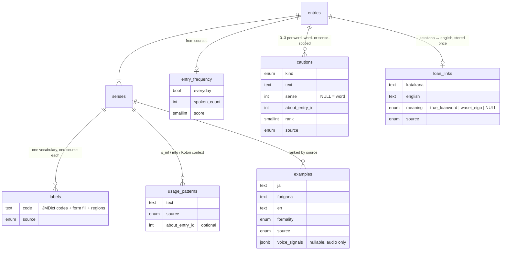
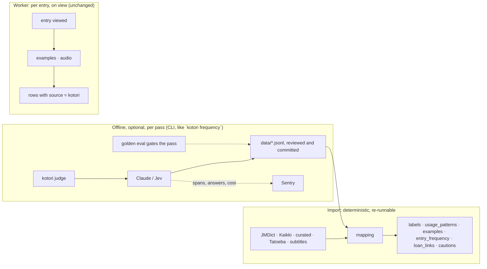

# Dictionary enrichment: labels, usage patterns, cautions

Status: agreed direction, 2026-11-05. Prototype under `apps/app/app/proto` (mock data, no API). Not yet scheduled.

## Problem

An enriched entry currently piles Jev's per-sense classifier output (a formality scale, a spoken/written scale, keigo, gender, age, currency, connotation, four warning probabilities), Claude's sense notes, sentence notes, a loan warning, and JMDict's own tags onto one page. The same fact ends up stated five or six ways: 食う shows "Casual · Speech", a slider that says casual again, a Masculine chip, a "Can sound rude to your boss" chip, a note that says rough/masculine/use 食べる, and a similar-words row that says 食べる is more formal. Much of it is obvious, some of it is wrong (Jev calls neutral conversational words like すごく "casual"), and the learner can't tell what came from the dictionary and what Kotori guessed.

The data model encodes the dull case as data: every sense gets every judgment, most at the default value, with a raw-answers blob beside it. Display policy that decides what is "obvious enough to hide" lives in five places with five thresholds.

## Goals

The entry page should let a learner answer two questions without thinking about them:

1. **Does this word actually get used in conversation, and by whom?**
2. **How do I use it the way a native speaker would?**

Usage information is shown only when it beats the learner's prior. The prior is: neutral formality, spoken and written, current, anyone says it, means what the gloss says. Anything equal to the prior is absent, not stored and not shown. Everything shown carries its source, and the learner can tell dictionary from Kotori at a glance.

## What the sources give us

Measured on the current JMDict, the Kaikki Japanese Wiktionary dump, the curated English file and JMDict's example edition.

| Signal | Coverage | Verdict |
|---|---|---|
| JMDict `misc` usage tags (col, sl, hon, hum, pol, vulg, derog, male, fem, chn, arch, dated…) | ~5% of common entries | High precision. Good recall for slang, keigo, gendered, derogatory, dated. **Silence means unremarkable** on those axes. |
| JMDict `s_inf` notes ("usu. to one's subordinate", "as 〜ですが", "usu. in the negative") | ~6% of common senses | Exact usage patterns. Promote from a muted line to a first-class field. |
| JMDict `lsource` origins on katakana words | 15% of katakana entries | Exact when present (all origin languages preserved; English origins link to English entries). Gloss matching still needed for the rest. |
| JMDict priority markers | all common entries | `ichi1` = everyday vocabulary, usable. News-only is topical, not a formality proxy. |
| Tatoeba sentences (JMdict_e_examp) | 62% of common first senses | Deterministic fallback example. Stilted. |
| Japanese Wiktionary (Kaikki) English senses | 14% tagged | slang/informal/vulgar/archaic good; formal nearly absent. 6% have example sentences. |
| Curated English file | all 3,087 words | IPA, frequency 1–5 (Claude-rated at curation), usage codes on ~14% of senses. |
| English OpenSubtitles counts | top 50k words | Direct spoken-use signal. Feeds `frequency` and `common`. |
| Japanese OpenSubtitles counts | – | Unusable: badly tokenised (食べる, 俺, うん score zero). A tokenised corpus (NINJAL BCCWJ/CSJ lists) is a candidate; licence unverified. |

Two gaps in the dictionary tags need judgment: **formal written vocabulary** (鑑みる, 及び, 当該 carry no tag) and **politeness cautions on neutral-looking words** (了解, お疲れ様).

## Principles

- **Never infer what a source already states.** Inference fills empty cells and never overwrites a dictionary value.
- **Deterministic import.** The import makes no model calls. It reads sources plus committed artifact files.
- **Inference is optional, offline, and droppable.** Batch judgments run as CLI passes, write reviewable files into `data/`, and pass a golden eval before being committed. A bad pass is a `git revert`. Per-entry enrichment (examples, audio) stays on the learner-triggered worker path.
- **Telemetry, not a log table.** Raw model answers, costs and versions go to Sentry spans (already wrapping `Claude.generate` and `Jev.ask`). Anything needed to rebuild data lives in the artifact file.
- **Obviousness is decided at generation, once**, with full context, not at render time with thresholds.

## Data model

`source` is `jmdict | jawiktionary | enwiktionary | tatoeba | kotori | user`.

**Labels** replace the nuance JSONB, `TAG_JUDGMENTS`, the tag/judgment dedupe and the warning probabilities. One list per sense in one vocabulary: JMDict's codes, the English dictionary's region codes, and Kotori's `form` fill. Each label has a severity for display: `avoid` (vulg, X, derog, arch, obs), `warning` (col, sl, male, fem, chn, dated, rare…), `info` (hon, hum, pol, form, regions), `quiet` (id, uncountable, abbr). Grammar facts such as countability are quiet labels with an explanation, never cautions. Labels are per sense; the word shows its first sense's, and a sense shows only what differs.

**Usage patterns** are the dictionary's own usage notes plus Kotori's added context, side by side, Kotori's marked. ご苦労様 shows JMDict's "usu. to one's subordinate" and under it Kotori's "Upward it sounds condescending; say お疲れ様です", with a compare link. No red warning when the dictionary already flagged it.

**Cautions** are the product: one short teaching, of a typed kind, only where a learner would be surprised, hard-capped at three per word. They may be scoped to a sense (結構's yes/no ambiguity on sense 2; 抱く's "usually heard as sex" on the hug sense) or to the word. The kinds differ by direction:

| Japanese learner | English learner | Both |
|---|---|---|
| rude_upward (了解, 食う) | wasei_eigo (マンション, ナイーブ, リフト) | confusable |
| keigo_direction (召し上がる vs いただく) | textbook_english (How do you do) | collocation |
| set_phrase (お疲れ様, 結構です) | directness (sorry overuse) | |
| particle_pattern | variety | |
| gendered_speech (あたし) | | |

A caution is **not** written when the labels already say it: てめえ (derog), yep (col), fuck (vulg) get no caution.

**Frequency** combines multiple signals (not raw corpus frequency alone) to drive two chips: "Common word" (ichi1, subtitle count + frequency floor, or `common`) as reassurance, and "Rarely heard today" (frequency score ≤ 2 or an archaic label) as the surprise. Nothing for the middle.

**Loan link** is one fact read from both ends (alongside per-sense `origins` for any origin language). On the Japanese entry it is a quiet origin line ("from English mansion, but not what mansion means"). On the English entry, `wasei_eigo` is a `wasei_eigo` caution and `true_loanword` is a quiet "same as 「アドバイス」" chip.

**Similar words** are no longer a stored judgment. Candidates come from cross-references and shared glosses (two shared, or the same leading gloss); the difference label is derived from the two words' labels (hon → "the respectful form", col → "more casual", en-GB → "the British word"). Only a label the other word has says how it differs; an unmarked word beside a marked one is "the plain word". Words with the same labels show "similar meaning".

### What goes away

`sense_nuance` (nuance and answers), `similar_words.difference`, `loan_words.answers/trap`, `examples`' six voice-signal columns (folded into one nullable JSONB), `sense_notes` (becomes usage patterns/cautions), Jev's per-sense question set, `interpret.ts`, `TAG_JUDGMENTS`, `saidByNuance`, the nuance sliders and warning chips, and every per-dimension `questionsVersion`.

## Per-dimension decision

| Dimension today | Decision |
|---|---|
| Casual, keigo, vulgar, gendered, age, currency, connotation, slang, variety, profanity | Tags only. No inference. |
| Formal written | Tags plus a `form` fill from Kotori for common untagged words, once the pass passes its eval. |
| Spoken vs written | Dropped as a stored dimension. Spoken use is shown through frequency chips. |
| Formality shape | Dropped; moot without sliders. |
| Old cautions | Replaced by typed `cautions` where non-obvious. |
| Similar-word difference | Derived from labels. |
| Katakana loan | `lsource` origin when present; Jev verdict (`true_loanword` / `wasei_eigo`) only for English words with candidates and no `lsource`. |
| Examples | Import from Tatoeba/Wiktionary, upgrade with Claude for common words on view. |

## Pipeline shape

Candidate artifact files: `data/labels/ja-form.jsonl`, `data/cautions/{ja,en}.jsonl`, `data/loans/verdicts.jsonl`. Each carries model and prompt version in a header. None exists until its pass earns it; the product is correct without them (dictionary labels, usage patterns, Tatoeba/Wiktionary examples, frequency).

## Entry page

Top to bottom: hero (headword, reading, forms, chip row: frequency chip, true-loanword chip, the word's labels), word-level cautions as a "Watch out" card, senses (glosses, part of speech and labels that differ from the word's, usage patterns with Kotori's marked ✦, examples with non-Kotori sources named, sense-level cautions), similar words with derived differences, sources line, and a ✦ legend when anything on the page is Kotori's.

Chips are coloured by severity and explain themselves on tap or hover, one at a time, in a line under the row. A ✦ on a chip or note means "added by Kotori's AI, not taken from the dictionary", and the explanation says so.

Dictionary-only words look finished and offer "Ask Kotori".

## Decisions taken while prototyping

- Cautions can be sense-scoped; 抱く is the canonical case.
- Grammar detail (uncountable) lives in the chip's explanation, not a caution.
- Archaic stands out: avoid colour plus a "rarely heard" chip plus explanation.
- ご苦労様-type cases: Kotori's context beside the dictionary's note, visually marked, not a warning.
- "Common word" is shown as reassurance; silence does not mean common. "Everyday word" line dropped.
- yep and fuck need no caution; the label carries it.
- True loanwords get a chip on the English side.
- Derived similar-word differences are fine as prototyped; out of scope for now.

## Open questions

- Caution texts that reference a sense by number ("sense 2") break if senses reorder. The generator should name the gloss.
- Whether amber reads as "careful" and rose as "don't" without a legend.
- Whether a floating tooltip beats the under-row explanation on native.
- A Japanese spoken-frequency source, and the NINJAL lists' licence.
- Whether `meaning: true_loanword` loan verdicts are worth storing at all, or only `wasei_eigo`.

## Next steps

1. Golden sets for the two inference passes (formal-written fill; cautions for common words), in both directions.
2. Migration plan: table drops and moves in `packages/db`, contract changes, import mapping for labels/usage patterns/frequency/loan links, Tatoeba and Wiktionary example seeding.
3. Entry page rebuilt from the prototype (`apps/app/app/proto`), then the prototype removed.
